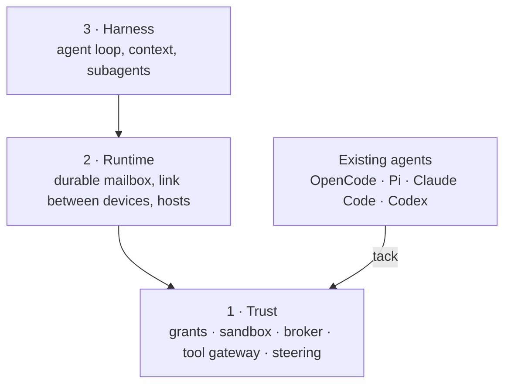
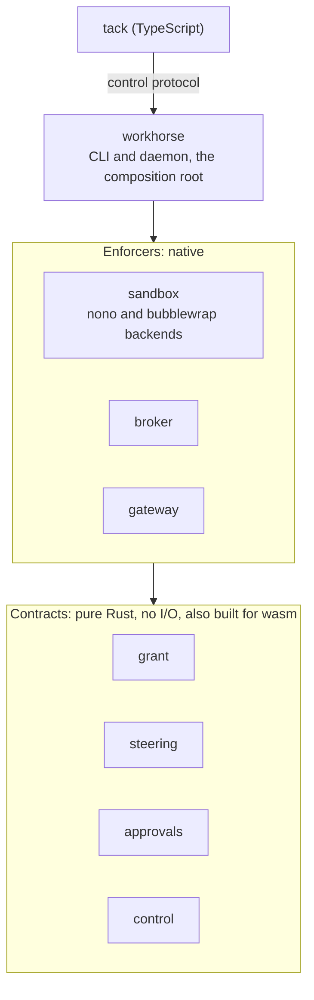

# Overview

**Status:** agreed direction, 2026-10-30. Nothing here is built. [`ARCHITECTURE.md`](ARCHITECTURE.md) keeps the original vision notes; this page says how they fit together.

## What Workhorse is

Workhorse is a set of open protocols in three layers. Each layer depends only on the layers below it, and each can be used without the layers above it.

The first user is one developer running existing coding agents on a laptop and a home server, who wants them safe, steerable and observable. That user needs layer 1 only, so layer 1 comes first.

## Layer 1: Trust

Whatever the harness, an agent reaches files, network, secrets and tools only through these, and a human can see and change all of it.

| Protocol | Question it answers |
|---|---|
| [**Grants**](modules/grant.md) | What may this agent touch: paths, hosts, secrets by name, tools |
| [**Sandbox**](modules/sandbox.md) | How an operating system enforces a grant (nono on macOS, bubblewrap on Linux) |
| [**Broker**](modules/broker.md) | How network traffic leaves, with secrets added outside the agent so the agent never holds them |
| [**Tool gateway**](modules/gateway.md) | How an agent reaches MCP servers through one door that applies its grant |
| [**Steering**](modules/steering.md) | Rules that fire on an agent's events and block, rewrite, or ask a human |
| [**Approvals**](modules/approvals.md) | How a human answers a request for a decision: a steering "ask" or a request to widen a grant |
| [**Control**](modules/control.md) | How a human, the CLI and tack talk to the other six: sessions, grants, approvals, steering verdicts |

In short: a grant belongs to one session and is made from a profile in the user's config. Everything is denied unless listed. A human can narrow a grant at any time, and it widens only by approval. All network traffic goes through the broker. Steering works inside the grant and never widens it. Every module's decisions, open questions and evidence are in its own file under [`modules/`](modules/).

## Layer 2: Runtime

Agents that outlive a terminal: a durable mailbox (an agent is a log plus an inbox), a link between devices, and a contract for hosts (native, workerd or Cloudflare, Rivet). Every agent it runs is under a layer 1 grant.

## Layer 3: Harness

The agent loop and its context: compaction, prompt caching, skills, codemode, subagents. Equestrian, Stable, Mule and Polo are harnesses. Until there is one, existing agents fill this role.

## tack: the bridge

[`@workhorse/tack`](https://github.com/StevenJPx2/workhorse/tree/tack) is how existing agents reach layer 1. A plugin is written once and runs in OpenCode, Pi, Claude Code and Codex. It carries steering and tool routing into each agent. It is TypeScript because those agents load JavaScript plugins; its hooks call into layer 1. It is useful on its own and lives on its own branch. See [`modules/tack.md`](modules/tack.md).

## Rules

- **Adopt standards; invent only where none exists.** MCP for tools, ACP for sessions, the OpenAI-compatible API for models. Workhorse defines grants, sandbox policy, broker, steering and, later, the mailbox.
- **A protocol is a contract plus a conformance suite.** Rust provides the reference implementations; each protocol is its own crate, usable alone.
- **One-way dependencies.** Layer 1 knows nothing of layers 2 and 3.

## Modules

Decided 2026-11-02 for layer 1; layers 2 and 3 are split when they start. Crates follow protocol boundaries; processes are a deployment choice.

Arrows mean "depends on". Contracts depend only on other contracts, with `grant` at the bottom: `steering` and `approvals` use it, and `control` carries all three. Enforcers depend only on contracts, never on each other.

| Module | Kind | Owns |
|---|---|---|
| [`grant`](modules/grant.md) | Contract | Grant and profile schema; whether a grant allows an action; narrowing, and widening by approval |
| [`steering`](modules/steering.md) | Contract | Normalized agent events, the rule format, and verdicts: allow, block, rewrite, ask |
| [`approvals`](modules/approvals.md) | Contract | Request and answer records, the queue's state machine, request IDs |
| [`control`](modules/control.md) | Contract | JSON-RPC methods for sessions, grants, approvals and steering; used by tack, the CLI and a phone |
| [`sandbox`](modules/sandbox.md) | Enforcer | Turns a grant into an OS policy and launches the agent under it, with nono and bubblewrap backends |
| [`broker`](modules/broker.md) | Enforcer | The one network exit: checks the grant, adds secrets, logs every request, never follows a redirect |
| [`gateway`](modules/gateway.md) | Enforcer | An MCP proxy that exposes only the tools a grant lists |
| [`workhorse`](modules/workhorse.md) | Composition root | The CLI (`workhorse run --profile p -- opencode`) and the daemon; the only place implementations are chosen |
| [`conformance`](modules/conformance.md) | Test suites | One suite per protocol: grant vectors, escape probes, egress tests |
| [`tack`](modules/tack.md) | Bridge | On its own branch: forwards agent hook events over `control` and applies verdicts |

| Concern | Decision |
|---|---|
| Contracts | Schemas, serialization and rules only, no I/O, so they also build for wasm |
| Processes | One daemon hosts the broker, gateway, steering and approvals, kept as separate crates. Each agent runs in its own sandboxed process |
| Standards | MCP for the gateway, JSON-RPC for `control`, ACP for sessions. Workhorse defines only the grant, steering and approval formats and the `control` methods |

## Order

1. Layer 1 protocols, one at a time, each with its contract, suite and a Rust implementation. Grants first, since the others enforce it; its shape is settled in [`modules/grant.md`](modules/grant.md). Approvals next, since steering and grants both need it.
2. tack, wired to steering.
3. Layer 2, reusing the evidence on `daemon-v0`.
4. Layer 3.

## Open questions

Each module's own open questions are in its file. These span modules:

- Whether every target agent resumes a session reliably enough for restart and resume, and which steering events each one actually reports and enforces. [Planned spike](spike/resume-and-events/PLAN.md).
- How tack reaches `control` from inside the agent's sandbox, which allows only the broker: a second allowed socket, or `control` carried through the broker.

## Evidence

Earlier work is evidence, not design. The `daemon-v0` branch holds the capability daemon, the sandbox, link, transport, workerd, kernel and agentOS spikes, and the uniform-stack proposal. The `legacy` and `fleet-v0` branches hold earlier versions. [`evidence/`](evidence/) holds notes on outside projects and what Workhorse takes from each, starting with [nanocode](evidence/nanocode.md).
