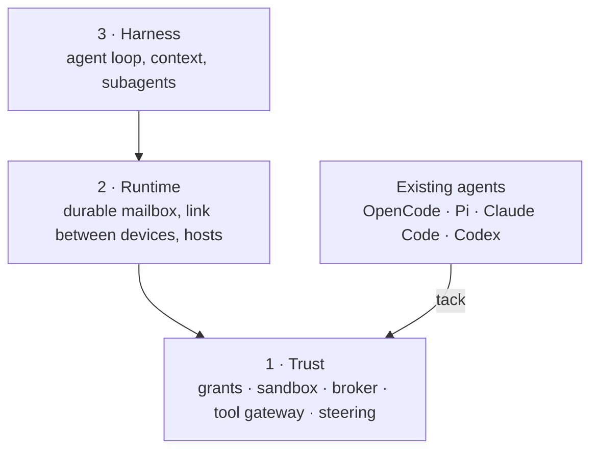

# Overview

**Status:** agreed direction, 2026-10-30. Nothing here is built. [`ARCHITECTURE.md`](ARCHITECTURE.md) keeps the original vision notes; this page says how they fit together.

## What Workhorse is

Workhorse is a set of open protocols in three layers. Each layer depends only on the layers below it, and each can be used without the layers above it.

The first user is one developer running existing coding agents on a laptop and a home server, who wants them safe, steerable and observable. That user needs layer 1 only, so layer 1 comes first.

## Layer 1: Trust

Whatever the harness, an agent reaches files, network, secrets and tools only through these, and a human can see and change all of it.

| Protocol | Question it answers |
|---|---|
| **Grants** | What may this agent touch: paths, hosts, secrets by name, tools |
| **Sandbox** | How an operating system enforces a grant (nono on macOS, bubblewrap on Linux) |
| **Broker** | How network traffic leaves, with secrets added outside the agent so the agent never holds them |
| **Tool gateway** | How an agent reaches MCP servers through one door that applies its grant |
| **Steering** | Rules that fire on an agent's events and block, rewrite, or ask a human |
| **Approvals** | How a human answers a request for a decision: a steering "ask" or a request to widen a grant |

### Grants

Decided 2026-11-02:

- **A grant belongs to a session.** It is created from a reusable profile, so two sessions of one agent can have different access.
- **Everything is denied unless listed.** Secrets appear by name only. Symlinks are never followed out of a granted path.
- **A human can narrow a grant at any time. It widens only when the agent asks and a human approves**, and the approval is recorded.
- **Network, tools and secrets change live**, because the broker and the gateway see every request. **File access is fixed when the agent starts**, because nono and bubblewrap fix it then. A file change restarts the agent under the new grant and resumes its session.
- **All network traffic goes through the broker.** The sandbox allows exactly one destination, the broker; it logs every request and adds secrets per host.
- **Tools are granted one by one, by name or pattern** (`github: issues.*`). Rules about arguments belong to steering.
- **The grant is the ceiling; steering works inside it.** A steering rule can block, rewrite or ask, never widen.
- **One approval queue.** Every request for a human decision goes to one queue, is answered the same way from any device, and is recorded. An approval is either "once" or "add to the grant".

| Part of a grant | Example | Enforced by | Changes live |
|---|---|---|---|
| Files | `~/code/x`, read-write | Sandbox | No: restart and resume |
| Network | `api.github.com` with secret `github-token` | Broker | Yes |
| Tools | `github: issues.*` | Tool gateway | Yes |
| Limits | 64 processes, 4 GB | Sandbox | No: restart and resume |

## Layer 2: Runtime

Agents that outlive a terminal: a durable mailbox (an agent is a log plus an inbox), a link between devices, and a contract for hosts (native, workerd or Cloudflare, Rivet). Every agent it runs is under a layer 1 grant.

## Layer 3: Harness

The agent loop and its context: compaction, prompt caching, skills, codemode, subagents. Equestrian, Stable, Mule and Polo are harnesses. Until there is one, existing agents fill this role.

## tack: the bridge

[`@workhorse/tack`](https://github.com/StevenJPx2/workhorse/tree/tack) is how existing agents reach layer 1. A plugin is written once and runs in OpenCode, Pi, Claude Code and Codex. It carries steering and tool routing into each agent. It is TypeScript because those agents load JavaScript plugins; its hooks call into layer 1. It is useful on its own and lives on its own branch.

## Rules

- **Adopt standards; invent only where none exists.** MCP for tools, ACP for sessions, the OpenAI-compatible API for models. Workhorse defines grants, sandbox policy, broker, steering and, later, the mailbox.
- **A protocol is a contract plus a conformance suite.** Rust provides the reference implementations; each protocol is its own crate, usable alone.
- **One-way dependencies.** Layer 1 knows nothing of layers 2 and 3.

## Order

1. Layer 1 protocols, one at a time, each with its contract, suite and a Rust implementation. Grants first, since the others enforce it; its shape is settled above. Approvals next, since steering and grants both need it.
2. tack, wired to steering.
3. Layer 2, reusing the evidence on `daemon-v0`.
4. Layer 3.

## Open questions

- Whether the tool gateway and the broker are one process or two.
- Traffic the broker cannot carry as HTTP, such as `git` over SSH, under the broker-only rule.
- Whether every target agent resumes a session reliably enough for restart and resume.
- Where profiles live, and how a session's grant is shown to a human.
- Which steering events every agent can actually report (see tack's capability matrix).

## Evidence

Earlier work is evidence, not design. The `daemon-v0` branch holds the capability daemon, the sandbox, link, transport, workerd, kernel and agentOS spikes, and the uniform-stack proposal. The `legacy` and `fleet-v0` branches hold earlier versions. [`evidence/`](evidence/) holds notes on outside projects and what Workhorse takes from each, starting with [nanocode](evidence/nanocode.md).
