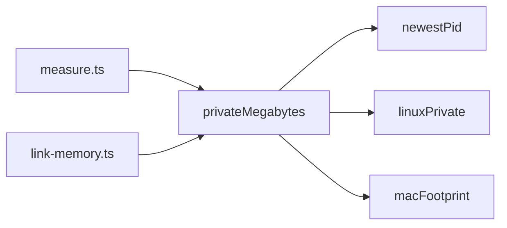

# Process memory

Shared measurement adapters for the idle-daemon and accepted-link budgets. They measure private physical cost, not RSS, which also includes reclaimable pages of the workerd executable.

| Module                 | Function           | Responsibility                                                        |
| ---------------------- | ------------------ | --------------------------------------------------------------------- |
| `newest-pid.ts`        | `newestPid`        | Finds workerd itself, not its sandbox launcher.                       |
| `linux-private.ts`     | `linuxPrivate`     | Reads `Private_Dirty` from `/proc/<pid>/smaps_rollup`.                |
| `mac-footprint.ts`     | `macFootprint`     | Reads `phys_footprint` from macOS `footprint`.                        |
| `private-megabytes.ts` | `privateMegabytes` | Selects the platform adapter; returns undefined if it cannot measure. |
| `index.ts`             | barrel             | Exports the shared measurement API.                                   |



- Both jobs fail when memory cannot be measured.
- The link job warms the accepting daemon and its app before measuring, then opens a real authenticated link and repeats the measurement.
- Linux CI sets THP to `madvise`; the original budget job also prints RSS and huge-page diagnostics.

```ts
import { privateMegabytes } from "./memory/index.ts";

const megabytes = privateMegabytes(installedWorkerdPath);
```

See [Budgets](../../docs/architecture.md#budgets) for the limits and measurement rationale.
