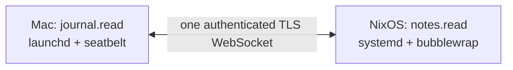

# Slice 2: home link evidence

The production implementation, not just the [standing-link spike](../../spike/link/FINDINGS.md), was exercised on two machines on October 22, 2026. [Remote links](architecture.md#remote-links) defines the contract.

## Runtime and topology

| Side                        | Runtime                                                    | Supervisor and sandbox       | App            |
| --------------------------- | ---------------------------------------------------------- | ---------------------------- | -------------- |
| Mac laptop                  | workerd 1.20261019.1, arm64                                | launchd, `sandbox-exec`      | `journal.read` |
| NixOS homelab, 192.168.0.40 | Same workerd, x86_64, interpreter patched to the Nix glibc | `systemd --user`, bubblewrap | `notes.read`   |

- Home accepted TLS links on LAN port 7841; the laptop dialed it.
- `workhorse pair` exchanged keys and certificates over port 7842. Both screens showed matching codes, reversed: `A213-179C-4988-06BA` and `193E-AD96-04E2-E45B`.
- Temporary peer entries granted only `notes.read` at home and `journal.read` on the laptop. Routes sent each other's app over the same link.
- No Tailscale or other overlay integration was used. Only LAN reachability was required.

## Observed behaviour

| Check                                   | Actual result                                                                                                 |
| --------------------------------------- | ------------------------------------------------------------------------------------------------------------- |
| Laptop calls `notes.read`, `todo.md`    | Home returns `buy milk\n`.                                                                                    |
| Home calls `journal.read`, `today.md`   | Laptop returns `walked the dog\n`; observed calls took 29.8–52.4 ms, including app execution and LAN traffic. |
| Traversal through remote app            | `denied`, capability `fs.read`, reason `outside_root`.                                                        |
| Unlisted remote operation `notes.write` | `denied`, reason `no_grant`.                                                                                  |
| SIGKILL home's service main process     | systemd restarts it (`NRestarts=1`); the laptop redials and reads the note again.                             |
| SIGKILL laptop's workerd                | launchd restarts it, warm-up starts the link without a new client request, and home reads the journal again.  |
| Home accepting link: memory delta       | 14,324 → 14,932 KB `Private_Dirty`, about 0.59 MB.                                                            |
| macOS accepted-link budget              | 15 → 16 MB `phys_footprint`, 1 MB delta.                                                                      |

## Automated evidence

- `bun run check`: 565 tests passed, including seven real sandboxed two-daemon tests. Formatting, lint, full types, Effect diagnostics, Fallow audit and dependency audit passed.
- `bun budgets/measure.ts` on the Mac: 13.0 MB idle private memory; 40.1 ms median first answer; core 1.9 KB gzip; daemon 41.0 KB gzip.
- `bun budgets/link-memory.ts`: opens a real authenticated link and waits for a remote app answer. The accepting app is warmed before the baseline, so app loading is not counted as link overhead.
- Gate proof: temporarily setting the accepted-link limit to zero produced `FAIL ... 1.00 MB (limit 0 MB)` and exit 1. The 1 MB limit was restored.
- Previous Linux CI commit `14453745`: 562 tests, 13.8 MB idle private memory, 61.3 ms cold start, daemon 41.0 KB gzip. The new accepted-link budget awaits its first CI run.

## Bugs reproduced and fixed during the live test

| Bug                                       | Evidence and fix                                                                                                                                                                                                                                                                                       |
| ----------------------------------------- | ------------------------------------------------------------------------------------------------------------------------------------------------------------------------------------------------------------------------------------------------------------------------------------------------------ |
| `y` rejected at pairing confirmation      | Closing readline emitted `close` before the answer was settled. The regression test fails with the old order and passes when the answer is recorded first; ended input still means no.                                                                                                                 |
| Reinstall fails on a running Linux daemon | Copying over the executing workerd returned `ETXTBSY`. Install now stages, patches and flushes a new binary, then atomically renames it into place. Reinstalling the running homelab service succeeded. Tests check inode replacement, an executing binary, and preservation/cleanup on a failed copy. |

## Cleanup and limits of the evidence

- The temporary LAN firewall rule for ports 7841–7842 was removed. Both test services were unregistered and the homelab installation removed; no persistent firewall or lingering setting was changed.
- The smoke test remains manually runnable, not part of CI.
- The accepting side's incremental memory is gated; production dialer-specific overhead is not yet isolated by a separate budget.
- Internet reachability, real overlay configurations, and phone handover were not tested. This proves the transport over a reachable LAN, not NAT traversal.
