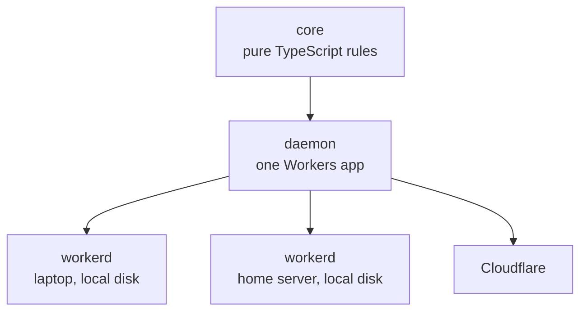
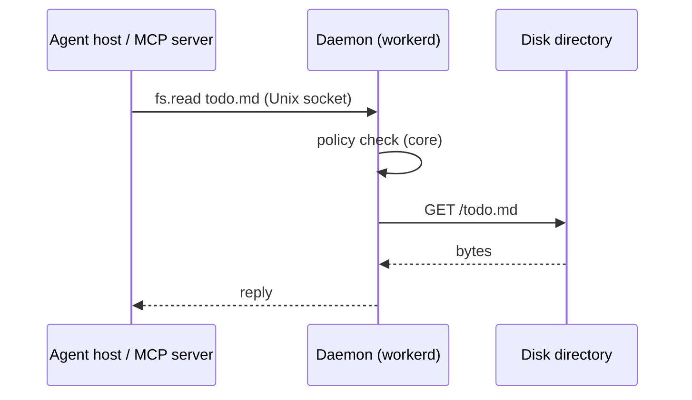
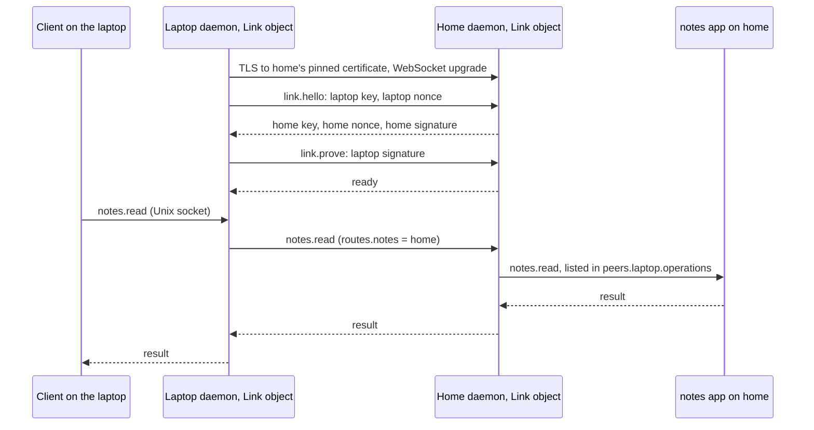
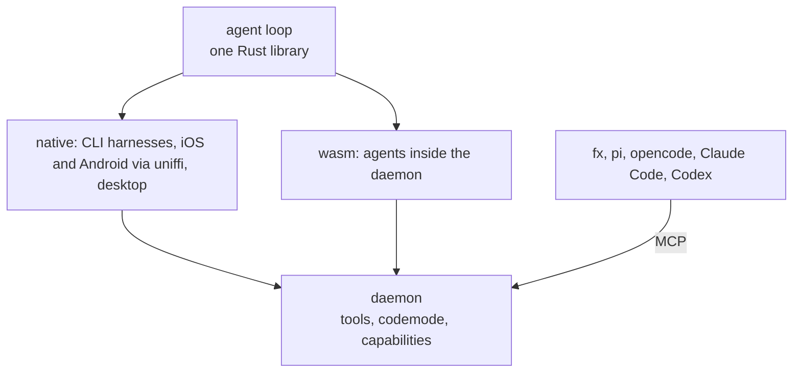

# Architecture

Workhorse MCP is one daemon per user that does all privileged work for agents and their apps. An agent host sees ordinary MCP servers. The servers have no access of their own: they call the daemon, and the daemon acts only within the user's policy.

## Shape



| Part            | What it is                                                                                                                            | State                    |
| --------------- | ------------------------------------------------------------------------------------------------------------------------------------- | ------------------------ |
| `core`          | A pure state machine that holds every rule: policy, leases, routing, mailboxes, tasks                                                 | None; it performs no I/O |
| daemon          | A Workers app that performs the effects `core` returns                                                                                | Durable Objects          |
| Apps            | Workers apps that implement the protocol and provide operations, such as `sourcefed.monitor.create`                                   | Through the daemon       |
| `workhorse` CLI | Installs and starts the daemon, and regenerates its configuration. Its native stdio relay connects stdio-only MCP hosts to the socket | None                     |

The daemon uses only the platform subset that workerd and Cloudflare share: Durable Objects (SQLite, alarms, WebSockets), `fetch`, and Dynamic Workers. The same bundle runs unchanged on every machine.

## Core

The core takes the current state and an input, and returns the next state and the effects to perform:

```ts
const { state: next, effects } = handle(state, {
  type: "publish",
  key: "github:pr42:comment:1",
  event,
});
// effects: [{ type: "persist", seq: 1, … }, { type: "deliver", seq: 1, … }, { type: "reply", … }]
```

Inputs are messages, timer ticks, and I/O results. Effects are plain values, so the audit trail records them directly and tests replay them without I/O.

## One call



## Protocol

JSON-RPC 2.0, one message per line, over any byte stream: a Unix socket on the same machine and the remote transport between machines. MCP servers face agent hosts with standard MCP.

JSON-RPC over Cap'n Proto and Cap'n Web: it is a stable open standard, it shares MCP's envelope, every target language (TypeScript, Swift, Kotlin, Rust) handles it without a dedicated library, and a human can read it on the wire.

```json
{"jsonrpc":"2.0","id":1,"method":"hello","params":{"protocol":[1]}}
{"jsonrpc":"2.0","id":1,"result":{"protocol":1}}
{"jsonrpc":"2.0","id":2,"method":"notes.read","params":{"path":"todo.md"}}
{"jsonrpc":"2.0","id":2,"result":{"text":"buy milk\n"}}
{"jsonrpc":"2.0","id":3,"method":"notes.read","params":{"path":"../secrets.txt"}}
{"jsonrpc":"2.0","id":3,"error":{"code":-32001,"message":"denied","data":{"capability":"fs.read","reason":"outside_root"}}}
{"jsonrpc":"2.0","id":4,"method":"fs.read","params":{"root":"notes","path":"todo.md"}}
{"jsonrpc":"2.0","id":4,"error":{"code":-32001,"message":"denied","data":{"capability":"fs.read","reason":"no_grant"}}}
```

| Rule     | Decision                                                                                                                                                                                                                                                                                 |
| -------- | ---------------------------------------------------------------------------------------------------------------------------------------------------------------------------------------------------------------------------------------------------------------------------------------- |
| Source   | One TypeScript schema per message. Other languages use the JSON Schema exported from it                                                                                                                                                                                                  |
| Methods  | `capability.operation`. The daemon routes by prefix to the owner of the name                                                                                                                                                                                                             |
| Lease    | An app receives its lease when the daemon loads it from its manifest. Calls carry no lease ID. Durable work belongs to the identity. An outside client has no lease: it reaches the outside world only through apps' public operations, as in the example, where `notes` holds the grant |
| Errors   | `-32001 denied` (policy refused), `-32002 failed` (allowed, but the operation failed), `-32003 unavailable` (the owner cannot be reached before the deadline), `-32004 limited` (a quota is reached)                                                                                     |
| Push     | JSON-RPC notifications on the same connection                                                                                                                                                                                                                                            |
| Versions | `hello` negotiates the version and must come first; any other call before it is refused. An unsupported version gets a clear refusal listing the supported versions                                                                                                                      |
| Limits   | Maximum frame size, maximum read size, maximum connections, and a deadline on every call. Oversized input is rejected, never truncated                                                                                                                                                   |

## Identity

| Connection                                               | How the daemon knows it                                                   | What it may do                                                                                                |
| -------------------------------------------------------- | ------------------------------------------------------------------------- | ------------------------------------------------------------------------------------------------------------- |
| Apps and their MCP servers                               | The daemon loads each one from its manifest as a Dynamic Worker           | Every internal feature for its own data, and the outside-world access that the policy grants to that manifest |
| Outside clients: host adapters, the CLI, the stdio relay | Unknown; it is "local user"                                               | The public operations that apps expose. No outside-world access of its own                                    |
| Other daemons and devices                                | An Ed25519 key, paired through the policy ([Remote links](#remote-links)) | The public operations the policy lists for that peer                                                          |

An agent host reaches an app's tools through the daemon, which serves MCP for every app in two framings: MCP's Streamable HTTP transport, and newline-delimited JSON-RPC on the Unix socket, the framing the MCP specification recommends for custom transports over Unix sockets. Hosts that speak only stdio run `workhorse mcp sourcefed`, a native relay that copies bytes between stdio and the socket and parses nothing. No connection ever claims an identity.

## Policy and leases

The policy governs access to the outside world and nothing else. Internal features need no grant.

| Kind          | Examples                                                                                     | Rule                                                                                                                                                                                          |
| ------------- | -------------------------------------------------------------------------------------------- | --------------------------------------------------------------------------------------------------------------------------------------------------------------------------------------------- |
| Outside world | Files, network, secrets, other daemons and devices                                           | Denied unless the policy grants it. A grant is the intersection of the policy and the request; everything else is reported in `denied`, never silently widened. `ask` rules go to an approver |
| Internal      | State, tasks, mailboxes, the app's own audit records, calls to other apps' public operations | Always available, limited to the caller's own data, and bounded by daemon-wide quotas. A reached quota returns `limited`                                                                      |

```json
{
  "apps": {
    "sourcefed": {
      "net.fetch": { "hosts": ["api.github.com"], "secrets": ["GH_TOKEN"] }
    },
    "chauffeur": {
      "fs": { "roots": { "skills": "~/.cache/chauffeur/skills" }, "mode": "read-write" }
    }
  }
}
```

A policy change regenerates the daemon's configuration and sandbox, then causes a controlled restart: stop accepting calls, finish calls in flight before a deadline, restart, resume.

## Extensions

Outside apps, such as chauffeur or the Workhorse suite, extend the daemon through two abilities. The daemon itself contains no judgment logic.

| Ability | What it does                                                                                                                             |
| ------- | ---------------------------------------------------------------------------------------------------------------------------------------- |
| Decide  | Answers `ask` rules for outside-world access with allow or deny. "Always allow" becomes a policy edit, which causes a controlled restart |
| Watch   | Receives the full audit trail live, including background work that no agent started                                                      |

| Rule          | Decision                                                            |
| ------------- | ------------------------------------------------------------------- |
| Who registers | Only apps the daemon loads, so their identity is proven             |
| Failure       | A decider that crashes or misses its deadline means deny            |
| Scope         | A decider answers allow or deny; it cannot change a request         |
| Record        | The audit trail names the decider and its answer for every decision |

## Base capabilities

The daemon owns a small, fixed set. Apps provide everything else.

| Capability  | Grant | Contract                                                                                                                                                                                                                                                                                                                                                   |
| ----------- | ----- | ---------------------------------------------------------------------------------------------------------------------------------------------------------------------------------------------------------------------------------------------------------------------------------------------------------------------------------------------------------- |
| `fs`        | Yes   | Reads and writes inside granted roots, through one workerd disk directory per root. The policy names each root, and an app reads by name and relative path (`ctx.fs.read("skills", "a.md")`), so app code never holds a real path and can name only its own roots. `.` and `..` never resolve; the OS sandbox stops symlinks that point outside the grants |
| `net.fetch` | Yes   | Host allowlist, timeouts, and credentials added by the daemon: `{"method":"net.fetch","params":{"url":"https://api.github.com/…","auth":"GH_TOKEN"}}`. The app never receives the secret                                                                                                                                                                   |
| `state`     | No    | Per-app durable key-value data                                                                                                                                                                                                                                                                                                                             |
| `task`      | No    | Scheduled and recurring work. Tasks are saved state, so they survive restarts; they can run, pause, and be removed                                                                                                                                                                                                                                         |
| `mailbox`   | No    | Durable delivery of events to targets, as specified below                                                                                                                                                                                                                                                                                                  |
| `audit`     | No    | One trail of every call, grant, denial, and effect. An app reads its own records                                                                                                                                                                                                                                                                           |

## Mailboxes

An app publishes an event to a target, such as one agent session. The daemon keeps the event until the target acknowledges it.

```json
{"jsonrpc":"2.0","method":"mailbox.deliver","params":{"target":"opencode-session:abc","seq":17,"key":"github:pr42:comment:123","event":{}}}
{"jsonrpc":"2.0","id":9,"method":"mailbox.ack","params":{"target":"opencode-session:abc","seq":17}}
```

| Rule          | Decision                                                                                                                                                                                           |
| ------------- | -------------------------------------------------------------------------------------------------------------------------------------------------------------------------------------------------- |
| Key           | Every publish carries a key derived from the upstream fact, never from the path that found it. A poll and a webhook for the same comment produce the same key. A publish without a key is rejected |
| Deduplication | The mailbox remembers every accepted key for its retention window, including keys already acknowledged                                                                                             |
| Atomicity     | Checking the key, assigning the sequence number, and saving happen in one step. Retrying a publish is always safe                                                                                  |
| Order         | First in, first out per mailbox, with a sequence number on every event                                                                                                                             |
| Effect        | Delivery is at least once. The client SDK saves the last sequence it processed and skips anything at or below it, so each event takes effect exactly once                                          |
| Consumers     | One active consumer per mailbox. A new consumer replaces the old one                                                                                                                               |
| Limits        | A maximum count and age per mailbox. When old events are dropped, the next delivery carries a gap marker with the number missed                                                                    |

Proof for these rules has three layers:

1. A deterministic simulation of the core replays generated sequences of duplicate publishes, lost acknowledgements, crashes, reconnects, second consumers, restarts, and overflow. Every unique key takes effect exactly once, in order, or a gap marker covers it.
2. Conformance fault tests against a running daemon: drop the connection between delivery and acknowledgement, kill the daemon mid-write, restart.
3. One named regression scenario for each duplicate cause found in sourcefed v0.3.6.

## Apps

An app is harness-agnostic. It speaks the Workhorse protocol, and its MCP server speaks standard MCP. A thin per-host adapter does only what MCP cannot, such as waking an OpenCode session with a new event.

```json
{
  "id": "sourcefed",
  "version": "1.0.0",
  "entry": "sourcefed.js",
  "provides": ["sourcefed.monitor.create", "sourcefed.monitor.list", "sourcefed.monitor.stop"],
  "needs": ["net.fetch"]
}
```

Every app runs as a Dynamic Worker with `globalOutbound: null`: its only path to anything outside is the bindings the daemon gives it, so apps are isolated from each other and from the network.

The daemon speaks MCP; apps do not. An app declares its tools, each with a name, a description, an input schema, and a function. The daemon serves them over MCP, handles protocol versions in one place, and calls the function over Workers RPC, so every tool call passes through policy and the audit trail. The app receives its lease as `ctx`, so it can offer only granted capabilities as tools:

```ts
const notes = mcp((ctx) => ({ tools: [ctx.tools.read] }));
```

An app that bundled its own MCP server would cost about 28 MB more per loaded app (spike 4), against about 2 MB for the app's isolate. Apps can use the MCP features the framework exposes: tools, resources, and prompts.

## Sandboxing

The OS service manager runs workerd inside the OS sandbox tool. `workhorse install` generates both from the policy.

| Platform | Supervisor                                | Sandbox                                                                                                                                                                                                                                                                                                                                                                                                             |
| -------- | ----------------------------------------- | ------------------------------------------------------------------------------------------------------------------------------------------------------------------------------------------------------------------------------------------------------------------------------------------------------------------------------------------------------------------------------------------------------------------- |
| macOS    | launchd agent                             | `sandbox-exec` profile: the storage folder, the socket folder, and the `fs` roots; outbound network; no Unix sockets except its own and the system DNS resolver                                                                                                                                                                                                                                                     |
| Linux    | `systemd --user` socket and service units | bubblewrap: a private mount namespace containing only the storage folder, the socket folder, the `fs` roots, the system library folders read-only (`/usr`, `/lib`, `/lib64`, `/bin`, or the store folder of `--loader` on NixOS), the DNS files, and the CA bundle file. `/home`, `/run`, and the host's `/tmp` are absent, so host sockets such as `nscd` and `docker.sock` do not exist inside it; shared network |

| Rule                | Decision                                                                                                                                                                                                                                                                                                                                                                                                                                                                                                            |
| ------------------- | ------------------------------------------------------------------------------------------------------------------------------------------------------------------------------------------------------------------------------------------------------------------------------------------------------------------------------------------------------------------------------------------------------------------------------------------------------------------------------------------------------------------- |
| Ceiling             | The OS sandbox is the ceiling for the whole daemon. Apps are isolated from each other inside it by Dynamic Workers                                                                                                                                                                                                                                                                                                                                                                                                  |
| Symlinks            | workerd's disk directories follow symlinks. The OS sandbox blocks any target outside the grants. A blocked access reaches the daemon as an opaque internal error, so `fs` checks paths in `core` and reports `denied` before touching the disk; the OS sandbox is the backstop                                                                                                                                                                                                                                      |
| Hostnames           | Kernel sandboxes cannot filter by hostname. `net.fetch` enforces host allowlists                                                                                                                                                                                                                                                                                                                                                                                                                                    |
| Startup grants      | workerd also receives its own binary, the system library paths, `/dev/null`, a directory handle on `/` (top-level names only, on macOS), and its configuration folder as the working directory; without them it cannot start. On Linux it also needs the CA bundle                                                                                                                                                                                                                                                  |
| Untrusted processes | The daemon runs no native processes for apps; apps are V8 isolates. A future capability that runs untrusted native processes for agents (a shell, code execution) needs hardware isolation. [nvx](https://github.com/microsoft/nvx) is a candidate: Microsoft's micro-VM sandbox on KVM, MSHV, or Windows. It does not run on macOS, and its own CI measured 275–310 ms cold start, about 60 ms snapshot restore, and 35–80 MiB peak memory (October 2026, dev prereleases only), so it is not the daemon's sandbox |

## Remote links

Remote links are WebSocket over TLS between two daemons, carrying the same protocol in both directions. Each link is held open by a `Link` Durable Object per peer and authenticated by a mutual Ed25519 challenge. Reaching the peer is the network's job: a link needs only an address, so it runs over a LAN, Tailscale, WireGuard, or any other overlay, and Workhorse integrates with none of them. Cloudflare is reached directly (slice 3). workerd serves both ends, so remote links add no native process.



```json
{
  "apps": {},
  "peers": {
    "home": {
      "key": "kLhC7…ed25519-public-key",
      "certificate": "-----BEGIN CERTIFICATE-----…",
      "address": "100.104.65.112:7841",
      "operations": []
    }
  },
  "routes": { "notes": "home" }
}
```

| Rule        | Decision                                                                                                                                                                                                                                                                                                                                                                                                                                                                                                                                                                               |
| ----------- | -------------------------------------------------------------------------------------------------------------------------------------------------------------------------------------------------------------------------------------------------------------------------------------------------------------------------------------------------------------------------------------------------------------------------------------------------------------------------------------------------------------------------------------------------------------------------------------- |
| Identity    | Each daemon has an Ed25519 key, generated by `workhorse install`; `workhorse key` prints the public half. A link opens with each side signing both nonces and both keys under the label `workhorse-link-v1`. A key that is not in `peers` is refused                                                                                                                                                                                                                                                                                                                                   |
| TLS         | Each daemon has a self-signed ECDSA P-256 certificate for the fixed name `daemon.workhorse`, made at install by a built-in DER encoder (no dependency). A peer pins that exact certificate and checks the name, so any address works. TLS gives confidentiality and authenticates the listener; the challenge authenticates both sides                                                                                                                                                                                                                                                 |
| Policy      | `peers.<name>` holds the peer's `key` and `certificate`. `address` (`host:port`) means this daemon dials that peer. `operations` lists the apps' public operations (`app.operation`) the peer may call here; none by default. `routes.<app> = <peer>` sends that app's operations to the peer. A call that arrived over a link is never routed to another peer                                                                                                                                                                                                                         |
| Listening   | A daemon listens for links only when installed with `--listen <host:port>`, an address the user picks, such as a tailnet or LAN address. The OS sandbox allows that one port                                                                                                                                                                                                                                                                                                                                                                                                           |
| Lifetime    | One `Link` Durable Object per peer holds the link for good: its namespace sets `preventEviction`, which only workerd supports. Without it, spike 6 lost the link after about 140 s. `workhorse warm` starts the dialing objects after every daemon start, since a new object does not dial by itself                                                                                                                                                                                                                                                                                   |
| Failure     | Both sides send a heartbeat every 5 s and drop the link after 15 s without an answer. The dialer redials with backoff from 100 ms to 2 s, and every dial has a 5 s deadline, because a peer that accepts TCP but never finishes TLS stalls a dial (spike 6)                                                                                                                                                                                                                                                                                                                            |
| Unavailable | A call routed to a peer whose link is down returns `-32003 unavailable` at once; a call that gets no answer within 10 s returns it too. Calls are never queued for later                                                                                                                                                                                                                                                                                                                                                                                                               |
| Pairing     | `workhorse pair --accept --listen <host:port>` on one machine and `workhorse pair <host:port>` on the other swap keys, certificates and the link port over one TCP connection. Neither side can check the other yet, so TLS would prove nothing: both print a code over each side's key and certificate, and each writes the other into its policy only after you confirm the codes match on both screens. A new peer may call nothing until you list operations; `workhorse install` applies the policy. The CLI's [pairing README](../packages/cli/src/pair/README.md) has the steps |

WebSocket over iroh: workerd cannot run iroh, so iroh would need a native gateway on the home server. iroh is reconsidered only if a real-phone test shows it restores calls after a Wi-Fi to mobile-data switch more than 2 seconds faster; a phone then reconnects and the mailbox redelivers anything unacknowledged.

## Lifecycle

`workhorse install` writes the workerd configuration, the sandbox profile, and the service definition, then registers the daemon with launchd or `systemd --user`. The service manager keeps one instance running and restarts it on failure, in about 100 ms (spike 4).

| Platform | Rule                                                                                                                                                                                                                                                                                                                                                                                                             |
| -------- | ---------------------------------------------------------------------------------------------------------------------------------------------------------------------------------------------------------------------------------------------------------------------------------------------------------------------------------------------------------------------------------------------------------------- |
| Both     | workerd does not remove a stale socket file, so after a crash it cannot bind again unless the service manager handles the socket. workerd loads the daemon's code on the first connection (mostly Effect, 14 ms on macOS and 60 ms on the homelab), so `workhorse warm` sends one `hello` after every start, which also starts the daemon's links to the peers it dials. The install warms the daemon it started |
| macOS    | The service removes the socket file, then starts the sandbox. launchd runs one instance, so this cannot remove another daemon's socket. `ThrottleInterval` is 1 second; the default 10 seconds delays recovery after a crash. The agent starts at login. launchd has no post-start hook, so the service command runs `workhorse warm` in the background after every start                                        |
| Linux    | A socket unit owns the socket and passes it to workerd (`--socket-fd`), so connections wait during a restart. The service also starts at login and warms after every start. Start limits are set deliberately (10 starts in 60 seconds), since a crash loop otherwise disables the service. The install warns when lingering is off, since user services then stop at logout                                     |
| NixOS    | The npm workerd binary expects a standard dynamic loader. The install points it at the store's glibc (`--loader`), or uses `nix-ld`                                                                                                                                                                                                                                                                              |

A client that finds no daemon runs `workhorse start`, which asks the service manager to start it. `workhorse daemon` runs in the foreground for development. An upgrade or a policy change regenerates the files, drains, restarts, and resumes; clients reconnect and receive unacknowledged mailbox events again.

The daemon runs a pinned workerd version with `--experimental`, which Dynamic Workers require. workerd marks on-disk Durable Object storage as experimental, so a workerd upgrade is tested against saved data before it ships. The cloud daemon deploys with the `cf` CLI.

## Deployments

| Setup            | What runs where                                                                                          |
| ---------------- | -------------------------------------------------------------------------------------------------------- |
| Single machine   | Laptop: workerd with the daemon and its apps, under launchd or `systemd --user`. No network links        |
| Laptop and home  | Home runs sourcefed continuously and keeps mailboxes while the laptop sleeps. The laptop keeps its files |
| Laptop and cloud | The same daemon on Cloudflare in place of home                                                           |
| Phone            | iOS and Android apps call public operations on the home daemon and read their mailboxes                  |
| Unattended       | A daemon on Cloudflare runs agents. The laptop watches the audit trail                                   |

## Harnesses and the agent loop

Harnesses sit on top of the daemon and outside the base. Each one reaches the daemon's apps over MCP, through the HTTP transport, the socket, or the stdio relay, so the daemon's sandbox, secrets, mailboxes, and durable tasks serve every harness the same way.

| Harness                              | Relationship                                                                                  |
| ------------------------------------ | --------------------------------------------------------------------------------------------- |
| Equestrian, Stable, Mule, Polo       | Workhorse's own harnesses, built on the agent loop below                                      |
| fx, pi, opencode, Claude Code, Codex | Use the daemon over MCP. Workhorse supplies the base and does not duplicate their agent loops |

The agent loop is one Rust library, compiled to native code and to wasm:



| Rule               | Decision                                                                                                                                                   |
| ------------------ | ---------------------------------------------------------------------------------------------------------------------------------------------------------- |
| One implementation | The same library serves native hosts and agents inside the daemon                                                                                          |
| Coarse boundary    | Callers cross into the loop once per model turn or tool call, never per small operation                                                                    |
| Orchestration only | The loop calls models and decides the next step. Tools, codemode, and capabilities run in the daemon; codemode runs agent-written code in a Dynamic Worker |
| Reuse first        | Spike 5 runs a harness on libfx against the daemon. The loop is built only for what libfx lacks                                                            |

The loop is a sibling project of the daemon in this repository, with its own Rust workspace and gates.

## Repository layout

A Bun workspace:

```text
daemon/
├── packages/
│   ├── protocol/      message schemas; JSON Schema export for other languages
│   ├── core/          pure rules; no runtime dependencies, no I/O
│   ├── worker/        the daemon: performs core's effects in workerd and Cloudflare
│   ├── conformance/   black-box suite, run against any daemon
│   ├── sdk/           TypeScript client, including mailbox sequence tracking
│   └── cli/           workhorse: install, start, daemon
├── smoke/             one hand-run demo per slice: 01-fs-read.ts, …
├── tools/             vendored anti-slop Oxlint rules and test setup
├── vite.config.ts     Vite+: format, lint, test, and task configuration
└── docs/
```

A package exists where it enforces a boundary through its dependencies and lint rules:

| Package       | Depends on                                                        | Boundary                                                                                                                                                                                                                      |
| ------------- | ----------------------------------------------------------------- | ----------------------------------------------------------------------------------------------------------------------------------------------------------------------------------------------------------------------------- |
| `protocol`    | Effect Schema                                                     | Contracts and protocol invariants only                                                                                                                                                                                        |
| `core`        | Types from `protocol`, and its dependency-free `constants` module | Lint bans `fetch`, `Date`, timers, `crypto`, `process`, `Math.random`, and every other runtime import, so I/O cannot be written and Effect never enters the rules bundle. `tsc` checks that every input and effect is handled |
| `worker`      | `core`, `protocol`                                                | The only package that touches Durable Objects, sockets, and disk directories                                                                                                                                                  |
| `conformance` | `protocol`                                                        | Sees only the protocol, so it proves behaviour from the outside and runs against any daemon                                                                                                                                   |
| `sdk`         | `protocol`                                                        | A client for apps and adapters that carries no rules                                                                                                                                                                          |
| `cli`         | `protocol`                                                        | Generates configuration; holds no rules. `workhorse mcp` runs a separate native relay binary, because a JavaScript runtime costs about 24 MB per relay and a stdio host runs one per session (spike 4)                        |

Nothing in the base imports an app.

## Proof

A daemon is any implementation that passes the conformance suite. The suite talks to the daemon only through the protocol and runs against the daemon on workerd and on Cloudflare. Every slice ends with the suite passing through the real runtime and `bun run check` passing. The toolchain is Vite+, configured in `vite.config.ts`. Its gates run in order:

| Gate                                                 | Command                                                                                                         |
| ---------------------------------------------------- | --------------------------------------------------------------------------------------------------------------- |
| Format, lint, and type-check our code                | `vp check`: oxfmt, Oxlint with the vendored anti-slop rules and zero warnings, and type checks through tsgolint |
| Type-check the whole project, vendored code included | `vp run types`: `tsc -b --force`                                                                                |
| Tests                                                | `vp test run`                                                                                                   |
| Effect diagnostics, policy checks as errors          | `vp run effect`: `@effect/tsgo`                                                                                 |
| Repository health                                    | `vp run health`: `fallow audit`                                                                                 |
| Dependency advisories                                | `vp run audit`: `bun audit`                                                                                     |
| Budgets                                              | The budget job in [Budgets](#budgets)                                                                           |

Every slice also adds a smoke file in `smoke/`, numbered by slice, for running by hand. `bun smoke/01-fs-read.ts` installs a throwaway daemon in a temporary folder, prints each request and reply, and leaves the daemon running; `--down` removes it. Smoke files import the same small client as the conformance suite, so a file of your own can call the running daemon the same way. CI does not run them: the conformance suite is the proof, and the smoke files show the behaviour.

Vite+ caches `types` and `effect` with explicit inputs: automatic file tracking missed a new source file for these Go-based tools. `health` and `audit` never cache. Installs use the frozen lockfile and exact versions.

## Budgets

Lightness is a gated property, measured where the design is meant to win: the cost of each additional and each idle agent, shared app memory, and tokens per task. A single native process such as fx will start faster and use less memory than one JavaScript runtime; the budgets do not compete on that axis.

| Budget                                                                     | Limit                                 | Evidence today                                                                                                                                                                                                                                                                                                                                                                 |
| -------------------------------------------------------------------------- | ------------------------------------- | ------------------------------------------------------------------------------------------------------------------------------------------------------------------------------------------------------------------------------------------------------------------------------------------------------------------------------------------------------------------------------ |
| Daemon idle private memory (Linux `Private_Dirty`, macOS `phys_footprint`) | ≤ 20 MB                               | macOS: 12–13 MB. Linux: 12.9 MB on the CI runner, 13.5 MB on the homelab (slice 1), with transparent huge pages on `madvise`, the common default; `always` adds about 12 MB of huge pages, so CI pins `madvise`. RSS is not gated: on Linux it is dominated by resident pages of the 140 MB workerd binary, which are file-backed and reclaimable (40 of 54 MB on the homelab) |
| Cold start to first answer, sandbox included                               | macOS ≤ 50 ms; Linux CI ≤ 70 ms       | macOS: 36–42 ms. Linux CI runners differ: medians 37.9–56.0 ms over four runs, slowest sample 63.8 ms. Homelab: 83–100 ms. Most of it is loading Effect on the first connection (about 14 ms on macOS, 60 ms on the homelab), so the service warms the daemon after every start (slice 1)                                                                                      |
| Additional RSS per active session                                          | ≤ 1 MB                                | About 0.7 MB per mailbox, not returned (spike 3); slice 4 must return it                                                                                                                                                                                                                                                                                                       |
| Additional RSS per idle session                                            | ≈ 0, evicted to SQLite                | Eviction and restore observed (spike 3)                                                                                                                                                                                                                                                                                                                                        |
| Additional private memory per accepted link                                | ≤ 1 MB                                | `budgets/link-memory.ts` warms the accepting daemon and app, measures private memory, opens a real authenticated link and measures again. macOS: 1 MB; homelab: 0.59 MB (14,324 → 14,932 KB Private_Dirty). The earlier spike measured about 0.55 MB on its minimal dialing side; the production dialer is not separately gated yet.                                           |
| Additional RSS per loaded app, shared across sessions                      | ≤ 2 MB                                | A trivial Dynamic Worker: 1.96 MB each over 50 (spike 4). An app bundling the MCP SDK: about 29 MB, which is why the daemon speaks MCP for apps                                                                                                                                                                                                                                |
| stdio relay, per process                                                   | Set from slice 10's first measurement | A Bun relay: 24 MB. A byte pipe (`nc -U`): 2.5 MB (spike 4)                                                                                                                                                                                                                                                                                                                    |
| Rules package (`core`)                                                     | ≤ 20 KB gzip                          | 1.9 KB (slice 2); 0.8 KB in slice 1.                                                                                                                                                                                                                                                                                                                                           |
| Daemon bundle (`worker`, with `core` and Effect)                           | ≤ 42 KB gzip                          | 40.9 KB in slice 2. Slice 1 measured 32.8 KB; the standing link (the `Link` object, its session, the handshake rules) added about 7.3 KB and the new protocol and core rules 0.8 KB. Reset to 42 KB by decision in slice 2, tighten-only from there; cold start and idle memory were unchanged                                                                                 |
| SDK (`sdk`)                                                                | Set from slice 1's first measurement  | Not yet measured                                                                                                                                                                                                                                                                                                                                                               |

| Rule                    | Decision                                                                                                                                                                                                                                                                   |
| ----------------------- | -------------------------------------------------------------------------------------------------------------------------------------------------------------------------------------------------------------------------------------------------------------------------- |
| Gate                    | A CI job measures every budget on each pull request and fails when one is exceeded                                                                                                                                                                                         |
| Direction               | Budgets only tighten                                                                                                                                                                                                                                                       |
| Cross-harness benchmark | The same workload of 1, 10, and 50 sessions with the same MCP server attached runs on Workhorse, fx, pi, opencode, Claude Code, and Codex. It records RSS, idle RSS, and tool memory. It is reported, not gated, because the other harnesses change on their own schedules |
| Token evaluation        | A fixed task suite runs on each harness with the same model and records input, output, and cached tokens, wall time, and success. It runs nightly and on demand, because model calls cost money                                                                            |

## Delivery

Spikes under `spike/`:

1. **nono.** A process sandboxing itself. **Done**: file limits, inheritance, and no widening hold on macOS and Linux; on Linux, Unix sockets stay open to a self-sandboxed process and UDP needs seccomp. Evidence in `spike/sandbox/FINDINGS.md`.
2. **Remote transport.** **Done** on the LAN and across a simulated network switch: iroh recovered 780 ms faster at the median, under the 2-second rule, and added 241 crates against 53, 11 MB binaries against 2 MB, and a relay process. WebSocket is the transport; the real-phone test runs when a phone is available. Evidence in `spike/transport/FINDINGS.md`.
3. **workerd.** One bundle on plain workerd and on Cloudflare. **Passed**. The core-shape comparison in the same spike measured TypeScript rules against Rust compiled to wasm: TypeScript ran the rules about 20× faster with about 19× less CPU, a 10 KB bundle against 116 KB, less memory, and the same end-to-end latency. Evidence in `spike/workerd/FINDINGS.md`.
4. **workerd-only daemon.** **Done**: workerd on a Unix socket under `sandbox-exec` with launchd and under bubblewrap with `systemd --user` passed all 13 checks before and after restarts, and without a sandbox the symlink and host-socket escapes succeeded. Restarts take about 100 ms. It also showed that an app bundling the MCP SDK costs about 29 MB, a Bun stdio relay 24 MB, and workerd on Linux x86_64 exceeds the idle-memory and cold-start budgets. Evidence in `spike/daemon/FINDINGS.md`.

Spike 5 (libfx) runs in slice 12.

6. **Standing link.** **Done** on one machine: a Durable Object in workerd holds a WebSocket-over-TLS link to another workerd, with self-signed certificates each side pins, and carries calls both ways. Without `preventEviction` the dialing object was evicted after about 140 s, link included. With it the link survived idle, and the dialer noticed a killed peer at once, a frozen one in 12.7 s through heartbeats, and redialed on the peer's return. A dial to a frozen peer hung, so dials need a deadline. The link costs the dialer about 0.55 MB. Evidence in `spike/link/FINDINGS.md`.

Slices:

0. **Done.** The Bun workspace on Vite+ with every gate in [Proof](#proof), CI, and the vendored anti-slop rules, whose 428 rule tests run in Vitest. Each gate was shown to fail on a deliberate violation.
1. Protocol, core, the daemon on workerd listening on a Unix socket, `fs.read` through a disk directory, the OS sandbox under the service manager on macOS and Linux, and the conformance harness. A fixture app loaded from a manifest holds the `fs.read` grant, and the suite reaches it through the app's public operation, so outside clients still have no outside-world access of their own. A minimal `cli` package provides `workhorse install`. **Done**: the 16-test conformance suite passes sandboxed in CI (bubblewrap), on macOS under launchd, and on the homelab under `systemd --user`, before and after a SIGKILL; without a sandbox exactly the two symlink-escape tests fail. Every budget passes on macOS and the Linux CI runner; `bun smoke/01-fs-read.ts` shows it by hand. The Linux budget misses came from RSS counting the binary's own pages, a freshly copied binary's unflushed pages counting as private memory, and the first connection loading Effect.
2. The home link, as in [Remote links](#remote-links): a standing WebSocket-over-TLS link per peer over any network, calls both ways, mutual Ed25519 authentication, self-signed certificates, pairing, routes, peer grants, and `unavailable`. Proof: conformance tests with two daemons, and a live laptop-to-homelab run over the LAN, including restarts of either side.

   Implemented: 7 sandboxed two-daemon conformance tests, the hand-run `bun smoke/02-home-link.ts`, pairing on the LAN and bidirectional app calls under launchd/seatbelt and systemd/bubblewrap, including SIGKILL recovery on both machines. See [slice 2 evidence](02-home-link.md). The accepted-link memory gate is added to CI alongside the existing budgets.

3. The same daemon on Cloudflare, with the conformance suite passing there.
4. Mailboxes, tasks, and state as core transitions, with the full mailbox proof.
5. `net.fetch` with credential injection.
6. Decide and Watch: `ask` rules answered by a registered decider, deny on failure or deadline, and the live audit stream.
7. Phone clients for iOS and Android.
8. The TypeScript SDK.
9. sourcefed as an app.
10. The MCP framework: the daemon serves apps' tools over MCP's HTTP transport and as newline-delimited JSON-RPC on the socket, plus the native stdio relay. Its language is chosen in this slice.
11. chauffeur.
12. Spike 5, libfx: one harness on libfx against the daemon decides what the agent loop must add.
13. The agent loop: native and wasm builds, with uniffi bindings for Swift and Kotlin.
14. The cross-harness benchmark and the token evaluation.

The budget job starts in slice 1 with the budgets that exist then, and gains each budget as its slice lands.

Dependencies:

| Item                                                                                          | Status                                              |
| --------------------------------------------------------------------------------------------- | --------------------------------------------------- |
| The `workerd` runtime, Effect, Vitest, Oxlint, Fallow                                         | Approved                                            |
| Vite+ (bundling oxfmt, Oxlint, tsgolint, Vitest), TypeScript 7, `@effect/tsgo`, `@types/node` | Approved as gate tooling, pinned exactly            |
| The `cf` CLI and wrangler, as deploy tooling                                                  | Approved                                            |
| `sandbox-exec` (built into macOS) and bubblewrap (a Linux system package)                     | Used by the generated sandbox; confirmed in spike 4 |
| The relay's native toolchain                                                                  | Requires approval in slice 10                       |
| A property-testing library for the mailbox simulation                                         | Requires approval before slice 4                    |
| `iroh`                                                                                        | Not used. Reconsidered only after a real-phone test |
| `uniffi` and the loop's model-client crates                                                   | Require approval before slice 13                    |

## Limits

| Limit                                 | Reason                                                                                                                                                                    |
| ------------------------------------- | ------------------------------------------------------------------------------------------------------------------------------------------------------------------------- |
| Malware that already runs as the user | It can edit the policy file. A user-level daemon cannot prevent that                                                                                                      |
| Possibly-malicious code               | workerd states that it is not a hardened sandbox and recommends a virtual machine for possibly-malicious code. The OS sandbox is a process sandbox, not a virtual machine |
| `sandbox-exec`                        | Apple marks it deprecated without a replacement; it still works and other agent sandboxes rely on it                                                                      |
| bubblewrap                            | It needs unprivileged user namespaces, which some Linux distributions disable                                                                                             |
| Apps that need a real process         | Not supported. A capability that needs one is designed as a base capability with its own sandbox, or served over HTTP by a service the user runs                          |
| Hostname filtering                    | Kernel sandboxes filter by port, not host. `net.fetch` is the host boundary                                                                                               |
| Memory per live mailbox               | workerd idles at about 30 MB and grows about 0.7 MB per active mailbox without returning it. The daemon bounds the number of live mailboxes                               |
