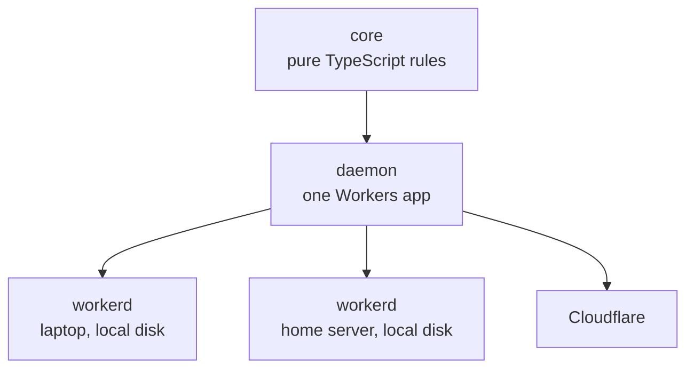
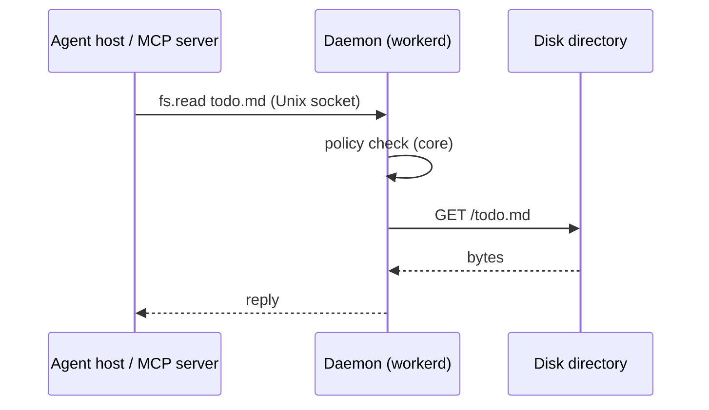

# Architecture

Workhorse MCP is one daemon per user that does all privileged work for agents and their apps. An agent host sees ordinary MCP servers. The servers have no access of their own: they call the daemon, and the daemon acts only within the user's policy.

## Shape



| Part | What it is | State |
|---|---|---|
| `core` | A pure state machine that holds every rule: policy, leases, routing, mailboxes, tasks | None; it performs no I/O |
| daemon | A Workers app that performs the effects `core` returns | Durable Objects |
| Apps | Workers apps that implement the protocol and provide operations, such as `sourcefed.monitor.create` | Through the daemon |
| `workhorse` CLI | Installs and starts the daemon, regenerates its configuration, and relays stdio for MCP hosts | None |

The daemon uses only the platform subset that workerd and Cloudflare share: Durable Objects (SQLite, alarms, WebSockets), `fetch`, and Dynamic Workers. The same bundle runs unchanged on every machine.

## Core

The core takes the current state and an input, and returns the next state and the effects to perform:

```ts
const { state: next, effects } = handle(state, { type: "publish", key: "github:pr42:comment:1", event });
// effects: [{ type: "persist", seq: 1, … }, { type: "deliver", seq: 1, … }, { type: "reply", … }]
```

Inputs are messages, timer ticks, and I/O results. Effects are plain values, so the audit trail records them directly and tests replay them without I/O.

## One call



## Protocol

JSON-RPC 2.0, one message per line, over any byte stream: a Unix socket on the same machine and the remote transport between machines. MCP servers face agent hosts with standard MCP.

JSON-RPC over Cap'n Proto and Cap'n Web: it is a stable open standard, it shares MCP's envelope, every target language (TypeScript, Swift, Kotlin, Rust) handles it without a dedicated library, and a human can read it on the wire.

```json
{"jsonrpc":"2.0","id":1,"method":"hello","params":{"protocol":[1]}}
{"jsonrpc":"2.0","id":1,"result":{"protocol":1}}
{"jsonrpc":"2.0","id":2,"method":"attach","params":{"request":[{"capability":"fs.read","root":"~/notes"}]}}
{"jsonrpc":"2.0","id":2,"result":{"granted":[{"capability":"fs.read","root":"~/notes"}],"denied":[]}}
{"jsonrpc":"2.0","id":3,"method":"fs.read","params":{"path":"../secrets.txt"}}
{"jsonrpc":"2.0","id":3,"error":{"code":-32001,"message":"denied","data":{"capability":"fs.read","reason":"outside_root"}}}
```

| Rule | Decision |
|---|---|
| Source | One TypeScript schema per message. Other languages use the JSON Schema exported from it |
| Methods | `capability.operation`. The daemon routes by prefix to the owner of the name |
| Lease | Bound to the connection after `attach`. Calls carry no lease ID. Durable work belongs to the identity |
| Errors | `-32001 denied` (policy refused), `-32002 failed` (allowed, but the operation failed), `-32003 unavailable` (the owner cannot be reached before the deadline), `-32004 limited` (a quota is reached) |
| Push | JSON-RPC notifications on the same connection |
| Versions | `hello` negotiates the version. An unsupported version gets a clear refusal |
| Limits | Maximum frame size, maximum read size, maximum connections, and a deadline on every call. Oversized input is rejected, never truncated |

## Identity

| Connection | How the daemon knows it | What it may do |
|---|---|---|
| Apps and their MCP servers | The daemon loads each one from its manifest as a Dynamic Worker | Every internal feature for its own data, and the outside-world access that the policy grants to that manifest |
| Outside clients: host adapters, the CLI, the stdio relay | Unknown; it is "local user" | The public operations that apps expose. No outside-world access of its own |
| Other daemons and devices | An Ed25519 key, paired through the policy | What the policy grants to that key |

An agent host reaches an app's MCP server through MCP's HTTP transport, or through `workhorse mcp sourcefed`, a stdio relay, for hosts that speak only stdio. No connection ever claims an identity.

## Policy and leases

The policy governs access to the outside world and nothing else. Internal features need no grant.

| Kind | Examples | Rule |
|---|---|---|
| Outside world | Files, network, secrets, other daemons and devices | Denied unless the policy grants it. A grant is the intersection of the policy and the request; everything else is reported in `denied`, never silently widened. `ask` rules go to an approver |
| Internal | State, tasks, mailboxes, the app's own audit records, calls to other apps' public operations | Always available, limited to the caller's own data, and bounded by daemon-wide quotas. A reached quota returns `limited` |

```json
{
  "apps": {
    "sourcefed": {
      "net.fetch": { "hosts": ["api.github.com"], "secrets": ["GH_TOKEN"] }
    },
    "chauffeur": {
      "fs": { "roots": ["~/.cache/chauffeur/skills"], "mode": "read-write" }
    }
  }
}
```

A policy change regenerates the daemon's configuration and sandbox, then causes a controlled restart: stop accepting calls, finish calls in flight before a deadline, restart, resume.

## Extensions

Outside apps, such as chauffeur or the Workhorse suite, extend the daemon through two abilities. The daemon itself contains no judgment logic.

| Ability | What it does |
|---|---|
| Decide | Answers `ask` rules for outside-world access with allow or deny. "Always allow" becomes a policy edit, which causes a controlled restart |
| Watch | Receives the full audit trail live, including background work that no agent started |

| Rule | Decision |
|---|---|
| Who registers | Only apps the daemon loads, so their identity is proven |
| Failure | A decider that crashes or misses its deadline means deny |
| Scope | A decider answers allow or deny; it cannot change a request |
| Record | The audit trail names the decider and its answer for every decision |

## Base capabilities

The daemon owns a small, fixed set. Apps provide everything else.

| Capability | Grant | Contract |
|---|---|---|
| `fs` | Yes | Reads and writes inside granted roots, through one workerd disk directory per root. `.` and `..` never resolve; the OS sandbox stops symlinks that point outside the grants |
| `net.fetch` | Yes | Host allowlist, timeouts, and credentials added by the daemon: `{"method":"net.fetch","params":{"url":"https://api.github.com/…","auth":"GH_TOKEN"}}`. The app never receives the secret |
| `state` | No | Per-app durable key-value data |
| `task` | No | Scheduled and recurring work. Tasks are saved state, so they survive restarts; they can run, pause, and be removed |
| `mailbox` | No | Durable delivery of events to targets, as specified below |
| `audit` | No | One trail of every call, grant, denial, and effect. An app reads its own records |

## Mailboxes

An app publishes an event to a target, such as one agent session. The daemon keeps the event until the target acknowledges it.

```json
{"jsonrpc":"2.0","method":"mailbox.deliver","params":{"target":"opencode-session:abc","seq":17,"key":"github:pr42:comment:123","event":{}}}
{"jsonrpc":"2.0","id":9,"method":"mailbox.ack","params":{"target":"opencode-session:abc","seq":17}}
```

| Rule | Decision |
|---|---|
| Key | Every publish carries a key derived from the upstream fact, never from the path that found it. A poll and a webhook for the same comment produce the same key. A publish without a key is rejected |
| Deduplication | The mailbox remembers every accepted key for its retention window, including keys already acknowledged |
| Atomicity | Checking the key, assigning the sequence number, and saving happen in one step. Retrying a publish is always safe |
| Order | First in, first out per mailbox, with a sequence number on every event |
| Effect | Delivery is at least once. The client SDK saves the last sequence it processed and skips anything at or below it, so each event takes effect exactly once |
| Consumers | One active consumer per mailbox. A new consumer replaces the old one |
| Limits | A maximum count and age per mailbox. When old events are dropped, the next delivery carries a gap marker with the number missed |

Proof for these rules has three layers:

1. A deterministic simulation of the core replays generated sequences of duplicate publishes, lost acknowledgements, crashes, reconnects, second consumers, restarts, and overflow. Every unique key takes effect exactly once, in order, or a gap marker covers it.
2. Conformance fault tests against a running daemon: drop the connection between delivery and acknowledgement, kill the daemon mid-write, restart.
3. One named regression scenario for each duplicate cause found in sourcefed v0.3.6.

## Apps

An app is harness-agnostic. It speaks the Workhorse protocol, and its MCP server speaks standard MCP. A thin per-host adapter does only what MCP cannot, such as waking an OpenCode session with a new event.

```json
{
  "id": "sourcefed",
  "version": "1.0.0",
  "entry": "sourcefed.js",
  "provides": ["sourcefed.monitor.create", "sourcefed.monitor.list", "sourcefed.monitor.stop"],
  "needs": ["net.fetch"]
}
```

Every app runs as a Dynamic Worker with `globalOutbound: null`: its only path to anything outside is the bindings the daemon gives it, so apps are isolated from each other and from the network. An MCP server built with the framework receives its lease as `ctx`, so it can offer only granted capabilities as tools:

```ts
const notes = mcp((ctx) => ({ tools: [ctx.tools.read] }));
```

## Sandboxing

The OS service manager runs workerd inside the OS sandbox tool. `workhorse install` generates both from the policy.

| Platform | Supervisor | Sandbox |
|---|---|---|
| macOS | launchd agent | `sandbox-exec` profile: the storage folder, the socket folder, and the `fs` roots; outbound network; no Unix sockets except its own |
| Linux | `systemd --user` unit | bubblewrap: a private mount namespace containing only the storage folder, the socket folder, and the `fs` roots, so host sockets such as `nscd` and `docker.sock` do not exist inside it; shared network |

| Rule | Decision |
|---|---|
| Ceiling | The OS sandbox is the ceiling for the whole daemon. Apps are isolated from each other inside it by Dynamic Workers |
| Symlinks | workerd's disk directories follow symlinks. The OS sandbox blocks any target outside the grants |
| Hostnames | Kernel sandboxes cannot filter by hostname. `net.fetch` enforces host allowlists |
| Startup grants | workerd also receives its own binary, the system library paths, and `/dev/null`; without them it cannot start |

## Remote links

Remote links are WebSocket over TLS, carrying the same protocol and authenticated by an Ed25519 challenge handshake. The home server is reached through a port-forward with TLS on a public DNS name; Cloudflare is reached directly. workerd serves both ends, so remote links add no native process.

WebSocket over iroh: workerd cannot run iroh, so iroh would need a native gateway on the home server. iroh is reconsidered only if a real-phone test shows it restores calls after a Wi-Fi to mobile-data switch more than 2 seconds faster; a phone then reconnects and the mailbox redelivers anything unacknowledged.

## Lifecycle

`workhorse install` writes the workerd configuration, the sandbox profile, and the service definition, then registers the daemon with launchd or `systemd --user`. The service manager keeps one instance running and restarts it on failure. A client that finds no daemon runs `workhorse start`, which asks the service manager to start it. `workhorse daemon` runs in the foreground for development. An upgrade or a policy change regenerates the files, drains, restarts, and resumes; clients reconnect and receive unacknowledged mailbox events again.

The daemon runs a pinned workerd version with `--experimental`, which Dynamic Workers require. workerd marks on-disk Durable Object storage as experimental, so a workerd upgrade is tested against saved data before it ships. The cloud daemon deploys with the `cf` CLI.

## Deployments

| Setup | What runs where |
|---|---|
| Single machine | Laptop: workerd with the daemon and its apps, under launchd or `systemd --user`. No network links |
| Laptop and home | Home runs sourcefed continuously and keeps mailboxes while the laptop sleeps. The laptop keeps its files |
| Laptop and cloud | The same daemon on Cloudflare in place of home |
| Phone | iOS and Android apps call public operations on the home daemon and read their mailboxes |
| Unattended | A daemon on Cloudflare runs agents. The laptop watches the audit trail |

## Repository layout

A Bun workspace:

```text
daemon/
├── packages/
│   ├── protocol/      message schemas; JSON Schema export for other languages
│   ├── core/          pure rules; no runtime dependencies, no I/O
│   ├── worker/        the daemon: performs core's effects in workerd and Cloudflare
│   ├── conformance/   black-box suite, run against any daemon
│   ├── sdk/           TypeScript client, including mailbox sequence tracking
│   └── cli/           workhorse: install, start, daemon, mcp relay
└── docs/
```

A package exists where it enforces a boundary through its dependencies and lint rules:

| Package | Depends on | Boundary |
|---|---|---|
| `protocol` | Effect Schema | Contracts and protocol invariants only |
| `core` | Types from `protocol` only | Lint bans `fetch`, `Date`, timers, `crypto`, and every runtime import, so I/O cannot be written. `tsc` checks that every input and effect is handled |
| `worker` | `core`, `protocol` | The only package that touches Durable Objects, sockets, and disk directories |
| `conformance` | `protocol` | Sees only the protocol, so it proves behaviour from the outside and runs against any daemon |
| `sdk` | `protocol` | A client for apps and adapters that carries no rules |
| `cli` | `protocol` | Generates configuration and relays stdio; holds no rules |

Nothing in the base imports an app.

## Proof

A daemon is any implementation that passes the conformance suite. The suite talks to the daemon only through the protocol and runs against the daemon on workerd and on Cloudflare. Every slice ends with the suite passing through the real runtime and the repository gates passing: `tsc`, Oxlint with the vendored anti-slop rules, Vitest, and Fallow.

## Delivery

Spikes under `spike/`:

1. **nono.** A process sandboxing itself. **Done**: file limits, inheritance, and no widening hold on macOS and Linux; on Linux, Unix sockets stay open to a self-sandboxed process and UDP needs seccomp. Evidence in `spike/sandbox/FINDINGS.md`.
2. **Remote transport.** Stopped without results: in a workerd-only daemon, iroh needs a native gateway, and only a real-phone test could justify one. WebSocket is the transport; the real-phone test runs when a phone is available.
3. **workerd.** One bundle on plain workerd and on Cloudflare. **Passed**. The core-shape comparison in the same spike measured TypeScript rules against Rust compiled to wasm: TypeScript ran the rules about 20× faster with about 19× less CPU, a 10 KB bundle against 116 KB, less memory, and the same end-to-end latency. Evidence in `spike/workerd/FINDINGS.md`.
4. **workerd-only daemon.** workerd listening on a Unix socket under `sandbox-exec` on macOS and bubblewrap on the homelab, started by launchd and `systemd --user`. It proves: `fs` through disk directories; a symlink pointing outside a root is blocked by the OS sandbox; a host Unix socket outside the grants is unreachable; MCP over HTTP reaches a Worker app; the stdio relay's memory; a restart through the service manager.

Slices:

1. The Bun workspace replaces this directory's Rust workspace and its CI gates. Protocol, core, the daemon on workerd listening on a Unix socket, `fs.read` through a disk directory, the OS sandbox under the service manager on macOS and Linux, and the conformance harness.
2. The home link over WebSocket and TLS: key pairing, remote routes, and `unavailable`.
3. The same daemon on Cloudflare, with the conformance suite passing there.
4. Mailboxes, tasks, and state as core transitions, with the full mailbox proof.
5. `net.fetch` with credential injection.
6. Decide and Watch: `ask` rules answered by a registered decider, deny on failure or deadline, and the live audit stream.
7. Phone clients for iOS and Android.
8. The TypeScript SDK.
9. sourcefed as an app.
10. The MCP framework, over MCP's HTTP transport and the stdio relay.
11. chauffeur.

Dependencies:

| Item | Status |
|---|---|
| The `workerd` runtime, Effect, Vitest, Oxlint, Fallow | Approved |
| The `cf` CLI and wrangler, as deploy tooling | Approved |
| `sandbox-exec` (built into macOS) and bubblewrap (a Linux system package) | Used by the generated sandbox; confirmed in spike 4 |
| A property-testing library for the mailbox simulation | Requires approval before slice 4 |
| `iroh` | Not used. Reconsidered only after a real-phone test |

## Limits

| Limit | Reason |
|---|---|
| Malware that already runs as the user | It can edit the policy file. A user-level daemon cannot prevent that |
| Possibly-malicious code | workerd states that it is not a hardened sandbox and recommends a virtual machine for possibly-malicious code. The OS sandbox is a process sandbox, not a virtual machine |
| `sandbox-exec` | Apple marks it deprecated without a replacement; it still works and other agent sandboxes rely on it |
| bubblewrap | It needs unprivileged user namespaces, which some Linux distributions disable |
| Apps that need a real process | Not supported. A capability that needs one is designed as a base capability with its own sandbox, or served over HTTP by a service the user runs |
| Hostname filtering | Kernel sandboxes filter by port, not host. `net.fetch` is the host boundary |
| Memory per live mailbox | workerd idles at about 30 MB and grows about 0.7 MB per active mailbox without returning it. The daemon bounds the number of live mailboxes |
