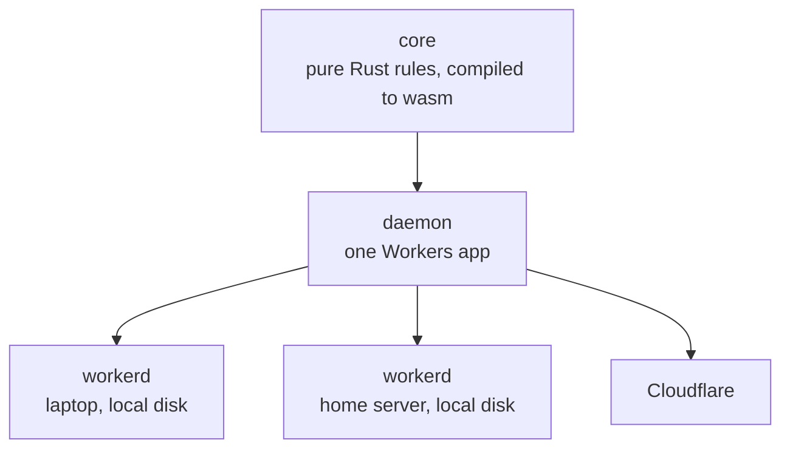
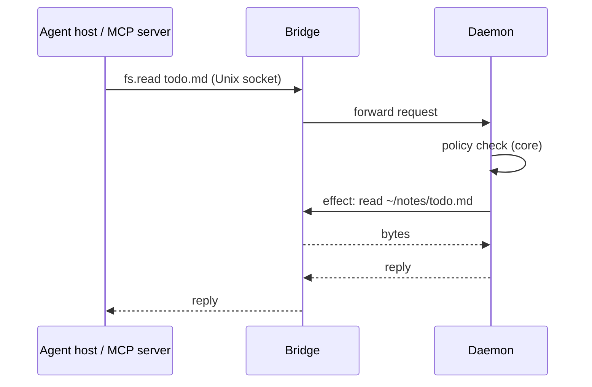

# Architecture

Workhorse MCP is one daemon per user that does all privileged work for agents and their apps. An agent host sees ordinary MCP servers. The servers have no access of their own: they call the daemon, and the daemon acts only within the user's policy.

## Shape



| Part     | What it is                                                                                                                                            | State                    |
| -------- | ----------------------------------------------------------------------------------------------------------------------------------------------------- | ------------------------ |
| `core`   | A pure state machine that holds every rule: policy, leases, routing, mailboxes, tasks                                                                 | None; it performs no I/O |
| daemon   | A Workers app: thin TypeScript around `core.wasm`                                                                                                     | Durable Objects          |
| `bridge` | A native Rust program: the Unix socket for hosts and MCP servers, files, processes, and remote links. It starts workerd and runs inside an OS sandbox | None                     |
| Apps     | Programs that implement the protocol and provide operations, such as `sourcefed.monitor.create`                                                       | Through the daemon       |

The daemon uses only the platform subset that workerd and Cloudflare share: Durable Objects (SQLite, alarms, WebSockets) and `fetch`. The same build therefore runs unchanged on every machine.

## Core

The core takes inputs and returns effects. The daemon performs the effects:

```rust
let effects = core.handle(Input::Request { conn, msg });
for effect in effects {
    shell.perform(effect).await; // Reply, Persist, Fetch, Spawn, Schedule, Deliver
}
```

Inputs are messages, timer ticks, and I/O results. Effects are plain values, so the audit trail records them directly and tests replay them without I/O.

## One call



## Protocol

JSON-RPC 2.0, one message per line, over any byte stream: a Unix socket on the same machine and the remote transport between machines. MCP servers face agent hosts with standard MCP.

JSON-RPC over Cap'n Proto and Cap'n Web: it is a stable open standard, it shares MCP's envelope, every target language (Rust, TypeScript, Swift, Kotlin) handles it without a dedicated library, and a human can read it on the wire.

```json
{"jsonrpc":"2.0","id":1,"method":"hello","params":{"protocol":[1]}}
{"jsonrpc":"2.0","id":1,"result":{"protocol":1}}
{"jsonrpc":"2.0","id":2,"method":"attach","params":{"request":[{"capability":"fs.read","root":"~/notes"}]}}
{"jsonrpc":"2.0","id":2,"result":{"granted":[{"capability":"fs.read","root":"~/notes"}],"denied":[]}}
{"jsonrpc":"2.0","id":3,"method":"fs.read","params":{"path":"../secrets.txt"}}
{"jsonrpc":"2.0","id":3,"error":{"code":-32001,"message":"denied","data":{"capability":"fs.read","reason":"outside_root"}}}
```

| Rule     | Decision                                                                                                                                                                                             |
| -------- | ---------------------------------------------------------------------------------------------------------------------------------------------------------------------------------------------------- |
| Methods  | `capability.operation`. The daemon routes by prefix to the owner of the name                                                                                                                         |
| Lease    | Bound to the connection after `attach`. Calls carry no lease ID. Durable work belongs to the identity                                                                                                |
| Errors   | `-32001 denied` (policy refused), `-32002 failed` (allowed, but the operation failed), `-32003 unavailable` (the owner cannot be reached before the deadline), `-32004 limited` (a quota is reached) |
| Push     | JSON-RPC notifications on the same connection                                                                                                                                                        |
| Versions | `hello` negotiates the version. An unsupported version gets a clear refusal                                                                                                                          |
| Limits   | Maximum frame size, maximum read size, maximum connections, and a deadline on every call. Oversized input is rejected, never truncated                                                               |

## Identity

| Connection                                  | How the daemon knows it                                                                               | What it may do                                                                                                |
| ------------------------------------------- | ----------------------------------------------------------------------------------------------------- | ------------------------------------------------------------------------------------------------------------- |
| Started by the bridge: apps and MCP servers | The bridge starts the process and hands it a private, already-connected socket. The manifest names it | Every internal feature for its own data, and the outside-world access that the policy grants to that manifest |
| Outside clients: host adapters, the CLI     | Unknown; it is "local user"                                                                           | The public operations that apps expose. No outside-world access of its own                                    |
| Other daemons and devices                   | An Ed25519 key, paired through the policy                                                             | What the policy grants to that key                                                                            |

An agent host starts an MCP server through the bridge: its MCP config runs `workhorse mcp sourcefed`, a relay over stdio. No connection ever claims an identity.

## Policy and leases

The policy governs access to the outside world and nothing else. Internal features need no grant.

| Kind          | Examples                                                                                     | Rule                                                                                                                                                                                          |
| ------------- | -------------------------------------------------------------------------------------------- | --------------------------------------------------------------------------------------------------------------------------------------------------------------------------------------------- |
| Outside world | Files, network, secrets, processes, other daemons and devices                                | Denied unless the policy grants it. A grant is the intersection of the policy and the request; everything else is reported in `denied`, never silently widened. `ask` rules go to an approver |
| Internal      | State, tasks, mailboxes, the app's own audit records, calls to other apps' public operations | Always available, limited to the caller's own data, and bounded by daemon-wide quotas. A reached quota returns `limited`                                                                      |

```json
{
  "apps": {
    "sourcefed": {
      "net.fetch": { "hosts": ["api.github.com"], "secrets": ["GH_TOKEN"] }
    },
    "chauffeur": {
      "process.run": { "commands": ["git"] },
      "fs": { "roots": ["~/.cache/chauffeur/skills"], "mode": "read-write" }
    }
  }
}
```

A policy change causes a controlled restart: stop accepting calls, finish calls in flight before a deadline, save, restart inside the new sandbox, resume.

## Extensions

Outside apps, such as chauffeur or the Workhorse suite, extend the daemon through two abilities. The daemon itself contains no judgment logic.

| Ability | What it does |
|---|---|
| Decide | Answers `ask` rules for outside-world access with allow or deny. "Always allow" becomes a policy edit, which causes a controlled restart |
| Watch | Receives the full audit trail live, including background work that no agent started |

| Rule | Decision |
|---|---|
| Who registers | Only apps the bridge starts, so their identity is proven |
| Failure | A decider that crashes or misses its deadline means deny |
| Scope | A decider answers allow or deny; it cannot change a request |
| Record | The audit trail names the decider and its answer for every decision |

## Base capabilities

The daemon owns a small, fixed set. Apps provide everything else.

| Capability    | Grant | Contract                                                                                                                                                                                 |
| ------------- | ----- | ---------------------------------------------------------------------------------------------------------------------------------------------------------------------------------------- |
| `fs`          | Yes   | Reads and writes inside granted roots. Paths resolve without leaving the root and without revealing whether an out-of-root file exists                                                   |
| `net.fetch`   | Yes   | Host allowlist, timeouts, and credentials added by the daemon: `{"method":"net.fetch","params":{"url":"https://api.github.com/…","auth":"GH_TOKEN"}}`. The app never receives the secret |
| `process.run` | Yes   | Runs an allowed command through the bridge, inside the bridge's sandbox, with a deadline and output limit                                                                                |
| `state`       | No    | Per-app durable key-value data                                                                                                                                                           |
| `task`        | No    | Scheduled and recurring work. Tasks are saved state, so they survive restarts; they can run, pause, and be removed                                                                       |
| `mailbox`     | No    | Durable delivery of events to targets, as specified below                                                                                                                                |
| `audit`       | No    | One trail of every call, grant, denial, and effect. An app reads its own records                                                                                                         |

## Mailboxes

An app publishes an event to a target, such as one agent session. The daemon keeps the event until the target acknowledges it.

```json
{"jsonrpc":"2.0","method":"mailbox.deliver","params":{"target":"opencode-session:abc","seq":17,"key":"github:pr42:comment:123","event":{}}}
{"jsonrpc":"2.0","id":9,"method":"mailbox.ack","params":{"target":"opencode-session:abc","seq":17}}
```

| Rule          | Decision                                                                                                                                                                                           |
| ------------- | -------------------------------------------------------------------------------------------------------------------------------------------------------------------------------------------------- |
| Key           | Every publish carries a key derived from the upstream fact, never from the path that found it. A poll and a webhook for the same comment produce the same key. A publish without a key is rejected |
| Deduplication | The mailbox remembers every accepted key for its retention window, including keys already acknowledged                                                                                             |
| Atomicity     | Checking the key, assigning the sequence number, and saving happen in one step. Retrying a publish is always safe                                                                                  |
| Order         | First in, first out per mailbox, with a sequence number on every event                                                                                                                             |
| Effect        | Delivery is at least once. The client SDK saves the last sequence it processed and skips anything at or below it, so each event takes effect exactly once                                          |
| Consumers     | One active consumer per mailbox. A new consumer replaces the old one                                                                                                                               |
| Limits        | A maximum count and age per mailbox. When old events are dropped, the next delivery carries a gap marker with the number missed                                                                    |

Proof for these rules has three layers:

1. A deterministic simulation of the core replays generated sequences of duplicate publishes, lost acknowledgements, crashes, reconnects, second consumers, restarts, and overflow. Every unique key takes effect exactly once, in order, or a gap marker covers it.
2. Conformance fault tests against a running daemon: drop the connection between delivery and acknowledgement, kill the daemon mid-write, restart.
3. One named regression scenario for each duplicate cause found in sourcefed v0.3.6.

## Apps

An app is harness-agnostic. It speaks the Workhorse protocol, and its MCP server speaks standard MCP. A thin per-host adapter does only what MCP cannot, such as waking an OpenCode session with a new event.

```json
{
  "id": "sourcefed",
  "version": "1.0.0",
  "runtime": "worker",
  "entry": "sourcefed.js",
  "provides": [
    "sourcefed.monitor.create",
    "sourcefed.monitor.list",
    "sourcefed.monitor.stop"
  ],
  "needs": ["net.fetch"]
}
```

| Runtime   | Runs as                                                                     | Isolation                                                                |
| --------- | --------------------------------------------------------------------------- | ------------------------------------------------------------------------ |
| `worker`  | A Dynamic Worker inside the daemon whose only outbound path is its bindings | Per app                                                                  |
| `process` | A process the bridge starts                                                 | The bridge's sandbox; shared with the other process apps on that machine |

An MCP server built with the framework receives its lease as `ctx`, so it can offer only granted capabilities as tools:

```ts
const notes = mcp((ctx) => ({ tools: [ctx.tools.read] }));
```

## Sandboxing

At startup the bridge sandboxes itself with nono to the union of the policy's grants, and it starts workerd inside a sandbox limited to its storage folder and the loopback link to the bridge. Child processes inherit the sandbox. Kernel sandboxes cannot filter by hostname, so `net.fetch` enforces host allowlists.

## Remote links

Remote links carry the same protocol, authenticated by Ed25519 keys. The home server is reached through a port-forward with TLS on a public DNS name. Cloudflare is reached over WebSocket.

Spike 2 selects the transport between devices and the home server:

| Option | Transport                                              |
| ------ | ------------------------------------------------------ |
| A      | WebSocket over TLS with an Ed25519 challenge handshake |
| B      | iroh, with an `iroh-relay` on the home server          |

WebSocket is selected unless iroh restores calls after a phone switches from Wi-Fi to mobile data more than 2 seconds faster. In that case iroh serves phones only. The conformance suite passes over the selected transport.

## Lifecycle

`workhorse install` registers the bridge with the OS service manager: launchd on macOS, `systemd --user` on Linux. A client that finds no bridge starts one: it takes a lock first, so two clients cannot both start one, and it passes a clean environment. `workhorse daemon` runs in the foreground for development. An upgrade or a policy change drains, saves, restarts, and resumes; clients reconnect and receive unacknowledged mailbox events again.

## Deployments

| Setup            | What runs where                                                                                                          |
| ---------------- | ------------------------------------------------------------------------------------------------------------------------ |
| Single machine   | Laptop: bridge, workerd, the daemon, and process apps. No network links                                                  |
| Laptop and home  | Home runs sourcefed continuously and keeps mailboxes while the laptop sleeps. The laptop keeps files and local processes |
| Laptop and cloud | The same daemon on Cloudflare in place of home                                                                           |
| Phone            | iOS and Android apps call public operations on the home daemon and read their mailboxes                                  |
| Unattended       | A daemon on Cloudflare runs agents. The laptop watches the audit trail                                                   |

## Repository layout

```text
daemon/
├── crates/
│   ├── protocol/      wire messages and the frame codec
│   ├── core/          pure rules; no_std, built for wasm32, tested natively
│   ├── bridge/        socket, files, processes, remote links, sandbox
│   ├── conformance/   black-box suite, run against any daemon
│   └── client/        Rust client for apps (slice 8)
├── worker/            Workers app around core.wasm (Bun, Effect, Vitest)
└── sdk/typescript/    TypeScript client
```

A crate exists where it enforces a boundary through its dependencies:

| Crate | Depends on | Boundary |
|---|---|---|
| `protocol` | `serde` | Contracts and protocol invariants only. The frame codec splits lines and enforces the frame limit without I/O |
| `core` | `protocol` | `#![no_std]`, so I/O cannot be written. It compiles to wasm32 for the Workers app |
| `bridge` | `protocol`, `tokio`, `nono`, TLS | The only privileged code. It never compiles to wasm |
| `conformance` | `protocol` | Sees only the protocol, so it proves behaviour from the outside and runs against any daemon |
| `client` | `protocol`, `tokio` | A client for apps that carries neither the rules nor the privileged code. It arrives with the first Rust app; until then `bridge` and `conformance` open their own connections |

Nothing in the base imports an app.

## Proof

A daemon is any implementation that passes the conformance suite. The suite talks to the daemon only through the protocol and runs against the daemon on workerd and on Cloudflare. Every slice ends with the suite passing through the real runtime and the repository gates passing.

## Delivery

Spikes run in parallel under `spike/`:

1. **nono.** The bridge sandboxes itself and starts workerd inside a sandbox. Reading outside the granted roots fails.
2. **Remote transport.** WebSocket and iroh between two bridges and from Swift and Kotlin phone apps. It measures latency on the LAN and on another network, recovery after a phone's network switch, setup steps, dependencies, binary size, and bridge RAM. It applies the selection rule above.
3. **workerd.** `core.wasm` in a Durable Object on workerd with local disk, alarms, and WebSockets, and the same build on Cloudflare. It measures workerd's idle RAM on a laptop and checks Dynamic Worker support. This spike gates the single-daemon shape. If it fails, the fallback is two shells around the same core: a native shell for devices and a Workers shell for the cloud.

Slices:

1. Core, the daemon on workerd, the bridge with its Unix socket and the `fs.read` effect, and the conformance harness, sandboxed from the first run.
2. The home link over the selected transport: key pairing, remote routes, and `unavailable`.
3. The same daemon on Cloudflare, with the conformance suite passing there.
4. Mailboxes, tasks, and state as core transitions, with the full mailbox proof.
5. `net.fetch` and `process.run`, with credential injection.
6. Decide and Watch: `ask` rules answered by a registered decider, deny on failure or deadline, and the live audit stream.
7. Phone clients for iOS and Android.
8. The `client` crate and the TypeScript SDK.
9. sourcefed as a `worker` app.
10. The MCP framework.
11. chauffeur.

Dependencies:

| Item                                                                                                              | Status                  |
| ----------------------------------------------------------------------------------------------------------------- | ----------------------- |
| `iroh`, `nono`, a WebSocket client and TLS (`tokio-tungstenite`, `rustls`), the `workerd` runtime, `wasm-bindgen` | Approved for the spikes |

## Limits

| Limit                                         | Reason                                                                                                                                                          |
| --------------------------------------------- | --------------------------------------------------------------------------------------------------------------------------------------------------------------- |
| Malware that already runs as the user         | It can edit the policy file. A user-level daemon cannot prevent that                                                                                            |
| Process apps on one machine share one sandbox | The bridge's sandbox is the ceiling for all of them. `worker` apps are isolated individually                                                                    |
| Possibly-malicious code                       | workerd states that it is not a hardened sandbox and recommends a virtual machine for possibly-malicious code. nono is a process sandbox, not a virtual machine |
| Hostname filtering                            | Kernel sandboxes filter by port, not host. `net.fetch` is the host boundary                                                                                     |
