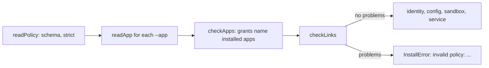

# Link checks

Checks across the policy and the installed apps that the policy schema cannot make on its own, run by `workhorse install`. The schema checks each field (names, keys, addresses, method names); these check that the fields agree with each other and with what is installed. Every problem is reported at once, and any problem stops the install.

## Functions

| Module              | Export          | Refuses                                                                                          |
| ------------------- | --------------- | ------------------------------------------------------------------------------------------------ |
| `name-problems.ts`  | `nameProblems`  | An installed app named `fs`, `net` or `link`, which would shadow a base capability or links      |
| `route-problems.ts` | `routeProblems` | A route to an unpaired peer, a route for an app also installed here, a route for a reserved name |
| `grant-problems.ts` | `grantProblems` | An operation granted to a peer that no installed app declares                                    |
| `reserved.ts`       | `RESERVED`      | The reserved names                                                                               |
| `check-links.ts`    | `checkLinks`    | Runs all three and fails the install with every problem listed                                   |
| `index.ts`          | barrel          | `checkLinks`                                                                                     |

## Where it runs



- **Why at install:** a route or grant naming an app that is not installed would fail only later, at a call, as `methodNotFound`. A wrong policy is refused, never silently ignored.
- **An app lives in one place:** routing an app that is also installed here would make the same method mean two things.
- **What the daemon still checks:** at run time `core` checks every peer call against the grants again (`routePeerCall`), since the deployment is input like any other.

## Usage

```ts
import { checkLinks } from "./check-links/index.ts";

yield * checkLinks(policy, apps);
// InstallError: invalid policy: route journal names unknown peer office; peer home is granted notes.write, which no installed app provides
```
