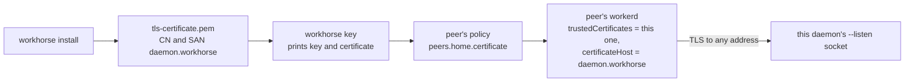

# Identity

A daemon's identity for links: an Ed25519 key that peers pair with, and a self-signed TLS certificate that peers pin. `workhorse install` makes both once and keeps them, because peers pin both: replacing them would undo every pairing. `workhorse key` prints the public half for a peer's policy.

## Functions

| Module                       | Export                                       | Responsibility                                                                                                                     |
| ---------------------------- | -------------------------------------------- | ---------------------------------------------------------------------------------------------------------------------------------- |
| `ensure-identity.ts`         | `ensureIdentity`                             | Make `identity.json` (Ed25519 JWK) and `tls-key.pem` and `tls-certificate.pem` (P-256), unless present. Private keys are mode 0600 |
| `self-signed-certificate.ts` | `selfSignedCertificate`, `CertificateFields` | Build one X.509 v3 certificate for a P-256 key, signed by itself, as PEM                                                           |
| `certificate-extensions.ts`  | `certificateExtensions`                      | subjectAltName with one DNS name; critical basicConstraints `CA:TRUE`, so the certificate is its own trust anchor                  |
| `pem.ts`                     | `pem`                                        | DER bytes as PEM text (RFC 7468)                                                                                                   |
| `read-public-identity.ts`    | `readPublicIdentity`, `PublicIdentity`       | The key and certificate a peer needs, from the files install made; never the private key                                           |
| `der/`                       | DER encoders                                 | The ASN.1 DER pieces one certificate needs; see [der/README.md](der/README.md)                                                     |

## Files under the daemon's `etc/`

| File                  | Contents                                           | Who reads it                                                                          |
| --------------------- | -------------------------------------------------- | ------------------------------------------------------------------------------------- |
| `identity.json`       | `{ kty, crv, x, d }`: `x` public, `d` private      | The daemon (`IDENTITY` binding) signs handshakes with `d`; `workhorse key` prints `x` |
| `tls-key.pem`         | PKCS#8 P-256 private key                           | workerd's HTTPS socket, only with `--listen`                                          |
| `tls-certificate.pem` | The self-signed certificate for `daemon.workhorse` | workerd's HTTPS socket; peers pin a copy                                              |
| `peer-<name>.pem`     | A dialed peer's certificate, from the policy       | workerd's TLS service for that peer (`trustedCertificates`)                           |

## How a certificate is checked



- **One name for every daemon:** the certificate names `daemon.workhorse`, and a peer pins the exact certificate, so the address it dials (LAN, Tailscale, WireGuard) never has to match.
- **No dependency:** Node and Bun can sign but cannot build X.509, so a small DER encoder builds this one fixed shape. Tests check it against Node's `X509Certificate` and `openssl`, and spike 6 showed workerd's TLS accepts it.
- **Long-lived on purpose:** valid for 25 years from install, since a peer pins it and expiry would silently break the link.
- **Time and randomness come from the caller:** `selfSignedCertificate` takes its times and serial number as inputs; `ensureIdentity` supplies them from Effect's clock and `randomBytes`.

## Usage

```ts
import { generateKeyPairSync, randomBytes } from "node:crypto";
import { DateTime } from "effect";
import { selfSignedCertificate } from "./self-signed-certificate.ts";

const keys = generateKeyPairSync("ec", { namedCurve: "P-256" });
const now = DateTime.makeUnsafe("2026-10-22T00:00:00Z");
const pemText = selfSignedCertificate(
  {
    name: "daemon.workhorse",
    serial: randomBytes(16),
    notBefore: now,
    notAfter: DateTime.add(now, { years: 25 }),
  },
  keys.publicKey,
  keys.privateKey,
);
```
