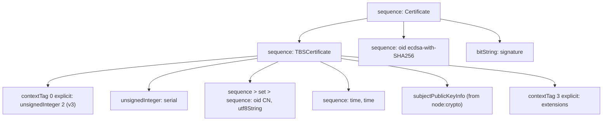

# DER

The parts of ASN.1 DER (ITU-T X.690) that one self-signed certificate needs, and nothing else. Each function returns one complete encoded element, so a certificate is built by nesting calls, the same shape as its ASN.1 definition. Used only by [`../self-signed-certificate.ts`](../README.md).

## Functions

| Module                | Export            | Encodes                                                                       |
| --------------------- | ----------------- | ----------------------------------------------------------------------------- |
| `tag.ts`              | `Tag`             | The universal tags used here                                                  |
| `length.ts`           | `length`          | A definite length: one byte below 128, otherwise `0x80 + n` and n bytes       |
| `element.ts`          | `element`         | Tag, length, contents                                                         |
| `concat.ts`           | `concat`          | Byte arrays joined in order                                                   |
| `sequence.ts`         | `sequence`        | SEQUENCE of encoded elements                                                  |
| `set.ts`              | `set`             | SET OF exactly one element, so DER's sorting rule never applies               |
| `boolean.ts`          | `boolean`         | BOOLEAN, true as `0xff`                                                       |
| `unsigned-integer.ts` | `unsignedInteger` | A non-negative INTEGER, minimal, with a leading zero when the high bit is set |
| `oid.ts`              | `oid`             | OBJECT IDENTIFIER from dotted text, base-128 arcs                             |
| `utf8-string.ts`      | `utf8String`      | UTF8String                                                                    |
| `octet-string.ts`     | `octetString`     | OCTET STRING                                                                  |
| `bit-string.ts`       | `bitString`       | BIT STRING of whole bytes                                                     |
| `context-tag.ts`      | `contextTag`      | `[n]`: explicit (wraps an element) or implicit (replaces a primitive's tag)   |
| `time.ts`             | `time`            | UTCTime through 2049, GeneralizedTime from 2050 (RFC 5280, 4.1.2.5)           |
| `index.ts`            | barrel            | The encoders the certificate uses                                             |

## How they nest



- **Exact bytes are tested** against encodings from X.690 and real certificates: `06082a8648ce3d040302` for ecdsa-with-SHA256, long-form lengths at 128 bytes, the 2049/2050 time switch.
- **Not general purpose:** no indefinite lengths, no negative integers, no multi-element SETs. Anything outside the one certificate shape belongs to a library, chosen deliberately.

## Usage

```ts
import { oid, sequence, utf8String } from "./index.ts";

// Name ::= SEQUENCE { SET { SEQUENCE { commonName, "daemon.workhorse" } } }
const commonName = sequence([oid("2.5.4.3"), utf8String("daemon.workhorse")]);
```
