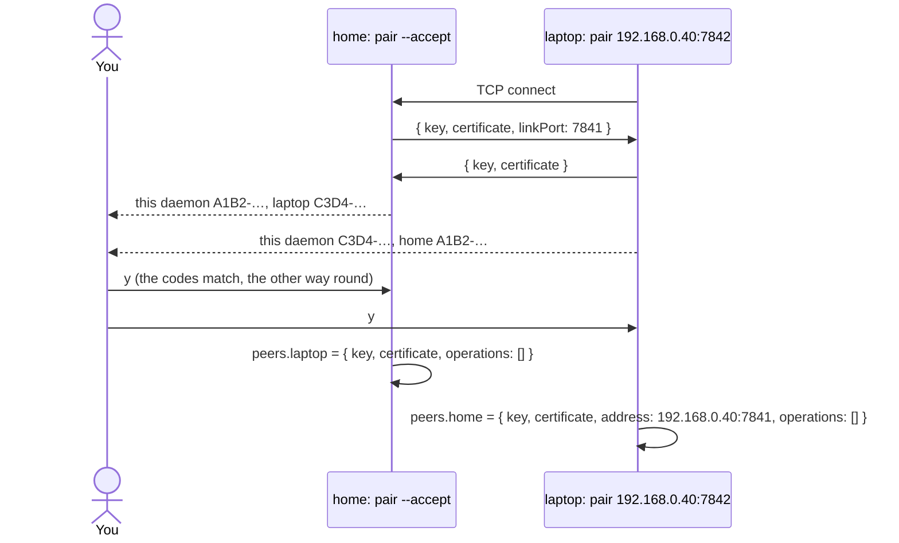

# Pairing

`workhorse pair` pairs two daemons: each learns the other's key and certificate and writes them into its own policy, once you confirm on both machines that the codes match. It only edits the policy file; `workhorse install` applies it. The design is in [Remote links](../../../../docs/architecture.md#remote-links).

```sh
# On the machine that accepts links (installed with --listen), for example home:
workhorse pair --base ~/.workhorse --policy ~/policy.json --name laptop --accept --listen 0.0.0.0:7842
# On the machine that dials it, for example the laptop:
workhorse pair --base ~/.workhorse --policy ~/policy.json --name home 192.168.0.40:7842
```

## Functions

| Module              | Export          | Responsibility                                                                               |
| ------------------- | --------------- | -------------------------------------------------------------------------------------------- |
| `pair.ts`           | `pair`          | Swap offers, show both fingerprints, ask, and add the peer only on yes                       |
| `pair-side.ts`      | `PairSide`      | Accept on a listen address, or dial an address                                               |
| `pair-offer.ts`     | `PairOffer`     | What each side sends: key, certificate, and (accepting side) the port it accepts links on    |
| `accept-pairing.ts` | `acceptPairing` | Wait for one connection, at most 5 minutes; the listener closes after it                     |
| `dial-pairing.ts`   | `dialPairing`   | Connect, at most 10 s                                                                        |
| `exchange.ts`       | `exchange`      | One JSON line each way, at most 16 KB, within 10 s; the other side's offer is decoded        |
| `fingerprint.ts`    | `fingerprint`   | A code over key and certificate: the first 64 bits of SHA-256, as `XXXX-XXXX-XXXX-XXXX`      |
| `confirm.ts`        | `confirm`       | Ask on the terminal; only `y` or `yes` counts                                                |
| `peer-entry.ts`     | `peerEntry`     | The policy entry: pinned key and certificate, no operations; the dialing side adds `address` |
| `add-peer.ts`       | `addPeer`       | Add it to the policy file, kept as written; a name already paired is refused                 |
| `link-port.ts`      | `linkPort`      | The port this daemon accepts links on, as install recorded it from `--listen`                |
| `host-port.ts`      | `hostPort`      | Split `host:port`, unbracketing IPv6                                                         |
| `index.ts`          | barrel          | `pair`, `PairSide`                                                                           |

## A pairing



- **Why the codes, not TLS:** at pairing time neither side can check the other, so TLS would prove nothing. Comparing the codes on both screens is the check: an attacker in the middle would have to make a different key and certificate produce the same 64-bit code in real time.
- **The certificate is covered too:** the code hashes key and certificate together. Even a swapped certificate alone could not complete a link, because the handshake also proves the key.
- **Nothing is granted:** a new peer gets `operations: []`. List the operations it may call, add any `routes`, then run `workhorse install`.
- **Bounded:** one connection, a 5-minute window, a 16 KB offer, 10 s to exchange.
- **Any network:** the dialing side records the host it paired with and the port the other side reported, so it works over a LAN, Tailscale or WireGuard alike.

## After pairing

```json
{
  "apps": {},
  "peers": {
    "home": { "key": "…", "certificate": "…", "address": "192.168.0.40:7841", "operations": [] }
  },
  "routes": { "notes": "home" }
}
```
