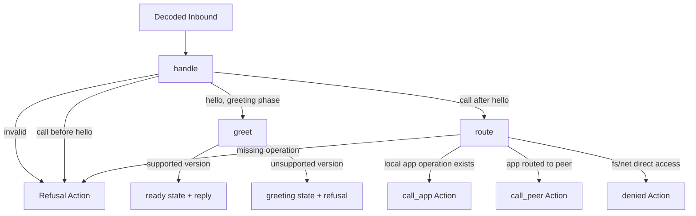

# Connection rules

This directory contains the pure connection state machine for the daemon's JSON-RPC socket. It validates protocol order and resolves public method names to app operations; it does not read sockets, invoke apps, or serialize replies. The daemon interprets the `Action` values returned by `handle`.

## Functions

| Module              | Function/value  | Responsibility                                                                                       |
| ------------------- | --------------- | ---------------------------------------------------------------------------------------------------- |
| `new-connection.ts` | `newConnection` | Initial `greeting` state; exports the `Connection` state type.                                       |
| `handle.ts`         | `handle`        | Advances one connection from one decoded `Inbound` message.                                          |
| `greet.ts`          | `greet`         | Negotiates the highest supported protocol version; exports `Step`, the state/effects result.         |
| `agree-version.ts`  | `agreeVersion`  | Chooses the highest common version, also used by the peer-link handshake.                            |
| `route.ts`          | `route`         | Resolves `owner.operation` against the app operation map; rejects direct outside-world capabilities. |
| `deny.ts`           | `deny`          | Builds a capability-denied action; exports `DenyReason`.                                             |
| `refuse.ts`         | `refuse`        | Builds a protocol refusal action.                                                                    |
| `action.ts`         | `Action`        | Shared result contract consumed by daemon-side effect handling.                                      |
| `index.ts`          | barrel          | Exposes the supported connection API and types.                                                      |

## Flow



`core` is the policy/state-machine layer in [`daemon/docs/architecture.md`](../../../../docs/architecture.md#core). It returns values describing effects; the daemon owns execution and I/O.

## Usage

```ts
import { handle, newConnection, type Directory } from "@workhorse/core";
import type { Inbound } from "@workhorse/protocol";

const directory: Directory = {
  apps: new Map([["notes", new Set(["read"])]]),
  routes: new Map([["journal", "home"]]),
};
const hello: Inbound = {
  type: "hello",
  id: 1,
  params: { protocol: [1] },
};

const step = handle(directory, newConnection, hello);
// step.connection is ready; step.effects contains a reply action.
```

- Call `handle` once for each decoded inbound message, passing the returned connection state to the next call.
- Interpret `step.effects` in the daemon; do not perform I/O in this package.
- An outside client can call only manifest-declared app operations. `fs.*` and `net.*` are denied directly.
- `link.*` is reserved for authenticated links; local clients cannot use the handshake methods.
- Routes produce `call_peer`; [link rules](../link/README.md) on the receiving daemon check the peer's grants.
