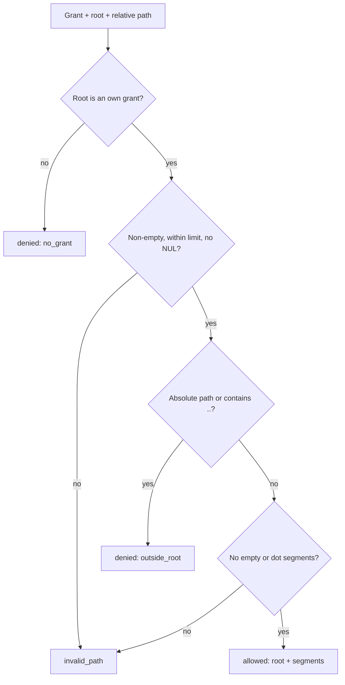
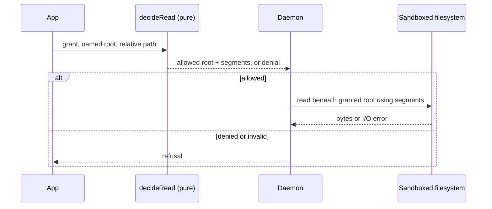

# Filesystem authorization rules

This directory contains the pure path/grant decision used before the daemon reads from a named filesystem root. It does not open files or resolve symlinks. The daemon must apply the returned root and path segments at the real filesystem boundary inside the OS sandbox.

## Functions and values

| Module           | Export            | Responsibility                                                                     |
| ---------------- | ----------------- | ---------------------------------------------------------------------------------- |
| `decide-read.ts` | `decideRead`      | Checks the named root grant and validates a relative path; exports `ReadDecision`. |
| `limits.ts`      | `MAX_PATH_LENGTH` | Caps accepted path length at 1024 characters.                                      |
| `index.ts`       | barrel            | Exposes filesystem authorization API and result type.                              |

## Decision flow





The core decision is one layer of defense, not a substitute for safe filesystem resolution. See the [`fs.read` sandbox contract](../../../../docs/architecture.md#sandboxing): the OS sandbox and daemon adapter enforce the actual directory boundary and symlink behavior.

## Usage

```ts
import { decideRead, type ReadDecision } from "@workhorse/core";
import type { FsGrant } from "@workhorse/protocol";

const grant: FsGrant = { roots: { notes: "/home/me/notes" }, mode: "read" };
const decision: ReadDecision = decideRead(grant, "notes", "projects/todo.md");

if (decision.type === "allowed") {
  // Pass decision.root and decision.segments to the daemon's bounded filesystem adapter.
}
```

- `allowed` returns path segments, never a concatenated host path.
- A missing named grant returns `denied / no_grant`.
- Absolute paths and `..` traversal return `denied / outside_root`.
- Empty, dot, repeated-slash, NUL-containing, or overlong paths return `invalid_path`.
- Percent-encoded text is treated literally; this function does not URL-decode paths.
