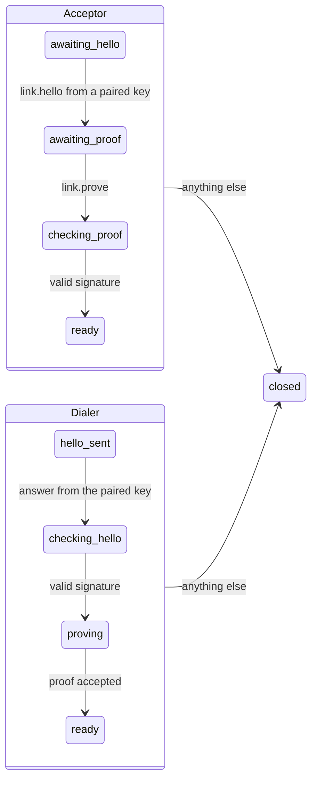

# Link rules

The pure rules for a link between two daemons: the mutual handshake, and what a paired peer may do once the link is open. Like the [connection rules](../connection/README.md), they take a state and an event and return the next state and the effects to perform. Signing, verifying and sending are effects, so nothing here touches a socket or a key; the worker's `Link` object (`packages/worker/src/link`) performs them.

## Functions and types

| Module                 | Export                                 | Responsibility                                                                               |
| ---------------------- | -------------------------------------- | -------------------------------------------------------------------------------------------- |
| `link-state.ts`        | `LinkState`, `LinkPeer`, `Peers`       | The phases of one link, and a paired peer as the rules see it: name, key, granted operations |
| `link-effect.ts`       | `LinkEffect`, `LinkStep`, `Transcript` | What the rules ask the daemon to do, and what a side signs or checks                         |
| `accept-link.ts`       | `acceptLink`                           | A link someone dialed: wait for `link.hello`                                                 |
| `dial-link.ts`         | `dialLink`                             | A link this daemon opened: send `link.hello` with every version it speaks                    |
| `link-step.ts`         | `linkStep`, `LinkEvent`, `LinkContext` | Advance one link by one event, dispatching on its phase                                      |
| `on-awaiting-hello.ts` | `onAwaitingHello`                      | Acceptor: the first message must be `link.hello` from a paired key with a shared version     |
| `on-awaiting-proof.ts` | `onAwaitingProof`                      | Acceptor: the next must be `link.prove`; ask to verify it                                    |
| `on-checking-proof.ts` | `onCheckingProof`                      | Acceptor: a valid proof opens the link                                                       |
| `on-hello-sent.ts`     | `onHelloSent`                          | Dialer: the answer must come from the paired key, in a version it offered; ask to verify it  |
| `on-checking-hello.ts` | `onCheckingHello`                      | Dialer: a valid signature lets it prove its own key                                          |
| `on-proving.ts`        | `onProving`                            | Dialer: the acceptor accepting the proof opens the link                                      |
| `on-ready.ts`          | `onReady`                              | Both: peer calls within grants, answers, heartbeats; a second handshake is refused           |
| `route-peer-call.ts`   | `routePeerCall`                        | A peer's call: listed operations only, apps here only, never on to another peer              |
| `close-link.ts`        | `closeLink`                            | End a link, optionally refusing the request that broke the rules                             |
| `index.ts`             | barrel                                 | The folder's public API                                                                      |

## Phases



- **Strict order:** anything other than the next handshake message closes the link. The worker sends heartbeats only once the link is ready, so they never interleave with the handshake.
- **Mutual:** each side signs a transcript naming its role, both keys and both fresh nonces (see the protocol's [Link](../../../protocol/src/link/README.md)).
- **One verification at a time:** the worker performs a `verify` effect and feeds its answer back as a `verified` event before the next message, so the answer always matches the state that asked.
- **Grants first:** a peer's call to an unlisted operation is denied before anything is looked up, so it reveals nothing about what is installed.

## Calls on an open link

| Message from the peer               | Effect                                       |
| ----------------------------------- | -------------------------------------------- |
| A call to a listed operation        | `call_app` on this daemon                    |
| A call to anything else             | `refuse`: `denied`, reason `no_grant`        |
| A response                          | `settle`: answers this side's waiting call   |
| `link.ping` or another notification | nothing; any message shows the peer is alive |
| `link.hello` or `link.prove`        | `refuse`: handshake already done             |

## Usage

```ts
import { acceptLink, linkStep, type LinkContext } from "@workhorse/core";

const context: LinkContext = { apps, peers: new Map([[laptop.key, laptop]]) };
let state = acceptLink({ key: ownKey, nonce: freshNonce });

for (const message of incoming) {
  const step = linkStep(context, state, { type: "message", message });
  state = step.state;
  // Perform step.effects in order; feed a verification's answer back as { type: "verified", valid }.
}
```

See [Remote links](../../../../docs/architecture.md#remote-links) for the design.
