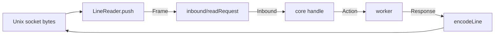
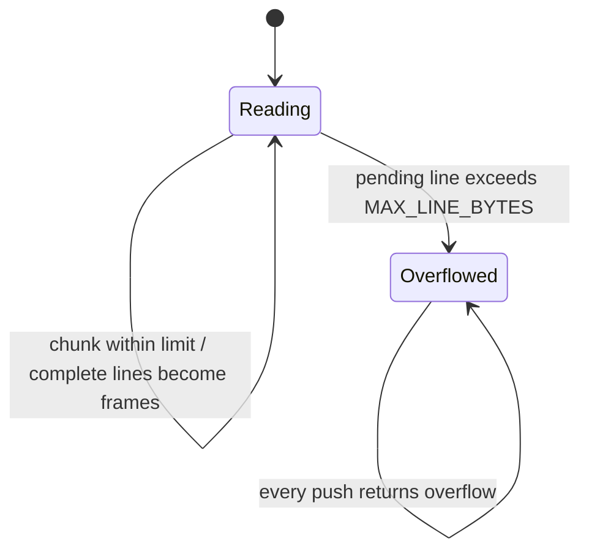

# Framing

How JSON-RPC messages travel over a byte stream: one message per line. This folder turns bytes into lines and messages into lines; it does not parse JSON or know any method. `inbound/` decodes the lines it produces.

## Functions and values

| Module           | Export            | Responsibility                                                                                         |
| ---------------- | ----------------- | ------------------------------------------------------------------------------------------------------ |
| `line-reader.ts` | `LineReader`      | Splits incoming chunks into complete lines, keeps the unfinished rest, and stops for good on overflow. |
| `line-reader.ts` | `Frame`, `Pushed` | A decoded line or an invalid-UTF-8 line; the lines one chunk completed and whether it overflowed.      |
| `encode-line.ts` | `encodeLine`      | Serializes one message as exactly one line.                                                            |
| `limits.ts`      | `MAX_LINE_BYTES`  | 1 MiB per line. Longer lines are rejected, never truncated.                                            |
| `index.ts`       | barrel            | The folder's public API.                                                                               |

## Where it sits



The architecture's [Protocol](../../../../docs/architecture.md#protocol) section fixes the wire format: JSON-RPC 2.0, one message per line, over any byte stream. Both the daemon (`packages/worker`) and clients (`packages/conformance`, `packages/cli`) use this folder, so they agree on the limit and the line format.

## How `LineReader` behaves



- A line can arrive split across many chunks; its pieces are joined once, when its newline arrives.
- Empty lines are skipped.
- A line that is not valid UTF-8 becomes `{ type: "invalid_utf8" }`, so the daemon can still reply with a parse error.
- After an overflow the reader returns `overflow: true` forever. The caller must reply and close the connection; frames completed earlier in the same chunk are still returned.

## Usage

```ts
import { encodeLine, LineReader, MAX_LINE_BYTES } from "@workhorse/protocol";

const reader = new LineReader(MAX_LINE_BYTES);
const { frames, overflow } = reader.push(new TextEncoder().encode('{"jsonrpc":"2.0"}\n{"jso'));
// frames: [{ type: "line", text: '{"jsonrpc":"2.0"}' }]; '{"jso' waits for its newline.

if (overflow) {
  // Reply with invalidRequest, then close the connection.
}

const line = encodeLine({ jsonrpc: "2.0", id: 1, result: { protocol: 1 } });
// '{"jsonrpc":"2.0","id":1,"result":{"protocol":1}}\n'
```
