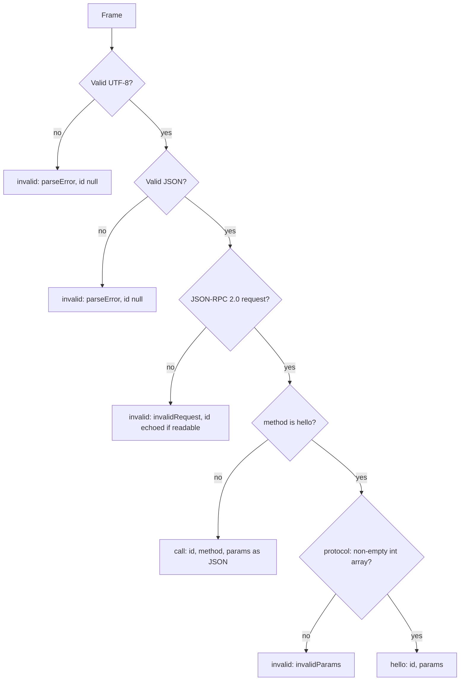

# Inbound

Classifies one line from a client before `core` sees it. It validates the JSON-RPC 2.0 envelope and decodes `hello`'s params; every other method's params pass through as JSON, because the app or capability that owns the method decodes them.

## Functions and types

| Module            | Export        | Responsibility                                                                                |
| ----------------- | ------------- | --------------------------------------------------------------------------------------------- |
| `inbound.ts`      | `Inbound`     | The three kinds of line: `hello`, `call`, `invalid`. Shared by both functions below.          |
| `read-request.ts` | `readRequest` | Decodes a `Frame` into an `Inbound`.                                                          |
| `invalid.ts`      | `invalid`     | Builds the `invalid` case with the error code and message its reply carries. Folder-internal. |
| `index.ts`        | barrel        | The folder's public API: `readRequest` and `Inbound`.                                         |

## Decision flow



| Line                                                                         | Result                              |
| ---------------------------------------------------------------------------- | ----------------------------------- |
| `{"jsonrpc":"2.0","id":1,"method":"hello","params":{"protocol":[1]}}`        | `hello`                             |
| `{"jsonrpc":"2.0","id":2,"method":"notes.read","params":{"path":"todo.md"}}` | `call`                              |
| `not json`                                                                   | `invalid`, `parseError`, id `null`  |
| `{"id":7,"method":"x"}` (no `jsonrpc`)                                       | `invalid`, `invalidRequest`, id `7` |
| `{"jsonrpc":"2.0","id":1,"method":"hello"}`                                  | `invalid`, `invalidParams`          |

## Where it sits

`readRequest` is the trust boundary for client input: after it, `core`'s [connection rules](../../../core/src/connection/README.md) work on a closed union instead of unknown JSON. Version negotiation and routing are `core`'s job, not this folder's. See [Protocol](../../../../docs/architecture.md#protocol) for the wire rules.

## Usage

```ts
import { LineReader, MAX_LINE_BYTES, readRequest } from "@workhorse/protocol";

const reader = new LineReader(MAX_LINE_BYTES);

for (const frame of reader.push(chunk).frames) {
  const inbound = readRequest(frame);

  if (inbound.type === "invalid") {
    // Reply with inbound.code and inbound.message, using inbound.id (null if unreadable).
  }
}
```

- An unreadable id is `null` in the reply, as JSON-RPC requires.
- `call` params stay JSON; never trust them before the owner's schema decodes them.
