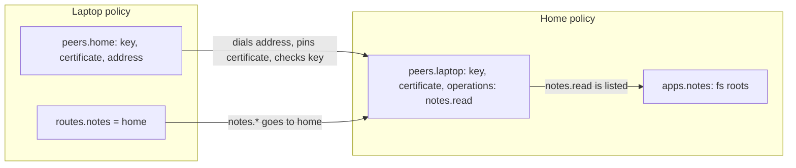

# Policy

The schema of the user's policy file: each app's outside-world access, the daemons this one is paired with, and which apps live on which peer. `workhorse install` decodes it strictly (unknown keys are errors) and hands it to the daemon inside the `Deployment`. It is a contract, so it holds no rules: `core` decides what a policy allows.

## Schemas

| Module          | Export                            | What it describes                                                                                     |
| --------------- | --------------------------------- | ----------------------------------------------------------------------------------------------------- |
| `names.ts`      | `AppName`, `RootName`, `PeerName` | Lower-case names, up to 63 characters. Names cannot contain `:` or `.`, so composites are unambiguous |
| `names.ts`      | `MethodName`                      | A public operation as a method, `<app>.<operation>`                                                   |
| `app-grants.ts` | `AppGrants`, `FsGrant`            | One app's outside-world access; today only `fs` roots and their mode                                  |
| `peer.ts`       | `PublicKey`                       | An Ed25519 public key: 32 raw bytes as unpadded base64url, 43 characters                              |
| `peer.ts`       | `Certificate`                     | One PEM certificate: the peer's self-signed TLS certificate, which this daemon pins                   |
| `peer.ts`       | `PeerAddress`                     | `host:port` to dial; a name, IPv4, or bracketed IPv6. Any network that reaches it works               |
| `peer.ts`       | `Peer`                            | A paired daemon: `key`, `certificate`, optional `address`, and the `operations` it may call here      |
| `policy.ts`     | `Policy`                          | `apps`, optional `peers`, optional `routes`                                                           |
| `index.ts`      | barrel                            | The folder's public API                                                                               |

## How a policy wires two daemons



- **`address` decides direction.** The side with `address` dials; once the link is up, both sides call over it.
- **`operations` is the peer's whole grant.** A peer may call only the listed public operations of apps on this daemon. An empty list, which pairing writes, allows nothing.
- **`routes` sends an app's operations to a peer.** A call that arrived over a link is never routed onward to another peer.
- **Checks across fields** (a route to an unknown peer, an operation of an app that is not installed, an app both installed and routed) are the CLI's job at install, because they need the installed apps.

The rules are in [Remote links](../../../../docs/architecture.md#remote-links) and [Policy and leases](../../../../docs/architecture.md#policy-and-leases).

## Usage

```json
{
  "apps": {},
  "peers": {
    "home": {
      "key": "kLhC7…43 characters",
      "certificate": "-----BEGIN CERTIFICATE-----\n…\n-----END CERTIFICATE-----\n",
      "address": "100.104.65.112:7841",
      "operations": []
    }
  },
  "routes": { "notes": "home" }
}
```

```ts
import { Policy } from "@workhorse/protocol";
import { Schema } from "effect";

const decode = Schema.decodeUnknownEffect(Schema.fromJsonString(Policy), {
  onExcessProperty: "error",
});
```
