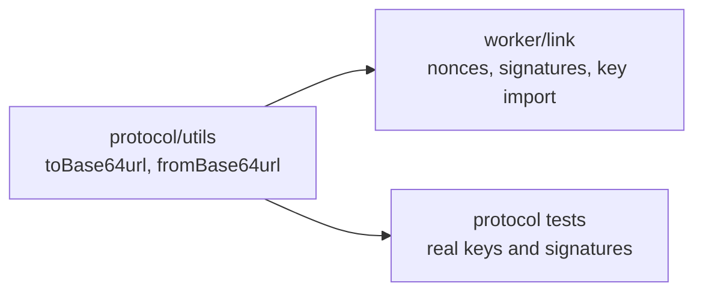

# Utilities

Bare utilities that more than one package needs. A function lives here only when it has no domain rules of its own and at least two callers; anything with rules belongs to its domain folder.

## Functions

| Module              | Function        | What it does                                                    |
| ------------------- | --------------- | --------------------------------------------------------------- |
| `to-base64url.ts`   | `toBase64url`   | Bytes to unpadded base64url (RFC 4648, section 5)               |
| `from-base64url.ts` | `fromBase64url` | Unpadded base64url back to bytes                                |
| `index.ts`          | barrel          | The folder's public API, re-exported from `@workhorse/protocol` |

## Who uses them



- **Why base64url:** keys, nonces and signatures cross links as JSON strings. The protocol fixes their encoding (see [Link](../link/README.md)), and the schemas in `policy/` and `link/` check it.
- **Portable:** they use only `btoa` and `atob`, which workerd, Bun and Node all provide, so the daemon, the CLI and tests share one implementation.
- **No validation:** `fromBase64url` trusts its input. Decode untrusted text with the matching schema (`PublicKey`, `Nonce`, `Signature`) first.

## Usage

```ts
import { fromBase64url, toBase64url } from "@workhorse/protocol";

const nonce = toBase64url(crypto.getRandomValues(new Uint8Array(32))); // 43 characters
const bytes = fromBase64url(nonce); // the same 32 bytes
```
