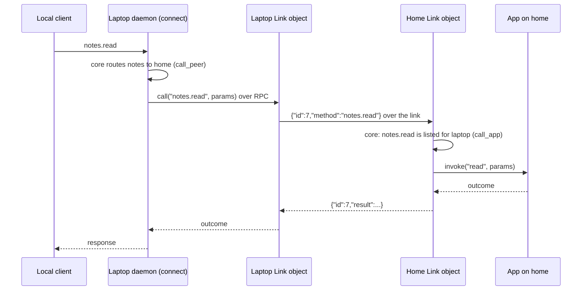

# Links in the daemon

How the daemon holds a standing link to each paired peer and carries calls over it in both directions. This folder performs what [core's link rules](../../../core/src/link/README.md) decide: it dials, accepts, signs, verifies, sends, and runs peer calls in apps. Design: [Remote links](../../../../docs/architecture.md#remote-links); evidence: spike 6 (`spike/link/FINDINGS.md`).

## Parts

| Module                                       | Export                               | Responsibility                                                                                              |
| -------------------------------------------- | ------------------------------------ | ----------------------------------------------------------------------------------------------------------- |
| `link-object.ts`                             | `Link`                               | The Durable Object for one peer, kept in memory for good. Accepts, dials and redials; answers `call`        |
| `session.ts`                                 | `Session`                            | One open WebSocket: ordered bounded queue, one consumer fiber, heartbeat, handshake deadline, pending calls |
| `perform-link-effect.ts`                     | `performLinkEffect`, `SessionPort`   | One handler per kind of effect from the rules                                                               |
| `session-deps.ts`                            | `SessionDeps`                        | What a session needs: env, apps here, this daemon's private key                                             |
| `accept-upgrade.ts`                          | `acceptUpgrade`, `ForwardToLink`     | The HTTPS handler: an upgrade from a paired key goes to that peer's `Link` object                           |
| `dial-peer.ts`                               | `dialPeer`                           | One dial through the peer's pinned TLS service, with a 5 s deadline                                         |
| `start-links.ts`                             | `startLinks`                         | Ask every dialed peer's `Link` object to dial; once per isolate, on the first connection                    |
| `call-peer.ts`                               | `callPeer`                           | A local client's call routed to a peer, through its `Link` object                                           |
| `redial-delay.ts`                            | `redialDelay`                        | 100, 250, 500, 1000 ms, then every 2 s                                                                      |
| `own-identity.ts`                            | `ownIdentity`                        | This daemon's key from the `IDENTITY` binding, imported for signing only                                    |
| `sign-transcript.ts`, `verify-transcript.ts` | `signTranscript`, `verifyTranscript` | Ed25519 over the handshake transcript, with WebCrypto                                                       |
| `fresh-nonce.ts`                             | `freshNonce`                         | 32 random bytes per link                                                                                    |
| `link-peer-of.ts`, `peer-name-by-key.ts`     | `linkPeerOf`, `peerNameByKey`        | The policy's peers, by name or by key                                                                       |
| `peer-header.ts`                             | `PEER_HEADER`                        | The internal header naming the peer of a forwarded upgrade; always overwritten                              |
| `link-error.ts`                              | `LinkError`                          | A link could not be opened                                                                                  |

## A call over a link



## Lifetime and failures

- **One object per peer**, named by the peer, in a namespace with `preventEviction`: without it workerd evicted the dialing side, link included, after about 140 s (spike 6).
- **Starting:** a new object does not dial by itself. `workhorse warm` connects after every daemon start, and that first connection asks every dialed peer's object to start.
- **Ordering:** socket callbacks only enqueue (at most 256 messages; more ends the session). One fiber applies the rules to each event and performs its effects before the next.
- **Heartbeats:** each side sends `link.ping` every 5 s once the link is open, and ends the session after 15 s without hearing anything.
- **Redial:** after a link that opened, the dialer redials 100 ms after it ends; after failures it backs off to every 2 s. A newer session replaces an older one.
- **`unavailable`:** a call while no link is open answers at once; a call without an answer in 10 s answers `unavailable`; calls are never queued.
- **Bounds:** at most 64 of this side's calls waiting, and 16 of the peer's calls running in apps here; more are refused.
- **Observable:** link open, link ended with its reason, refused upgrades and failed dials go to the daemon's log.

## Usage

```ts
// A local connection's call routed to a peer (connection.ts):
const outcome = yield * callPeer(env, "home", "notes.read", { path: "todo.md" });

// The first connection after a start (connection.ts):
yield * startLinks(env, deployment.policy);
```
