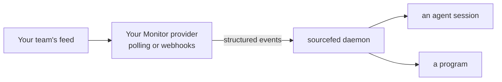
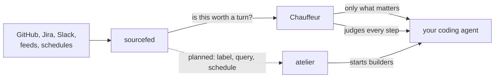
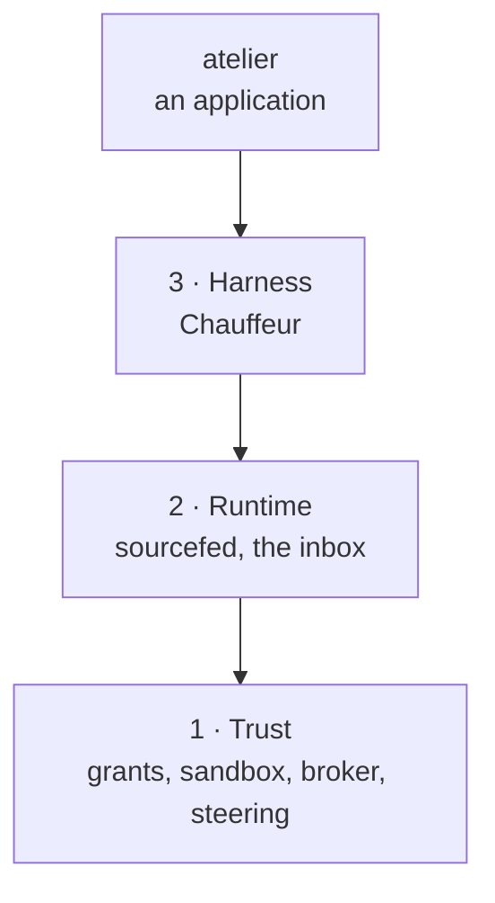

# Workhorse

Open projects for every coding agent

sourcefed · Chauffeur · atelier, and what ties them together

<!--
This isn't a pitch deck. It's a walk through three problems I hit every day with
coding agents, the tool I built for each, and how they work together.
-->

---
layout: center
---

# Your agent can't hear the world

  
A pull request
CI, reviews, conflicts

  
A Slack thread
the answer you were waiting for

  
A Jira ticket
status, comments, scope

  
Your inbox
the mail that matters

  
A schedule
every night at 02:00

You use Pi, OpenCode or the Codex CLI. A built-in PR watcher still leaves
Slack, Jira and your inbox outside the loop.
You copy the CI log in. You remind it to check the thread.

<!--
Say I'm in Pi, OpenCode or the Codex CLI. I open a PR. Nothing in the harness watches
it for me. Even if one does have a PR watcher, it doesn't watch a Slack thread, a
Jira ticket, or my inbox. So I end up being the agent's notification system.
-->

---
layout: demo
---

# sourcefed

**Any source, any agent.**

A few small primitives:

- a **monitor** watches one **source**
- each change is an **event**, delivered to a **target**: an agent's session, or a
  program
- the agent creates its own monitors as it works

The agent opens a pull request, then watches it. When CI fails, the failing log
arrives as a message, and the agent fixes it and pushes.

::right::

A real CI failure, delivered. Waiting time is sped up.

<!--
sourcefed gives any agent the information it needs from any source. Here the agent
made its own monitor for the PR it just opened. CI fails on GitHub, sourcefed hands
over the failing log, and the agent fixes it and pushes. Nobody copied anything.
-->

---
layout: demo
---

# Reviews, threads, tickets, feeds

| Source | Watches |
| --- | --- |
| GitHub | a PR, or every issue with a label |
| Slack | a thread, or a DM |
| Jira | a ticket, or a JQL query |
| Schedule | a cron time |
| Feeds | Gmail, RSS, Atom, JSON |

Plugins for OpenCode and Pi, MCP for Claude Code and Codex, HTTP for programs.

::right::

A review comment becomes the agent's next task.

<!--
Same idea for a review comment. And it isn't just GitHub: Slack threads, Jira tickets
and queries, schedules, Gmail and any other feed. It runs as a plugin in OpenCode and
Pi, over MCP in Claude Code and Codex, and over HTTP for programs. Every source is a
provider package on the same Monitor contract, so you can write a new one, or have
your agent write it.
-->

---

# Your source, the same primitives

Ask your agent to add a provider for your team's deployment feed.
The provider translates changes into events; sourcefed handles their delivery.

Each source is its own package, registered in the daemon. This is an extension
point for code, not a feed format every service has to adopt.

<!--
You can build your own feeds too, or have the agent do it. A new source implements
the Monitor contract and is registered in the daemon. It doesn't have to
reinvent the host adapters or event delivery.
-->

---
layout: center
---

# But not every event deserves a turn

A bot's comment. An approval. A status flip. The fifth "thanks!" in a thread.

And it isn't only events: agents stray on their own, too.

<!--
Once everything flows in, the next problem shows up: not every message is useful to
the agent, and every one costs a turn. Agents also wander off on their own. That's
where Chauffeur comes in.
-->

---

# Chauffeur

**It judges what your agent is about to do, and steps in when it matters.**

Each decision is a quick yes/no question to a fast judge such as Jev: about a third
of a second, not another agent turn.

  
Guard
shell rewrites, permissions, secrets kept from the judge

  
Steer
your own rules, tools it asks for, /goal and rulebooks

  
Save
only the skills it needs, warm caches, model failover

  
See
every decision audited, edits live without a restart

<!--
Chauffeur rides along with the agent. Before and after each step it asks small yes/no
questions of a fast decision model like Jev, which adds about a third of a second,
and acts on the answer. It does four kinds of things: it guards, it steers, it saves
tokens and money, and it shows you every decision. Let's go through them.
-->

---
layout: demo
---

# Agents write their own tools

GPT-6.1 Sol and Opus reach for `sed -i`, heredocs and `node -e` to write files, even
with the edit tool there and Code Mode on.

Chauffeur combines hard checks with small chains of judgments, using fast
decision models such as Jev before spending another agent turn.

When the next call rewrites a file through the shell, Chauffeur stops it and
points the agent to the edit tool, so the change stays reviewable.

::right::

A `sed` rewrite denied; the agent uses the edit tool.

<!--
Have you noticed this? Models like GPT-6.1 Sol, and Opus for that matter, slop out
their own writing tool even though one exists, even with Code Mode on. Chauffeur puts
a chain of judges in front of the agent, starting with fast decision models like Jev,
and checks each step against what you asked for. Here the next call is a sed rewrite,
so Chauffeur stops it and steers the agent to the edit tool.
-->

---
layout: demo
---

# Permissions, judged

Strict permissions mean a prompt every minute. YOLO mode means `rm -rf` is one bad
guess away.

A judge sits in between:

- **approves** what clearly serves your task
- **asks you** about the rest, such as `~/.ssh` or an unrelated folder
- **blocks** irreversible harm; a force-push to `main` always asks

Every decision lands in `chauffeur audit`.
These are harness-level checks, not an OS sandbox.

::right::

Task-related access outside the project, approved.

<!--
Permissions are either too restrictive, or you flip on YOLO mode and it's too risky.
That's the perfect place for a judge. It approves what you'd approve anyway, asks
about what you'd want to see, and blocks what you'd never allow.
-->

---
layout: demo
---

# Secrets stay out of the judge

Every judgment sends a little context to a model. Before it leaves, Chauffeur
replaces anything credential-shaped, such as an API key in your prompt, with
`REDACTED`.

It protects what the judge sees; the agent's own transcript is the agent's.

::right::

A key in the prompt; the judge's request shows `REDACTED`.

<!--
A judge is another model, so the context you send it matters. Anything that looks
like a credential is redacted before the request leaves. The right pane is the user
message as it arrived at the judge.
-->

---
layout: demo
---

# Your new tool, every time

A tool you keep reminding the agent to use becomes a rule:

**When:** after a tool call.

**Ask:** did it use a browser for X when `twitter-cli` does the job?

**Then:** steer it to `twitter-cli` and attach its skill.

Drop it in `~/.config/chauffeur/rules/` and the agent is steered onto the right path,
with the skill that shows how.

::right::

A browser fetch steered to `twitter-cli`.

<!--
You've got a cool new dev tool and you keep having to remind the agent to use it.
Write a rule once and Chauffeur steers it onto the right path every time, and hands
over the skill too.
-->

---
layout: demo
---

# Ask for what's missing

With `ask_chauffeur`, the agent asks in plain words for a tool or skill it lacks,
such as "a way to post to Slack", and gets the one that fits.

The agent doesn't need every tool in its prompt to find the one it needs.

::right::

The agent asks for a way to post to Slack, and finishes the handoff with `slackcli`.

<!--
Rules push the agent toward tools. ask_chauffeur lets it pull: it describes what it
needs, and Chauffeur grants the matching tool or skill.
-->

---
layout: demo
---

# Rulebooks: /goal and your own

**`/goal <objective>`** keeps the agent working until the objective is met:

- it breaks the work into todos, and can't finish while one is open
- it ends once the evidence shows the goal is met
- it pauses when only you can unblock it, and stops after 20 continuations

A project can add its own, such as `/release`: bump the version, update the
changelog, run the tests, tag, then check the evidence.

::right::

`/goal` resumes unfinished work, then verifies the whole suite passes.

<!--
A rulebook is a set of rules you switch on for one session with a slash command.
/goal stops the agent from declaring victory early: it keeps going until the evidence
says the goal is met, pauses when it needs you, and gives up after 20 rounds with a
summary. Projects write their own, like /release.
-->

---
layout: demo
---

# The right skill, without the token bill

Chauffeur reads each message and attaches only the skills it needs. Everything else
stays out of the prompt:

- the full skill list is hidden
- tools a task won't use are hidden, and come back when a later message needs them
- the longest tool descriptions are replaced with shorter ones

On longer tasks: **29% fewer input tokens**, **19% faster**, the same or better pass
rate. A session's first request is **44–48% smaller**.

::right::

A question about a Jira ticket gets the `jira-cli` skill, and nothing else.

<!--
Most people don't know how much of every request is skills and tool descriptions the
agent never uses. Chauffeur reads the message, attaches only the skills it needs,
hides the rest, and trims the longest tool descriptions. Measured on a benchmark:
29% fewer input tokens and 19% faster on longer tasks, with the same or better pass
rate.
-->

---
layout: demo
---

# Warm caches, cheap returns

Step away for a few minutes and the prompt cache expires: the next message pays to
send the whole conversation again.

- While a session is idle, Chauffeur keeps the cache warm, as long as that's cheaper
  than re-sending.
- After it expires on a long conversation, a cheaper model summarizes it first; your
  prompt still runs on your model.

After 6½ minutes away: **7,625 tokens read from cache**, not 2,816 written again.

::right::

The next prompt reads its cache; later, a cheap summary replaces an expired one.

<!--
Prompt caching only pays while the cache is warm, and most providers expire it after
a few idle minutes. Chauffeur keeps it warm while that's cheaper than re-sending, and
when it has expired on a long conversation, has a cheaper model summarize it before
your own model runs. In a real Sonnet session, the prompt after a 6 and a half minute
break read 7,625 tokens from cache; with warming off, 2,816 tokens had to be written
again.
-->

---
layout: demo
---

# Past usage limits

A usage limit covers the whole provider account. When the agent hits one,
Chauffeur:

- switches to the same tier on another provider you use, recommended models first
- falls back to free models only when nothing else is left
- skips models you blacklisted, even when pinned
- switches back once the limit has likely cleared

::right::

Opus hits a limit, then GPT-6.1 Sol; the task still finishes.

<!--
Usage limits are per account, so retrying the same provider doesn't help. Chauffeur
moves the session to the same tier on another provider you pay for, uses free models
only as a last resort, and moves back when the limit clears. In this clip a local
endpoint stands in for Anthropic's limit; the GPT-6.1 Sol limit after it is real.
-->

---

# And quietly

  
Cheaper subagents
routine searching, reading and mechanical edits go to a cheaper model from the same provider, such as Sonnet under Opus

  
Questions with options
an agent that ends its turn asking you something in plain text is steered to the question tool, so you pick an option and it carries on

  
Clean test sessions
when the agent tests OpenCode against your real data and leaves sessions behind, it is resumed to delete them

<!--
Some of the most useful things are invisible. Subagents doing routine work run on a
cheaper model. Questions arrive as options you can click. And test sessions the agent
created get cleaned up.
-->

---
layout: demo
---

# See every decision

`chauffeur audit --follow --brief` shows each decision as it happens: what was
asked, the answer, and how long it took.

Rules, rulebooks, permission contracts and every word Chauffeur says are config.
Edits apply within a second, without a restart.

::right::

The live audit feed, beside the agent it judges.

<!--
Nothing Chauffeur does is hidden. Every decision is logged with the questions it
asked and how long they took, and you can watch the feed live. Everything it says
and decides is config you can edit, and edits apply without a restart.
-->

---
layout: demo
---

# sourcefed, through Chauffeur

Chauffeur sets up monitors for the PR, Jira ticket or Slack thread you are working
on.
In OpenCode, before sourcefed delivers an event, it asks Chauffeur whether the agent
needs to act on it, so bot comments, approvals and status churn stay out.

The PR is a real one, and so is its CI failure.

::right::

A real CI failure resumes the agent to fix and push.

<!--
And this is where the two meet. Chauffeur creates the monitors itself and gates what
comes through, so the agent only hears about events worth a turn.
-->

---
layout: center
---

# Same gates, every project

Format, lint, tests, docs: in every Rust project, the checks are the same.

How do you push code out as fast as agents can write it, and keep the process as
deterministic as possible?

<!--
Now you have all of this. But your process, the CI and the checks you use for
correctness, is pretty much the same in every project of a language. How do you run
it so it's as deterministic as possible while still shipping fast? That's atelier.
-->

---
layout: demo
---

# atelier

**A personal software factory: a labelled issue becomes a proven pull request.**

Label an issue `atelier:build`. Within a minute, a builder agent is working on it in
its own worktree, from the base branch. It opens a draft PR and fixes what CI
reports.

The agent writes the code. Everything around it is atelier's: claiming the issue,
branching, running the checks, and deciding when the work is done.

::right::

An issue claimed: labels swapped, the builder's session and branch commented.

<!--
atelier is a personal software factory. Label an issue and a builder agent picks it
up in its own worktree and opens a PR. The agent only writes the change; the factory
around it is deterministic code.
-->

---
layout: demo
---

# How the factory stays high quality

- **The agent can't declare itself done.** It marks the PR ready only after atelier
  tells it every check passed; a person merges.
- **One set of gates per project**, listed once. Their fixes run before every
  commit, and CI runs each gate as its own check.
- **The rules come from the base branch,** so a branch or a PR can't loosen the
  limits it runs under.
- **Every step is saved before it acts,** so a crash resumes instead of repeating.

Next: **pipelines** of steps, and runs started by **sourcefed**.

::right::

`check` fails on an unformatted table, and `fix` fixes it.

<!--
What makes it a high-quality factory rather than a fast one: the agent never grades
its own work. atelier applies the gates' fixes before each commit, runs every gate in CI, tells the
builder when everything passed, and a person merges. The config comes from the base
branch, so a PR can't relax its own checks, and every step is saved before it acts.
Next come pipelines, and runs started by sourcefed: a label, a Jira query or a 2
a.m. schedule.
-->

---

# Better together

Each one works alone. Together, the agent hears what changed, stays on course, and
ships through the same gates every time.

<!--
Each of these is useful on its own. Together: sourcefed hears the world, Chauffeur
decides what reaches the agent and keeps it on course, and atelier turns the work
into proven pull requests.
-->

---
layout: two-cols
---

# Workhorse

Open protocols and open projects, for every coding harness you use.

Each project works on its own, or with the others.

Underneath: three layers of open protocols, trust first.

::right::

<!--
That's Workhorse: open protocols and open projects that apply to every coding harness
you own. Each can help you on its own, or they work together.
-->

---

# What's next

- **atelier**: pipelines of steps, then runs started by sourcefed
- **Chauffeur v2**: the same behavior, rebuilt as an engine of judges, adapters for
  Pi, Claude Code and Codex
- **sourcefed**: one triage for every host, through Chauffeur
- **Workhorse**: milestone 1, Contained: grants, sandbox and the broker
- **wrkhse**: every project in one GitHub organization

---
layout: section
---

# Under the hood

Two internal tools for building all of this

---

# tack and rungs

### tack

One interface to write an agent plugin once and run it in every harness: OpenCode,
Pi, Claude Code and Codex.
It's how these tools reach every agent without a port per harness.

### rungs

A small step machine: plans of steps that wait on earlier outcomes.
`no_std`, no allocation, no dependencies, every run proven to end with Kani.
It is the shared foundation for atelier's pipelines and Chauffeur's strategies.

<!--
Two internal tools, not the point of the talk. tack is how the plugins reach every
harness from one definition. rungs is the step machine inside atelier's pipelines and
Chauffeur's strategies.
-->

---
layout: center
---

# Read more

Every project's docs, in one place: <a href="/" target="_self">the Workhorse hub</a>
