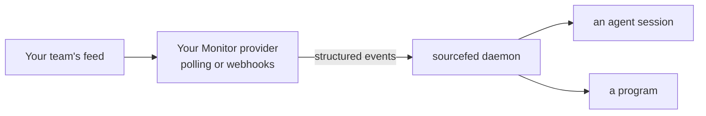
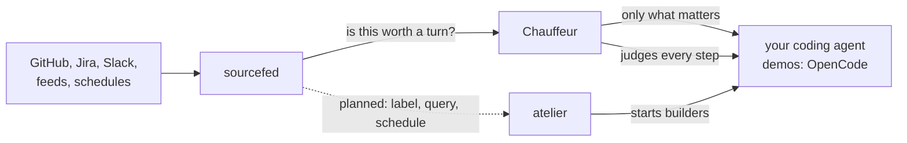
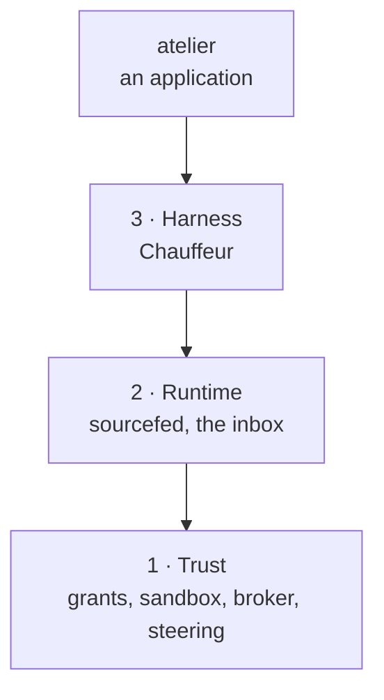

# Workhorse

Open projects for every coding agent

sourcefed · Chauffeur · atelier, and what ties them together

<!--
This isn't a pitch deck. It's a walk through three problems I hit every day with
coding agents, the tool I built for each, and how they work together.
-->

---
layout: center
---

# Your agent can't hear the world

  
A pull request
CI, reviews, conflicts

  
A Slack thread
the answer you were waiting for

  
A Jira ticket
status, comments, scope

  
Your inbox
the mail that matters

  
A schedule
every night at 02:00

You use Pi, OpenCode or the Codex CLI. A built-in PR watcher still leaves
Slack, Jira and your inbox outside the loop.
You copy the CI log in. You remind it to check the thread.

<!--
Say I'm in Pi, OpenCode or the Codex CLI. I open a PR. Nothing in the harness watches
it for me. Even if one does have a PR watcher, it doesn't watch a Slack thread, a
Jira ticket, or my inbox. So I end up being the agent's notification system.
-->

---
layout: demo
---

# sourcefed

**Any source, any agent.**

A few small primitives:

- a **monitor** watches one **source**
- each change is an **event**, delivered to a **target**: an agent's session, or a
  program
- the agent creates its own monitors as it works

The agent opens a pull request, then watches it. When CI fails, the failing log
arrives as a message, and the agent fixes it and pushes.

::right::

A real CI failure, delivered. Waiting time is sped up.

<!--
sourcefed gives any agent the information it needs from any source. Here the agent
made its own monitor for the PR it just opened. CI fails on GitHub, sourcefed hands
over the failing log, and the agent fixes it and pushes. Nobody copied anything.
-->

---
layout: demo
---

# Reviews, threads, tickets, feeds

| Source | Watches |
| --- | --- |
| GitHub | a PR, or every issue with a label |
| Slack | a thread, or a DM |
| Jira | a ticket, or a JQL query |
| Schedule | a cron time |
| Feeds | Gmail, RSS, Atom, JSON |

Plugins for OpenCode and Pi, MCP for Claude Code and Codex, HTTP for programs.

::right::

A review comment becomes the agent's next task.

<!--
Same idea for a review comment. And it isn't just GitHub: Slack threads, Jira tickets
and queries, schedules, Gmail and any other feed. It runs as a plugin in OpenCode and
Pi, over MCP in Claude Code and Codex, and over HTTP for programs. Every source is a
provider package on the same Monitor contract, so you can write a new one, or have
your agent write it.
-->

---

# Your source, the same primitives

Ask your agent to add a provider for your team's deployment feed.
The provider translates changes into events; sourcefed handles their delivery.

Each source is its own package, registered in the daemon. This is an extension
point for code, not a feed format every service has to adopt.

<!--
You can build your own feeds too, or have the agent do it. A new source implements
the Monitor contract and is registered in the daemon. It doesn't have to
reinvent the host adapters or event delivery.
-->

---
layout: center
---

# But not every event deserves a turn

A bot's comment. An approval. A status flip. The fifth "thanks!" in a thread.

And it isn't only events: agents stray on their own, too.

<!--
Once everything flows in, the next problem shows up: not every message is useful to
the agent, and every one costs a turn. Agents also wander off on their own. That's
where Chauffeur comes in.
-->

---
layout: demo
---

# Chauffeur

**Agents write their own tools.**

GPT-6.1 Sol and Opus reach for `sed -i`, heredocs and `node -e` to write files, even
with the edit tool there and Code Mode on.

Chauffeur combines hard checks with small chains of judgments, using fast
decision models such as Jev before spending another agent turn.

When the next call rewrites a file through the shell, Chauffeur stops it and
points the agent to the edit tool, so the change stays reviewable.

::right::

Chauffeur v1, OpenCode: a `sed` rewrite denied; the agent uses the edit tool.

<!--
Have you noticed this? Models like GPT-6.1 Sol, and Opus for that matter, slop out
their own writing tool even though one exists, even with Code Mode on. Chauffeur puts
a chain of judges in front of the agent, starting with fast decision models like Jev,
and checks each step against what you asked for. Here the next call is a sed rewrite,
so Chauffeur stops it and steers the agent to the edit tool.
-->

---
layout: demo
---

# Permissions, judged

Strict permissions mean a prompt every minute. YOLO mode means `rm -rf` is one bad
guess away.

A judge sits in between:

- **approves** what clearly serves your task
- **asks you** about the rest, such as `~/.ssh` or an unrelated folder
- **blocks** irreversible harm; a force-push to `main` always asks

Every decision lands in `chauffeur audit`.
These are harness-level checks, not an OS sandbox.

::right::

Chauffeur v1, OpenCode: task-related access outside the project, approved.

<!--
Permissions are either too restrictive, or you flip on YOLO mode and it's too risky.
That's the perfect place for a judge. It approves what you'd approve anyway, asks
about what you'd want to see, and blocks what you'd never allow.
-->

---
layout: demo
---

# Your new tool, every time

A tool you keep reminding the agent to use becomes a rule:

**When:** after a tool call.

**Ask:** did it use a browser for X when `twitter-cli` does the job?

**Then:** steer it to `twitter-cli` and attach its skill.

Drop it in `~/.config/chauffeur/rules/` and the agent is steered onto the right path,
with the skill that shows how.

::right::

Chauffeur v1, OpenCode: a browser fetch steered to `twitter-cli`.

<!--
You've got a cool new dev tool and you keep having to remind the agent to use it.
Write a rule once and Chauffeur steers it onto the right path every time, and hands
over the skill too.
-->

---
layout: demo
---

# sourcefed, through Chauffeur

Chauffeur sets up monitors for the PR, Jira ticket or Slack thread you are working
on.
In OpenCode, before sourcefed delivers an event, it asks Chauffeur whether the agent
needs to act on it, so bot comments, approvals and status churn stay out.

The PR is a real one, and so is its CI failure.

::right::

Chauffeur v1, OpenCode: a real CI failure resumes the agent to fix and push.

<!--
And this is where the two meet. Chauffeur creates the monitors itself and gates what
comes through, so the agent only hears about events worth a turn.
-->

---
layout: center
---

# Same gates, every project

Format, lint, tests, docs: in every Rust project, the checks are the same.

How do you push code out as fast as agents can write it, and keep the process as
deterministic as possible?

<!--
Now you have all of this. But your process, the CI and the checks you use for
correctness, is pretty much the same in every project of a language. How do you run
it so it's as deterministic as possible while still shipping fast? That's atelier.
-->

---
layout: demo
---

# atelier

**A labelled issue becomes a proven pull request.**

Label an issue `atelier:build`. Within a minute, a builder agent is working on it in
its own worktree.
It opens a draft PR, fixes what CI reports, and marks it ready once atelier says
every check passed.

The loop is code, not a prompt: atelier claims, branches, checks and closes, and the
agent does the writing.

::right::

An issue claimed: labels swapped, the builder's session and branch commented.

<!--
atelier is a personal software factory. Label an issue and a builder agent picks it
up in its own worktree, opens a PR, fixes CI and marks it ready. The steps around the
agent are deterministic code.
-->

---
layout: demo
---

# One set of gates

A project lists its gates once. The builder runs them before committing and
fixes what it can; GitHub independently runs each as its own check.

Next:

- **pipelines** of steps, such as a nightly security audit next to the build
- **triggers from sourcefed**: a label, a JQL query or a schedule starts a run within
  moments

::right::

`check` fails on an unformatted table, and `fix` fixes it.

<!--
The gates are the same everywhere, so atelier runs them for every commit and every
PR. Next come pipelines, and triggers from sourcefed, so a label, a Jira query or a 2
a.m. schedule starts a run.
-->

---

# Better together

Each one works alone. Together, the agent hears what changed, stays on course, and
ships through the same gates every time.

<!--
Each of these is useful on its own. Together: sourcefed hears the world, Chauffeur
decides what reaches the agent and keeps it on course, and atelier turns the work
into proven pull requests.
-->

---
layout: two-cols
---

# Workhorse

Open protocols and open projects, for every coding harness you use.

Each project works on its own, or with the others.

Underneath: three layers of open protocols, trust first.

::right::

<!--
That's Workhorse: open protocols and open projects that apply to every coding harness
you own. Each can help you on its own, or they work together.
-->

---

# What's next

- **atelier**: pipelines of steps, then runs started by sourcefed
- **Chauffeur v2**: the same behavior, rebuilt as an engine of judges, adapters for
  Pi, Claude Code and Codex
- **sourcefed**: one triage for every host, through Chauffeur
- **Workhorse**: milestone 1, Contained: grants, sandbox and the broker
- **wrkhse**: every project in one GitHub organization

---
layout: section
---

# Under the hood

Two internal tools for building all of this

---

# tack and rungs

### tack

One interface to write an agent plugin once and run it in every harness: OpenCode,
Pi, Claude Code and Codex.
It's how these tools reach every agent without a port per harness.

### rungs

A small step machine: plans of steps that wait on earlier outcomes.
`no_std`, no allocation, no dependencies, every run proven to end with Kani.
It is the shared foundation for atelier's pipelines and Chauffeur's strategies.

<!--
Two internal tools, not the point of the talk. tack is how the plugins reach every
harness from one definition. rungs is the step machine inside atelier's pipelines and
Chauffeur's strategies.
-->

---
layout: center
---

# Read more

Every project's docs, in one place: <a href="/" target="_self">the Workhorse hub</a>
