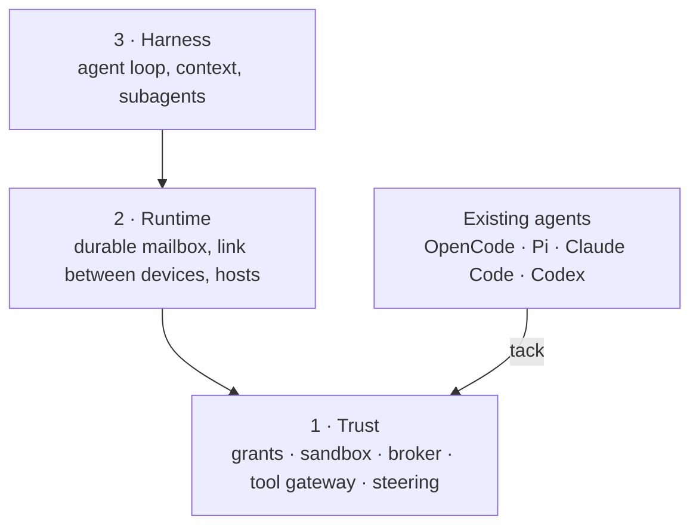
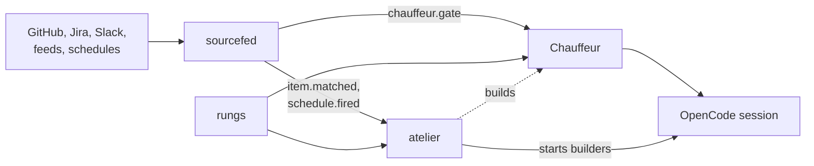

# Workhorse

Safe, steerable, observable coding agents

<div class="opacity-70 mt-6">A family of small projects, each in its own repository</div>

---

# The problem

Agents make code cheap. They don't make it trustworthy.

<v-clicks>

- **Non-deterministic quality.** Coding is not solved; the same prompt gives
  different code.
- **They miss the larger picture.** Agents focus on the wrong details and
  don't learn from mistakes the way people do.
- **Hidden work.** What an agent did, and why, is often invisible.
- **Too much reach.** An agent can touch whatever its machine can: files,
  network, secrets.

</v-clicks>

---

# The philosophy

What makes something easy for people to get right makes it _really_ easy for
agents. What people get wrong, agents get wrong more often.

<v-clicks>

- **Hard boundaries.** Each module owns one job and says what it does not own.
- **Strict APIs.** Make the wrong decision hard to express.
- **Nothing hidden.** Whatever an agent does, a person can see and change.
- **Proof.** Done means an executed check that would fail if it broke.

</v-clicks>

---
layout: two-cols
---

# Three layers of open protocols

Each layer depends only on those below it, and each works without those
above it.

Trust comes first: one developer running existing agents on a laptop and a
home server, who wants them safe, steerable and observable.

::right::



---

# The family

| Project | What | Status |
| --- | --- | --- |
| **Workhorse** | Open protocols: trust, runtime, harness | Direction agreed |
| **atelier** | A labelled issue becomes a proven pull request | Slice 3 in progress |
| **rungs** | A small, proven step machine | `v0.1.0` released |
| **sourcefed** | What changed in GitHub, Jira, Slack, feeds, schedules | `0.5.1` |
| **Chauffeur** | Judges what an agent is doing and steers it | Slice 2 next |
| **tack** | One plugin, every coding agent | Designed |

---

# atelier

A personal software factory.

- **What:** label an issue `atelier:build`; a builder agent works in its own
  worktree, opens a pull request, fixes what CI reports and marks it ready.
- **Why:** issues in, proven pull requests out, with the owner reviewing
  rather than typing.
- **Status:** slices 0 to 2 implemented; slice 3, pipelines made of steps, in
  progress; slice 4 triggers runs from sourcefed.

---

# rungs

A step machine small enough to prove.

```rust
let plan = Plan::new([
    Step::new(2),
    Step::new(2).after([Need::outcome(0, [Outcome(1), Outcome::FAILED])]),
])?;

let mut run = plan.start();
assert_eq!(run.advance(), [0]);   // start fast
run.settle(0, Outcome(1))?;       // unsure
assert_eq!(run.advance(), [1]);   // start sure
```

- **Why:** atelier's pipelines and Chauffeur's strategies are the same shape.
- **Status:** `v0.1.0` released. `no_std`, no allocation, no dependencies,
  every run proven to end with Kani.

---

# sourcefed

How does an agent hear that something changed?

- **What:** monitors on GitHub pull requests and issues, Jira, Slack, feeds
  and schedules; a daemon with HTTP RPC and an event stream.
- **Why:** no more copying CI logs or reminding the agent to check its pull
  request. Programs such as atelier follow the same events.
- **Status:** `0.5.1`: issue collections, Jira queries, schedules and
  programs as targets.

---

# Chauffeur

Steers a coding agent as it works: sense, classify, act.

- **What:** a daemon reads the harness's events, asks fast and careful judges,
  and acts: attach skills, compact a cold session, stop a destructive
  command, hold back noise.
- **Why:** the right context at the right moment, without the agent having
  to ask for it.
- **Status:** `v2` slices 0 and 1 implemented; slice 2 triages sourcefed's
  events.

---

# tack

Write a coding-agent plugin once.

- **What:** one plugin definition becomes a native plugin for OpenCode, Pi,
  Claude Code and Codex.
- **Why:** it carries Workhorse's steering and tool routing into the agents
  people use today.
- **Status:** designed; OpenCode first, in Workhorse's third milestone.

---

# How they connect



---

# Where each sits

| Project | Place in Workhorse |
| --- | --- |
| rungs | A contract in layer 1's style: pure, no I/O, proven |
| sourcefed | Layer 2: the inbox |
| Chauffeur | Layer 3: the harness's context, beside steering |
| atelier | An application above all three |
| tack | The bridge from today's agents into layer 1 |

---

# What's next

<v-clicks>

- **atelier** finishes pipelines on rungs, then starts runs from sourcefed.
- **Chauffeur** triages sourcefed's events, then escalates on rungs.
- **Workhorse** builds milestone 1, Contained: grants, sandbox, broker.
- **wrkhse**: the projects move to one GitHub organisation, a one-line
  change for this hub.

</v-clicks>

---
layout: center
---

# Read more

The docs for every project: <a href="/" target="_self">the hub</a>
