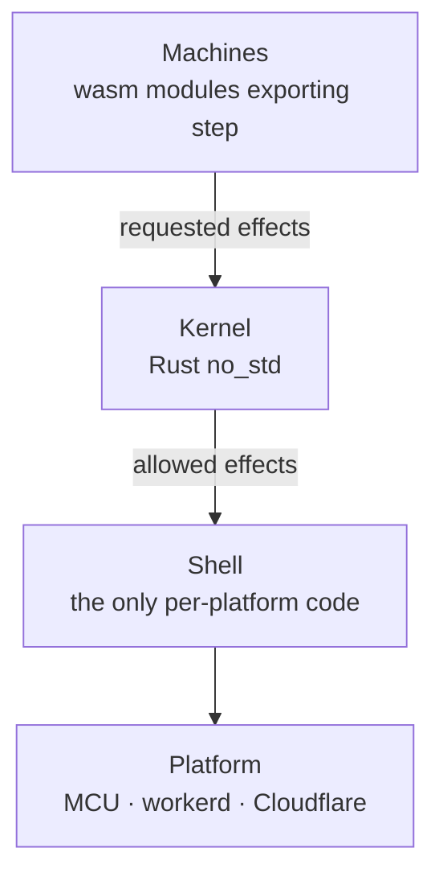
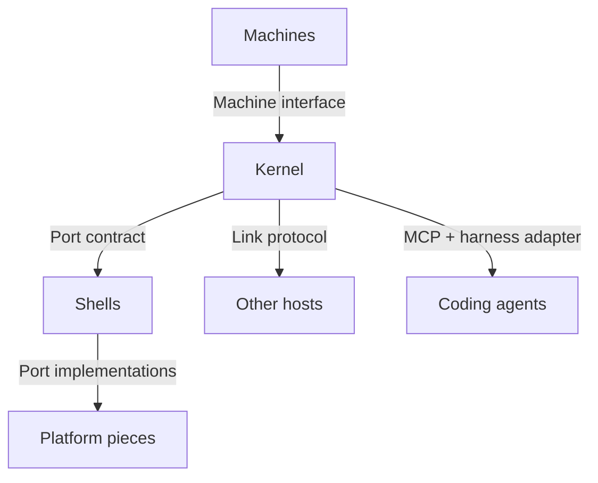
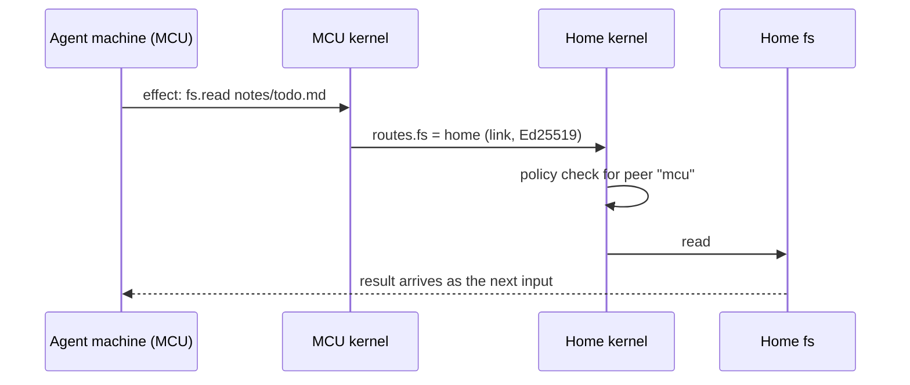
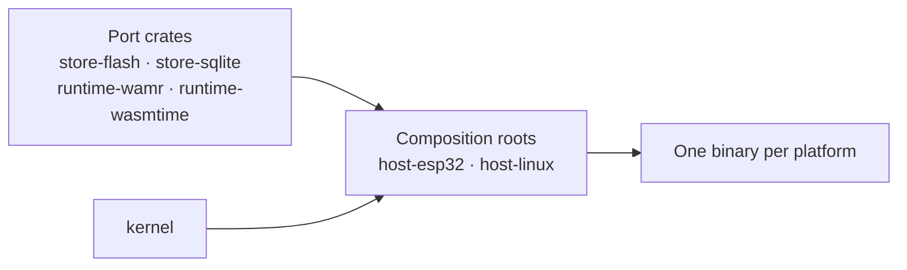

# Uniform stack

**Status:** proposal, under discussion. It does not yet replace [`ARCHITECTURE.md`](../ARCHITECTURE.md) or [`daemon/docs/architecture.md`](../daemon/docs/architecture.md). Nothing here is built.

## Pitch

Workhorse is a set of open contracts for durable agents. An agent is a log plus an inbox. Its capabilities are granted to it; it has no ambient access. Any host that implements the contracts can run, pause and move it: a microcontroller, a laptop daemon, a Durable Object, or Lambda.

[Infinity](https://github.com/hydro-project/infinity) is one runtime: it owns the agent loop, is tied to AWS, and leaves security to whoever deploys it. In Workhorse terms it would be one host. Workhorse's value is the contracts and the capability and policy layer above them.

## Principles

| Principle | Rule |
|---|---|
| One stack | Every host runs the same three pieces: machines, kernel, shell |
| Power is ports | A host's power is the set of ports its shell implements. No profiles, no feature flags |
| One boundary shape | Every boundary is a contract, a conformance suite, and its implementations |
| Contracts are data | Every contract is a schema in `protocol`, so any language can implement it |
| Pluggable only when real | A boundary becomes pluggable when two real implementations exist; until then it has only its contract |
| Smallest host | A microcontroller (ESP32-class: about 512 KB SRAM, a few MB PSRAM, no OS processes) |
| Harnesses outside | The base defines the step contract; harnesses supply the loop logic |

## The stack



| Piece | Same on every host | What it is |
|---|---|---|
| Protocol | Yes | JSON-RPC 2.0 lines, `capability.operation` names, the four error codes, mailbox semantics, the port contract |
| Machines | Yes | Apps and agents: `step(state, input) → (state, effects)`, never doing I/O themselves |
| Kernel | Yes | Pure rules for policy, routing, mailboxes, tasks, durability, link sessions and trust-boundary parsing. Native wherever the shell is Rust (MCU, native shell). Wasm only where the shell is JavaScript (workerd, Cloudflare), which run nothing else |
| Shell | No | Performs effects: storage, timers, sockets, `fetch`. Nothing else varies between hosts |
| Conformance | Yes | One black-box suite, run against every shell |

## Boundaries



| Boundary | Contract | Implementations | Proof |
|---|---|---|---|
| Machine ↔ Kernel | Machine interface: `alloc`, `step`, JSON inputs and effects, memory and CPU limits | Machine SDKs: Rust first | Machine interface suite |
| Kernel ↔ Shell | Port contract: effect families and ordering rules | Shells: workerd, native Rust | Shell suite: the kernel's test vectors replayed through a real shell |
| Shell ↔ Platform | One port per effect family | Port crates: flash, SQLite, Durable Object storage, WAMR, V8, wasmtime | Port suites, such as the storage suite |
| Host ↔ Host | Link protocol | Transports: WebSocket | Conformance over a link |
| Host ↔ Agent | MCP, plus the harness adapter; ACP later | unagent, one output per harness | unagent's fidelity matrix |
| Policy ↔ OS | Universal sandbox policy | nono (macOS), bubblewrap (Linux), none (MCU) | Escape probes |

| Boundary | Pluggable today | Reason |
|---|---|---|
| Storage, wasm runtime, shell, sandbox, harness | Yes | Two or more real implementations each |
| Transport | No | WebSocket only; iroh was rejected in spike 2 |
| Machine SDK | No | Rust only so far |

## Port contract

The kernel never calls a port. It returns effects, and their outcomes come back as the next inputs. The shell contract therefore needs no runtime adapter layer; it is data:

1. **Effect families.** Each family is one port.
2. **Ordering.** Effects arrive in batches; a batch completes before the next starts. This carries "saved before shown" into every shell.
3. **Results.** Every effect's outcome comes back as an input.

| Port | Effects | Bound by |
|---|---|---|
| `store` | Atomic commit, append log, key-value | Every host |
| `alarm` | One alarm at the earliest due time, monotonic clock | Every host |
| `entropy` | Random bytes for link nonces and IDs | Every host |
| `ingress` | Accept clients, reply, deliver | Every host |
| `machine` | Load wasm, run `step` within limits | Every host |
| `net` | Outbound HTTP; the shell adds secrets by name | Hosts with a network |
| `link` | Byte stream to a peer | Hosts with peers |
| `fs` | Named roots | Laptop and home |

A shell announces its ports at startup. The kernel routes an operation whose port is missing to a peer through `routes`, or returns `-32003 unavailable`. Ed25519 signing for links runs in the kernel; it needs only `entropy`.

Rust traits for the ports are a convenience for Rust shells, not the definition.

## Hosts

| Host | Shell | Bound locally | Routed to a peer |
|---|---|---|---|
| Microcontroller | Rust on ESP-IDF: flash log, TLS, WebSocket | `store`, `alarm`, `entropy`, `ingress`, `machine`, `net`, `link` | `fs`, deciders, heavy apps |
| Laptop / home (NixOS) | workerd: today's `worker` | Every port | Whatever `routes` says |
| Cloud | Cloudflare: the same bundle | Every port except `fs` | `fs` to laptop or home |



Shells are composition roots. Port crates depend only on the port contract, never on each other, and each platform binary selects its ports in one place.



| Shell | Covers | Note |
|---|---|---|
| workerd (TypeScript) | Laptop, home, Cloudflare | Durable Object storage, Dynamic Workers, `fetch`; the kernel runs inside as wasm |
| Native Rust | MCU; later Linux and macOS with `std` | Can replace workerd on Linux if its budget gap matters, without a third shell |

## Machines

| Concern | Decision |
|---|---|
| Format | Plain core wasm modules exporting `alloc` and `step`, with JSON inputs and effects. Not the component model: WAMR and V8 do not run components natively |
| Runtimes | WAMR on an MCU, V8 in workerd and Cloudflare, wasmtime on native hosts |
| Limits | Memory capped by a maximum page count. CPU capped by the shell's deadline: workerd's CPU limit, `wasm_runtime_terminate` in WAMR |
| JSON | A small JSON crate rather than full `serde_json`, which adds an estimated 100–200 KB per machine |
| Sandbox | A step cannot perform I/O; it can only return effects the kernel checks against policy |
| Model calls | `net.fetch` to the provider; the shell adds the key. No separate model concept |
| Tools | Calls to `capability.operation`, local or routed |
| Events and subagents | Mailboxes, with the originating call recorded |
| Waiting | A `task` with a due time. A waiting agent is only saved state |
| Agent loop | A machine. Native builds remain for Workhorse's own harnesses, outside the base |

## Agent contract

```text
step(log, inbox batch) → (appended entries, effects)
effects: net.fetch · capability.operation call · mailbox publish · task wake
results arrive as inbox entries
```

| Rule | Decision |
|---|---|
| Log | Append-only JSON Lines with byte-stable history, so prompt caches hold and the log can move between hosts |
| Checkpoints | A checkpoint entry type lets a harness compact and a host truncate storage |
| Ordering | Host-assigned sequence numbers, never wall-clock time |
| Compaction, prompting, model choice | The harness's step implementation, outside the base |

## Sandbox

One policy, declared in the app manifest and approved at install, compiled to a backend chosen by the host:

| Field | Meaning |
|---|---|
| Filesystem | Named roots, read or read-write |
| Egress | Hosts, methods and paths, enforced by the broker in `net.fetch` |
| Credentials | Names only; values stay in the shell |
| Resources | Memory and CPU limits |
| Approvals | Actions that need a human decision |

| Host | Backend | Note |
|---|---|---|
| macOS | nono (Seatbelt) | Approved as the first backend |
| Linux | bubblewrap mount namespace, or nono in supervisor mode | Spike 1: a self-sandboxed nono process can still connect to pathname Unix sockets on Linux, and resolved DNS through `/var/run/nscd/socket` on NixOS |
| MCU | None | The kernel is the boundary |
| Later | nvx or microvm.nix | Only if native processes for agents are needed |

Kernel sandboxes filter by port, not hostname, so no backend enforces network policy in the kernel: each blocks direct network access, and all egress goes through the broker.

## Harnesses

| Concern | Decision |
|---|---|
| Driving sessions | ACP, adopted as-is. Deferred |
| Hooking sessions | The harness adapter (unagent): manifest plus TypeScript SDK, with a runtime bridge only for harnesses that run hooks as commands |
| Independence | unagent is independent of the daemon; the daemon is one plugin author among many |
| Synchronous hooks | Deterministic only. An LLM in `tool.before` costs about 1–3 s × 50 calls per turn |
| Push | Daemon emits, adapter delivers now, next or on wake: as a synthetic tool call where the harness allows, otherwise as a user-style message |
| Offline daemon | Each hook action declares whether it fails open or closed |
| Override ratio | If more than about 30% of a plugin is harness-specific overrides, the universal layer is not paying for itself |

## Modules

| Rust workspace | Role |
|---|---|
| `kernel` | Pure rules, `no_std` |
| `kernel-wasm` | Kernel glue for workerd |
| `protocol` | Contract types (see [Open questions](#open-questions)) |
| `machine` | Machine SDK and interface glue |
| `ports/*` | One crate per port implementation |
| `hosts/*` | Composition roots: `esp32`, `linux` |
| `cli` | `workhorse`: install, pair, warm, stdio relay, sandbox backends |
| `loop` | Agent loop, built as a machine |
| `machines/*` | sourcefed, chauffeur |

| TypeScript workspace | Role |
|---|---|
| `shell-workerd` (today's `worker`) | Composition root for workerd and Cloudflare |
| `conformance` | Host suite and shell suite |
| `sdk` | Client and mailbox sequence tracking |
| `unagent` | Harness adapter, independent |
| `tools`, `smoke` | Lint rules and hand-run demos |

## Existing pieces

| Piece | Status | Role |
|---|---|---|
| `protocol` | Reshape | Contract schemas; trust-boundary parsing moves into the kernel |
| `core` | Reshape | Becomes the Rust kernel |
| `worker` | Reshape | The workerd shell: performs effects; link rules and crypto move to the kernel |
| `conformance` | Keep, central | Defines a host; runs against every shell, including an MCU over its link |
| `cli` | Move to Rust | See [Moving TypeScript to Rust](#moving-typescript-to-rust) |
| `budgets` | Keep | Gains per-host budgets |
| Base capabilities | Keep | `fs`, `net.fetch`, `state`, `task`, `mailbox`, `audit` are the effect vocabulary |
| Decide / Watch | Keep | A decider is a machine; Watch reads the audit stream |
| Remote links | Keep | What makes small hosts possible |
| Mailboxes, durability rules | Keep | Kernel rules |
| Identity | Keep | An MCU is a paired peer |
| Agent loop | Keep | Already a step function; one kind of machine |
| Codemode | Keep | Agent-written code as a short-lived machine |
| unagent | Keep, independent | The harness adapter |
| nvx | Defer | Hardware isolation for native processes |
| sourcefed | Rewrite as a machine | Tick → `net.fetch` GitHub → publish keyed by the upstream fact. Runs on home |
| chauffeur | Rewrite as a machine | A decider plus an `fs` root for skills; judges call models through `net.fetch` |

## Moving TypeScript to Rust

| Candidate | Today | Benefit in Rust | Verdict |
|---|---|---|---|
| `core` | TypeScript, about 685 lines | One kernel on every host, including an MCU | Move |
| Trust-boundary parsing in `protocol` (`framing/`, `inbound/`, `link/` readers) | TypeScript | One validator for hostile input on every host | Move into the kernel |
| Link session rules in `worker/src/link/` (bounded queue, heartbeat, deadlines, redial delays) | TypeScript, mixed with socket I/O | The same link behaviour on an MCU; rules tested without sockets | Move the rules into the kernel; socket I/O stays in shells |
| Ed25519 transcript signing and verification | WebCrypto in `worker` | One implementation; an MCU needs it | Move into the kernel |
| `cli` | Bun, about 1,938 lines | One static binary with no Bun needed to install. Hosts the native stdio relay (a Bun relay costs 24 MB against 2.5 MB for a byte pipe, spike 4). Uses nono as a library, as spike 1 did. Pairing and identity share kernel types. Embeds a prebuilt worker bundle instead of running `bun build` at install | Move |
| `budgets` | Bun scripts | Only if it needs CLI internals | Later |
| unagent's command-hook runner | Not built | A Rust binary starts in about 1 ms against 58 ms for Node (measured on M1), but the runner must load JavaScript plugins | Evaluate later |
| Remaining `worker` | TypeScript | None: Durable Objects are a JavaScript API | Keep |
| `conformance` | TypeScript | A second, independent implementation of the wire catches serialization bugs that shared Rust types would hide | Keep deliberately |
| `sdk`, unagent | TypeScript | They run inside JavaScript harnesses | Keep |

## Evidence and risks

| Risk | Evidence | Consequence |
|---|---|---|
| Rust kernel inside workerd is slower and larger | Spike 3 measured a JSON-per-call boundary in a tight loop. [Spike 7](../spike/kernel/FINDINGS.md) measured the daemon: 0–2 ms cold start, at most +0.4 MB idle private memory, +3–12% CPU per real message, 17.9 KB gzip kernel | Passes every gated budget; the daemon bundle's bytes are reported, no longer gated, by decision (`daemon/docs/architecture.md`, "Budgets"). In workerd it can at best tie TypeScript |
| workerd misses budgets on Linux x86_64 | Spike 4: 48–50 MB idle RSS and 51–60 ms cold start. Private memory is within budget (12.9–13.5 MB, slice 1) | The native Rust shell can cover Linux if needed |
| Dynamic Workers loading wasm machines | Unverified | Test before building machines |
| Wasm machine and kernel on an ESP32 | Unverified. The mailbox kernel is 40 KB of wasm (spike 7); WAMR about 85 KB and TLS tens of KB are estimates | Test on hardware or QEMU before committing |
| nono on Linux | Spike 1: Unix sockets remain reachable for a self-sandboxed process | Keep bubblewrap's mount namespace or use nono's supervisor mode |

## Kernel retest

Spike 3 asked which language the rules should use when workerd is the only host. It did not weigh portability, and it measured the boundary rather than the daemon. The retest asks whether a Rust kernel inside workerd meets the daemon's real lightness targets.

| Spike 3 | Retest |
|---|---|
| One boundary crossing per input, 420,000 times | One crossing per batch of inputs, matching the coarse-boundary rule for the agent loop |
| JSON strings through wasm-bindgen, copied in and out on every call | Raw exports (`alloc`, `step`) over linear memory with a compact encoding |
| `serde_json` with `std` glue (103 KB wasm) | `no_std` throughout, a small codec, `opt-level = "z"`, LTO, `panic = "abort"`, `wasm-opt -Oz` |
| Default allocator; linear memory kept the benchmark's peak (+58 MB) | A bump allocator reset after every step; durable state in the `store` port, not in wasm memory |
| RSS | Private memory (`Private_Dirty`, `phys_footprint`), the metric the budgets gate |
| A CPU loop as the headline | End to end: cold start, idle private memory, memory per mailbox, p50/p95 at realistic rates, CPU per 1,000 messages |
| macOS arm64 only | macOS arm64 and the NixOS homelab; the same crate natively on an ESP32 |

Real costs spike 3 found, which the retest does not remove: a second toolchain, clean builds of about 9 s against 0.02 s, and wasm linear memory that grows but never shrinks.

### Results

Run as [spike 7](../spike/kernel/FINDINGS.md) on macOS arm64 and the NixOS homelab, three rounds each, with two kernels. Kernel 1 ported spike 3's rules line by line. Kernel 2 keeps their behaviour but stores each text once, uses a hashed key set and returns references to input texts instead of copies. The bump allocator and the ESP32 run were not done: a custom allocator needs more unsafe code than was approved, and the ESP32 was out of scope. The rules kept spike 3's in-memory state so the comparison isolates the boundary and the language.

| Target | TypeScript → Rust kernel 2 |
|---|---|
| Correctness | 300 seeded sequences × 400 inputs give identical effects; malformed batches are refused and run nothing |
| `core` bundle (≤ 20 KB gzip) | 17.9 KB gzip: passes (spike 3: 42.6 KB) |
| Daemon bundle (was ≤ 42 KB gzip) | About 57 KB: failed the budget, since retired as a gate by decision; reported, not gated |
| Cold start | Equal on macOS (15 ms); +2 ms homelab (50 → 52) |
| Idle private memory | Within noise on macOS; +0.3–0.4 MB homelab |
| Private memory per mailbox | +15–25 KB with one instance per isolate |
| End-to-end p50 | Within noise on macOS; +0.05–0.1 ms on a disk-bound homelab |
| CPU per real message | +3–6% macOS; +8–10% homelab on disk, about +12% (19 µs) on tmpfs |
| CPU bench | 2.6–2.7× slower than V8's JIT in batches (kernel 1: 5.3×; spike 3: 20×) |

Kernel 1's 5× came from how the port was written: a sorted string set, a copy of every text, and texts sent back to the shell it came from. Natively, without wasm, kernel 1's rules were already slower than the TypeScript. Kernel 2's rules match the TypeScript on the M1, and what remains of the bench gap is the crossing. Natively, with no wasm, kernel 2's rules take 30 ms against the TypeScript's 54–58 ms, so the kernel's whole cost in workerd is the JavaScript–wasm boundary. Hence wasm only at JavaScript hosts.

The Rust kernel inside workerd meets every gated lightness target. It failed only the daemon bundle-bytes budget (about 57 KB against 42 KB), which was then retired as a gate by decision in favour of the cold-start and idle-memory budgets it protects; the size is still reported. Per real message on the homelab, after slimming the glue, it costs about 13,000 more instructions and 31,000 more cycles (+6–7%), median of 20 paired rounds of hardware counters. The whole message path is stall-bound, at 2.1 cycles per instruction against 0.9 in a hot loop, and the Rust path's extra instructions cost about the same per instruction. A profile puts the Rust path at about 7,900 instructions per message: 5,200 in the kernel, led by the unacknowledged-event `BTreeMap` (it grows with the backlog) and per-call decode and encode, and 2,700 in the JavaScript glue, led by the per-character text writer. Separately, WebSocket compression costs both variants about 17% of every message.

A fair comparison then applied every shell-level change to both versions, 10 rounds on the homelab. JSON-RPC batch frames of 16 requests cut cycles per request by 76–77% for either version with no added latency. Turning WebSocket compression off saves another 10–17%. Coalescing single frames on a zero-delay timer saves 42–46% but adds about 2.5 ms to every request, because workerd's timer fires late. None of these reverses the ranking: the Rust kernel keeps about 11,000 extra instructions per request for converting inputs and effects, so it costs 8% more cycles unbatched and 16–17% more batched. In workerd these rules can at best tie TypeScript. The Rust kernel's case is one implementation on every host, native speed and no GC; its workerd cost is the price of that, and is within budget.

## Napkin math

| Host | Figure | Source |
|---|---|---|
| MCU | Kernel about 40 KB, WAMR about 85 KB, TLS tens of KB, against 4–16 MB flash | Spike 7's mailbox kernel: 39,353 B of wasm, 17,930 B gzip; the rest estimates |
| workerd, macOS arm64 | 30–33 MB idle RSS, 44–61 ms sandboxed cold start | Spike 4 |
| workerd, NixOS x86_64 | 48–50 MB idle RSS, 54–55 ms sandboxed cold start | Spike 4 |
| One machine in workerd | About 2 MB per isolate | Spike 4 |
| Cloudflare | 128 MB per isolate, scales to zero | Platform limit |
| Agent state | 200k tokens ≈ 800 KB; Infinity reports about 100 KB per idle agent | Estimate; Infinity |
| Step time | Model call 1–30 s; host work milliseconds | Estimate |
| New shell | About 1k lines when reusing port crates | Estimate |

## Build order

The outer structure comes first: every boundary gets its contract, its suite and one real implementation, through one thin path end to end. No boundary is scaffolded without an implementation behind it.

1. **Contracts.** The machine interface, the port contract and the sandbox policy as schemas in `protocol`, beside the existing link and JSON-RPC contracts.
2. **Thin path.** One trivial machine, through the kernel's `hello` and routing, in the workerd shell, passing the host and shell suites.
3. **Second implementations.** The native Rust shell running the same kernel and machine, which makes the shell boundary pluggable for real.
4. **Kernel port.** Mailbox rules, carrying over the simulation suite, then link session rules and crypto.
5. **sourcefed as a Rust machine**, end to end over MCP.
6. **MCU shell** on an ESP32, routed to home.
7. **Remove** the TypeScript `core` and the obsolete parts of `worker`.

## Dependencies needing approval

| Item | For |
|---|---|
| Rust toolchain and the `wasm32` target | Kernel, machines, CLI, native shell |
| A small JSON crate | Kernel and machines |
| An Ed25519 crate (`no_std`) | Kernel link crypto |
| `nono` (crate) | macOS sandbox backend; approved as the first backend |
| WAMR, ESP-IDF | MCU shell |
| wasmtime | Native shell on Linux and macOS |

## Open questions

| Question | Recommended default |
|---|---|
| Batch frames and compression in the daemon protocol | JSON-RPC batch frames cut cycles per request about 4.5× and WebSocket compression costs 10–17% for small frames, whatever the kernel's language. Decide whether the link protocol encourages batching and whether the daemon negotiates compression |
| Kernel instances in workerd | One per isolate. Freeing a mailbox when workerd evicts its Durable Object is unsolved, since workerd does not announce eviction |
| Source language for `protocol` | Rust types as the source, exporting JSON Schema, with TypeScript types generated for the workerd shell, `sdk` and `conformance` |
| Conformance language | Keep TypeScript as an independent implementation of the wire |

## Deferred

- ACP for driving sessions, and exposing ACP from Workhorse's own harnesses
- The microVM tier, and sandboxing agent sessions in the daemon
- Workhorse's own harnesses: Equestrian, Stable, Mule, Polo
- Machine SDKs beyond Rust
- Transports beyond WebSocket
