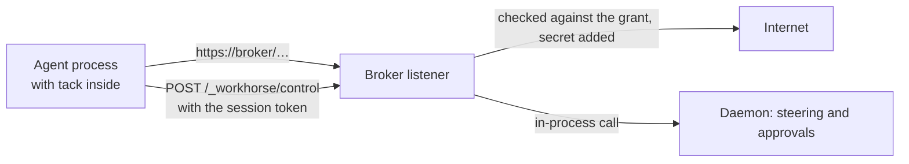

# `control`

**Kind:** contract, layer 1. **Status:** proposed, not built.

How a human, the CLI and tack talk to the daemon: start and stop sessions, read and change grants, list and answer approvals, and send agent events to steering for a verdict. It is layer 1's only new wire protocol.

## Owns

- The JSON-RPC methods, their parameters, results and errors.
- How a client proves who it is to the daemon.

## Does not own

- The meaning of grants, verdicts and approvals: those belong to [`grant`](grant.md), [`steering`](steering.md) and [`approvals`](approvals.md). This module carries them.
- Reaching the daemon from another device: that belongs to layer 2's link.

## Depends on

[`grant`](grant.md), [`steering`](steering.md) and [`approvals`](approvals.md), for the types it carries. Pure Rust with no I/O; also builds for wasm.

## Decisions

- **JSON-RPC** (2026-11-02): an existing standard, so only the methods are Workhorse's.
- **One protocol for every client** (2026-11-02): tack, the CLI and a phone use the same methods.
- **From inside a sandbox, `control` goes through the broker** (2026-11-02). The broker reserves one path, `/_workhorse/control`, never forwards it, and hands its calls to the daemon in-process. The sandbox keeps exactly one allowed destination.
- **Inside clients get a smaller method set** (2026-11-02): send an event, receive a verdict, request an approval or a wider grant. Answering approvals and changing grants are only available outside the sandbox, because the agent can read anything tack can, including its token.
- **A per-session token** identifies inside clients; the daemon issues it when the session starts.
- **Outside clients on the same machine use a Unix socket** in the user's runtime directory, readable only by the user; its file permissions are the authentication (2026-11-02). A phone comes later, through layer 2's link.

## Open questions

- The method list itself, inside and outside.
