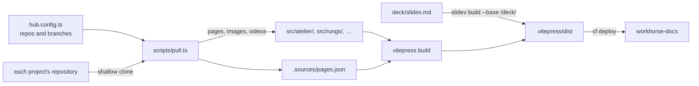

# Site

The hub: the Workhorse family's docs in one site, rendered with
[VitePress](https://vitepress.dev), with Mermaid diagrams drawn and local
search, and the [deck](../deck/slides.md) at `/deck`. It is deployed to
Cloudflare as the Worker `workhorse-docs` from `main`.

Each project's pages are pulled from its own repository when the site
builds, at the branch [`hub.config.ts`](../hub.config.ts) names; that file
is the only place a repository's owner, name or branch appears. Workhorse's
own pages come from this checkout, so a pull request shows its own changes.

| Path | Holds |
| --- | --- |
| `scripts/pull.ts` | Clones each project at its branch and copies its pages, and the images and videos they show, under `src/<project>/` |
| `src/` | The hub's own pages; the pulled ones beside them are ignored by git |
| `.vitepress/config.mts` | The sidebar for the hub and for each project, edit links to each page's own repository |
| `.vitepress/links.ts` | Keeps links to pulled pages on the site, and sends links to code to GitHub at the pulled branch |
| `.vitepress/theme/` | Draws `mermaid` blocks in the site's font and colours, fitted to a readable size, full screen on a click |
| `cloudflare.config.ts` | The Worker and its account; `wrangler.config.ts` names the folder it serves |

- **Run:** `bun install` here and in `../deck`, then `bun run dev`.
- **Build:** `bun run build` pulls every project, builds the site and the
  deck into `.vitepress/dist/`, and fails on a dead link in the hub's own
  pages.
- **Deploy:** `.github/workflows/docs.yml` builds every pull request, and
  deploys each push to `main` and a daily build with `CLOUDFLARE_API_TOKEN`,
  so changes in the projects' repositories reach the hub within a day.
- **Links in pulled pages:** a relative link, or a GitHub link, to a page the
  hub pulled stays on the site; a link to anything else goes to GitHub at the
  configured branch. A missing image is read from GitHub, so a project's
  mistake never fails the hub's build.
- **Diagrams** use Mermaid's `base` theme, classic look and dagre layout, in
  the site's colours, light or dark. Each fits its column, never below 75% of
  its natural size; a wider one scrolls sideways.
