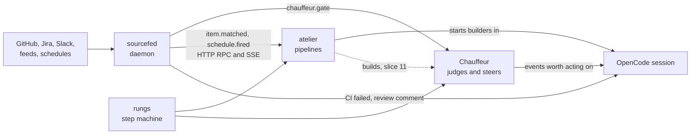
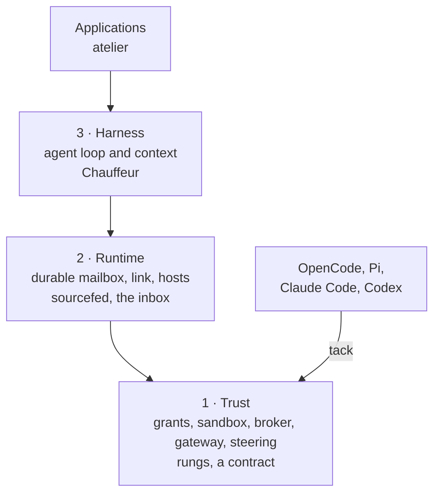

# How the projects connect

Each project is useful alone. Together, sourcefed tells the others what
changed, rungs runs their plans, Chauffeur steers the agents, and atelier
turns issues into pull requests with all of them.

| From | To | What crosses | Where it's planned |
| --- | --- | --- | --- |
| sourcefed | an agent | CI failures, reviews, comments and conflicts on its pull request, as messages in its session | [sourcefed](/sourcefed/) |
| sourcefed | atelier | `item.matched` and `schedule.fired` over the daemon's HTTP API, acknowledged once atelier saves the run | [atelier#42](https://github.com/StevenJPx2/atelier/issues/42), [sourcefed#3](https://github.com/StevenJPx2/sourcefed/issues/3) |
| sourcefed | Chauffeur | Each event, asked about before it is queued, so every host gets the same filtered stream | [Chauffeur slice 2](/chauffeur/docs/plans/slices/slice-2) |
| rungs | atelier | The step machine inside every pipeline | [atelier#43](https://github.com/StevenJPx2/atelier/issues/43) |
| rungs | Chauffeur | The step machine inside every strategy | [Chauffeur slice 3](/chauffeur/docs/plans/slices/slice-3) |
| atelier | Chauffeur | Builds Chauffeur's issues into pull requests | [chauffeur#5](https://github.com/StevenJPx2/chauffeur/issues/5) |
| tack | every agent | One plugin, written once, loaded natively by each agent | [tack](/workhorse/modules/tack) |

## Where each sits in Workhorse's layers

Workhorse is three layers of protocols, each depending only on those below it
([overview](/workhorse/OVERVIEW)). The projects sit at these places in it:

| Project | Place | Why |
| --- | --- | --- |
| rungs | A contract, in layer 1's style | Pure Rust with no I/O, `no_std` and proven, as layer 1's contracts are: `grant`, `steering`, `approvals` and `control` |
| sourcefed | Layer 2, the inbox | An agent is a log plus an inbox; sourcefed fills the inbox with what changed outside |
| Chauffeur | Layer 3, the harness's context, beside layer 1's steering | It decides what an agent should see and do next; steering's rules decide what it may do |
| atelier | An application above all three | It runs agents to do work: issues in, proven pull requests out |
| tack | The bridge into layer 1 | It carries steering and tool routing into agents that exist today |
