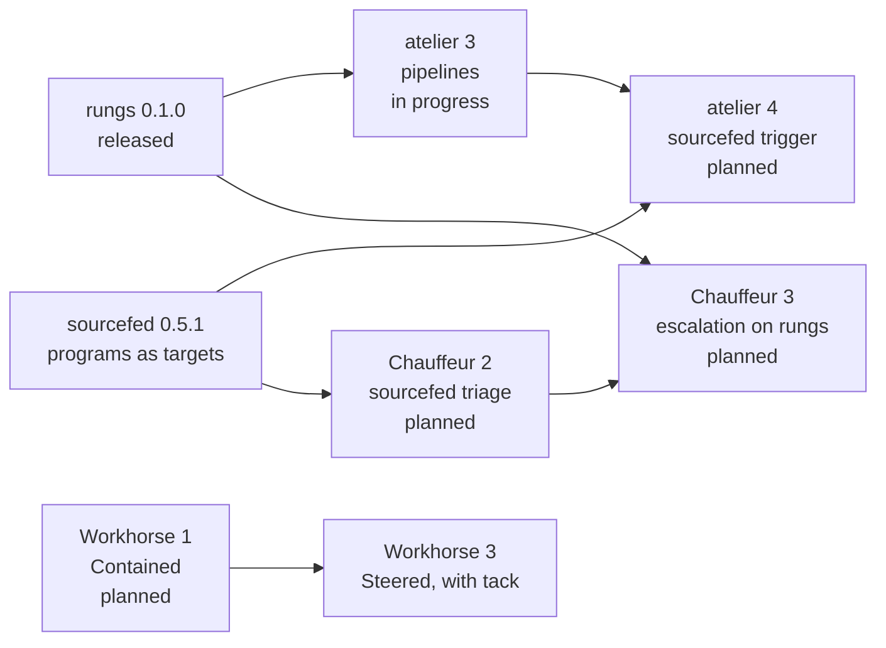

# Roadmap

Each project ships one vertical slice at a time, and its owner reviews each
before the next starts. Each project's plan is the source of truth; this page
says where each one is.

| Project | Now | Next | Plan |
| --- | --- | --- | --- |
| rungs | Released, `v0.1.0`: plans and runs, proven with Kani | Adopted by atelier's pipelines and Chauffeur's strategies | [rungs#1](https://github.com/StevenJPx2/rungs/issues/1) |
| atelier | Slices 0 to 2 implemented (`0.1.0-rc.7`); slice 3, pipelines made of steps, in progress | Slice 4, the sourcefed trigger; slice 11, Chauffeur adopts atelier | [#1](https://github.com/StevenJPx2/atelier/issues/1), [#43](https://github.com/StevenJPx2/atelier/issues/43), [#42](https://github.com/StevenJPx2/atelier/issues/42), [slices](/atelier/docs/plans/) |
| sourcefed | `0.5.1`: issue collections, Jira queries, schedules and program targets, with `daemon.health`; the end-to-end checks remain | Triage through Chauffeur | [sourcefed#3](https://github.com/StevenJPx2/sourcefed/issues/3) |
| Chauffeur | `v2`: slices 0 and 1 implemented, the Conventional Commits nudge in OpenCode | Slice 2, sourcefed triage; slice 3, escalation from Jev to GLiDE on rungs | [slices](/chauffeur/docs/plans/slices/) |
| Workhorse | Agreed direction; nothing built | Milestone 1, Contained: `grant`, `sandbox` and `broker` | [roadmap](/workhorse/OVERVIEW#roadmap) |
| tack | Designed; the unagent spike's notes | Milestone 3, Steered: OpenCode first, then Pi, Claude Code and Codex | [tack](/workhorse/modules/tack) |
