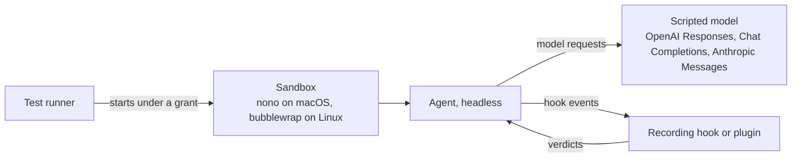

# Spike plan: restart and resume, and steering events

**Status:** plan, not run. It answers two factual open questions in [`OVERVIEW.md`](../../OVERVIEW.md) for OpenCode, Pi, Claude Code and Codex. Results go to `evidence/agent-resume-and-events.md`.

| Question | Why it matters |
|---|---|
| **A. Restart and resume.** After an agent is stopped mid-task and restarted under a changed grant, does its session continue correctly? | A file-grant change takes effect only by restarting the agent under the new grant and resuming its session |
| **B. Steering events.** Which events does each agent really report, with what data, and can a verdict be enforced? | Steering rules can only act on events that fire, and a block must hold even when the daemon is unreachable |

## What is already known

tack's capability matrix (`spike/unagent/MATRIX.md` on the `tack` branch, versions of 2026-10-27) lists every agent's events, actions and failure behaviour from documentation and source code. Nothing there was captured from a running agent. Three of its cells shape this plan:

- **Codex:** hosted tools never fire `PreToolUse`, so steering cannot see them.
- **Defaults:** Claude Code hooks, Claude Code mods and Codex hooks fail open by default. A missing Codex hook binary still fails open.
- **Resume:** OpenCode reports no event when a session is reopened.

## Setup

| Part | Decision |
|---|---|
| Machines | The MacBook (macOS) and the homelab (NixOS x86_64), as in spike 8 |
| Agents | Latest release of each, version recorded per result. Headless modes from the matrix: `opencode run`, `pi -p` or `--mode rpc`, `claude -p`, `codex exec` |
| Model | A scripted local model, extending spike 8's `src/broker.ts` in `wrkhse/daemon-v0`. It must speak all three provider APIs: Codex uses the Responses API and Claude Code uses Anthropic Messages. Turns are deterministic, so every run is comparable |
| Sandbox | `nono run` and bubblewrap with a file root per test. The network allows only the scripted model |
| Recording | One recording hook or plugin per agent: an OpenCode plugin, a Pi extension, Claude Code hook entries and Codex hook entries. Each writes every event it sees, as received, to a JSON lines file, and answers with a verdict the test chooses |

## Test A: restart and resume

The scripted model drives a task of five steps. Each step is one tool call that appends a numbered line to `steps.txt` in the work root.

| Step | Check |
|---|---|
| 1. Stop the agent at four points: between turns, while a tool runs, while the model reply streams, and while waiting for an approval | Each with SIGTERM and with SIGKILL, killing the whole process tree (spike 8: killing nono's supervisor alone orphans the child) |
| 2. Restart under a changed grant: one root removed, one root added | The agent's own resume command, found in its documentation and recorded |
| 3. Read the result | The history is intact; no completed step ran twice (`steps.txt` has no duplicate lines); the task finishes; the removed root is denied and the added root works; time from restart to the first new model request |
| 4. Interrupted tool call | Record whether the agent reruns it, reports it as interrupted, or loses it |

An agent passes A when, at every stop point, the session resumes, no completed step repeats, and the new grant applies. **Bite check:** a restart that skips the resume command must fail step 3.

## Test B: steering events and enforcement

| Step | Check |
|---|---|
| 1. Capture | Run one scripted turn that sends a prompt, calls a built-in tool, calls an MCP tool, triggers a permission request, spawns a subagent where supported, and ends. Store every event and its raw payload, per agent |
| 2. Compare with the matrix | Mark each matrix cell in sections 2 and 4 as confirmed or contradicted, with the captured payload as evidence |
| 3. Enforce | For a tool call, test four verdicts: block, rewrite the input, ask, and allow. Check the effect on disk, not just what the agent reports |
| 4. Fail closed | Repeat block with the verdict source unreachable, timed out and, for hook commands, missing. Record whether the call runs |
| 5. Gaps | Codex hosted tools, and any tool the matrix marks as bypassing hooks: does the call still pass through the broker or the gateway? |

An agent passes B when every event steering needs fires with enough data to decide, and a block holds in all of step 4. **Bite check:** a recording hook that ignores its verdict must make step 3 fail.

## Results

| Output | Where |
|---|---|
| A table per agent for tests A and B, versions, raw captures and the commands used | `evidence/agent-resume-and-events.md` and `spike/resume-and-events/` |
| Corrected matrix cells | `spike/unagent/MATRIX.md` on the `tack` branch |
| Consequences | `OVERVIEW.md`: which agents support restart and resume, how each fails closed, and which events steering may rely on |

## Order

1. Scripted model with all three APIs, plus its own tests.
2. Recording hook or plugin for each agent.
3. Test B on macOS, then on Linux.
4. Test A on macOS, then on Linux.
5. Write the results; update the matrix and `OVERVIEW.md`.

The agents are tools under test, not dependencies. Any new package in the spike needs approval first.

## Out of scope

Agents tabled in the matrix (Cursor, Copilot CLI, Gemini CLI and others), the user interface for approvals, and the broker's handling of secrets.
