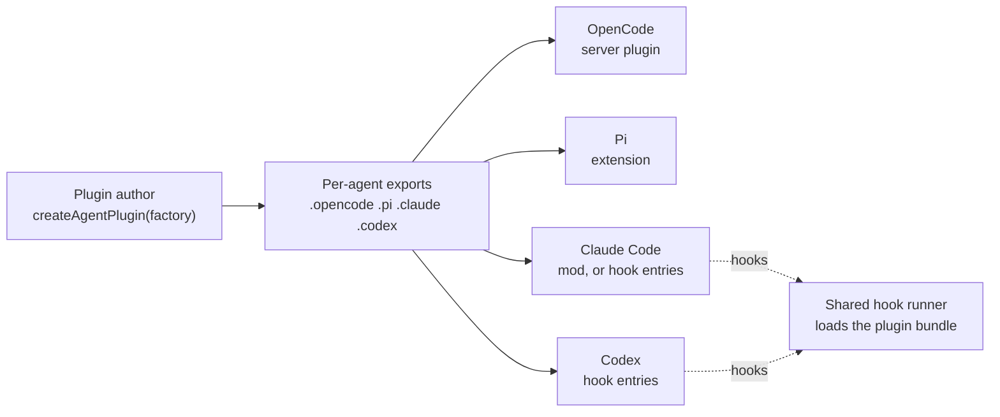

# unagent: write an agent plugin once, run it in every coding agent

**Goal:** what unplugin does for bundlers, done for coding agents. A plugin author writes one plugin against one small SDK. The SDK turns it into a native plugin for OpenCode, Pi, Claude Code and Codex, and reports, per agent, what that agent cannot do.

Status: proposed design, rescoped on 2026-10-27. Nothing is built. Versions checked: OpenCode 2.1.4, Pi 1.4.0, Claude Code 2.1.310, Codex 0.164.0, fx 0.0.14.

Evidence:

- [MATRIX.md](MATRIX.md): what each agent supports, cell by cell.
- [HARNESS-ADAPTERS.md](HARNESS-ADAPTERS.md): run-time hooks, actions, failure and timing.
- [FINDINGS.md](FINDINGS.md): install surfaces, prior art, UI.
- [A5C-SPIKE.md](A5C-SPIKE.md): the closest existing attempt, tested.

## What changed on 2026-10-27

| Before | Now |
| --- | --- |
| A Workhorse package. The daemon's apps were the main consumer | **Independent of the Workhorse daemon.** The daemon is one possible plugin author, nothing more |
| One adapter per agent fans out to registered deciders and combines their answers | **One native plugin per author, as unplugin does.** Each agent combines several plugins by its own rules |
| A daemon-defined UI spec, drawn by render-only renderers | The plugin calls UI functions in the SDK directly |
| Verdicts first, rewrites later | **Rewrites are supported from the start** |
| Five agents | Four built first. Cursor, Copilot CLI, Gemini CLI and others are tabled and get empty placeholder exports |

## The model



unplugin's shape, carried over:

| unplugin | This SDK |
| --- | --- |
| `createUnplugin((options, meta) => ({ name, transform, … }))` | `createAgentPlugin((options, meta) => ({ name, toolBefore, … }))` |
| `meta.framework` is `vite`, `rollup`, … | `meta.agent` is `opencode`, `pi`, `claude`, `codex` |
| `unplugin.vite(options)` returns a Vite plugin | `plugin.opencode(options)` returns an OpenCode plugin |
| `vite: { configureServer }`: native hooks for one bundler | `opencode: { … }`: native hooks for one agent |
| A table of which hook works in which bundler | The fidelity table, read at build time |

## A plugin

```ts
import { createAgentPlugin } from "unagent"

export const guard = createAgentPlugin((options: { protected: string[] }, meta) => ({
  name: "guard",

  toolBefore(call, ctx) {
    if (call.tool === "bash" && /\brm -rf\b/.test(call.input.command)) return ctx.deny("rm -rf is blocked.")
    if (call.tool === "bash" && call.input.command.startsWith("git push")) {
      return ctx.rewrite({ command: `${call.input.command} --dry-run` })
    }
  },

  promptSent(prompt, ctx) {
    return ctx.append(`Protected paths: ${options.protected.join(", ")}`)
  },

  responseFinished(response, ctx) {
    if (response.reason === "error") ctx.session.append({ text: "Last turn failed; check the log." }, { delivery: "next" })
  },

  tools: {
    guard_status: { description: "List protected paths", input: {}, run: () => options.protected },
  },

  opencode: {
    // Native OpenCode hooks, for things the SDK does not cover.
  },
}))
```

Each agent then loads its own export:

| Agent | What the user installs | Where it comes from |
| --- | --- | --- |
| OpenCode | A server plugin module | `export default guard.opencode({ protected: ["infra/"] })` |
| Pi | An extension | `export default guard.pi({ protected: ["infra/"] })` |
| Claude Code | A mod, or a plugin directory whose `hooks.json` calls the hook runner | `guard.claude(...)`, packaged by `unagent build` |
| Codex | A plugin directory whose hooks call the hook runner | `guard.codex(...)`, packaged by `unagent build` |

## Hooks

| Hook | Arguments | The plugin can return |
| --- | --- | --- |
| `sessionCreated`, `sessionResumed`, `sessionEnded` | session | nothing |
| `promptSent` | prompt text, `idleSeconds` | block, rewrite text, append context |
| `toolBefore` | tool name, input | deny, ask, allow, rewrite input |
| `toolAfter` | tool name, input, result | append context, rewrite result where the agent allows it |
| `permissionAsked` | the request | allow, deny, leave to the user |
| `responseFinished` | `reason: done \| aborted \| error` | nothing |
| `sessionIdle` | session | nothing |
| `compactionBefore`, `compactionAfter` | session | veto, add instructions |

Every hook gets `ctx` with `ctx.session` (append `now`, `next` or `wake`; compact; interrupt; change model) and `ctx.ui` (`status`, `toast`, `dialog`, `band`, `panel`). The SDK computes `sessionIdle` and `idleSeconds` for every agent from `responseFinished`.

`tools` are registered natively where the agent can do that in-process (OpenCode, Pi, Claude Code mods). Otherwise the build adds a stdio MCP server that serves the same definitions.

## Running in each agent

| Agent | How the plugin runs | Fails closed on `toolBefore` by | Actions between hooks |
| --- | --- | --- | --- |
| OpenCode | In-process server plugin | Throwing in `execute.before` | Direct API calls |
| Pi | In-process extension | Returning `block` from `tool_call` | Direct API calls |
| Claude Code, mod | In-process mod | `.catch` returning a deny | Direct `$.session` and `$.prompt` calls |
| Claude Code, hooks | Hook runner per hook | `onFailure: "block"` on the hook entry | Queued; delivered at the next hook that can carry them |
| Codex | Hook runner per hook | The runner printing a deny for every internal error | Queued; delivered at the next hook. A missing or crashing runner still fails open |

On every agent, the SDK gives each `toolBefore` a budget. A handler that throws or misses it produces a deny by default. A plugin can set `onError: "allow"` for hooks that only observe.

Queued actions for hook-command agents are kept in a per-plugin, per-session file under the plugin's state folder. The runner drains them at the next hook that can carry them. A hook-command plugin runs only while a hook is running, so it cannot start work on its own; an idle Codex session wakes only at turn end.

### The hook runner

One runner, `unagent-hook`, is installed once and shared by every plugin. A hook entry runs `unagent-hook <plugin bundle> --agent codex`, and the runner loads the bundle, calls the plugin and prints that agent's reply.

- A compiled Bun executable is 89 MB (measured with Bun 1.4.4), so one per plugin is too much.
- Bun starts in 7 ms and Node in 59 ms on the development machine. The overhead budget is 20 ms at p99 before the plugin runs. Loading a bundle from a compiled runner is expected to stay inside it **(inferred; slice 2 measures it)**.

## Several plugins at once

The SDK makes no attempt to combine plugins. Each plugin is a native plugin, so the agent combines them by its own rules:

| Agent | Several plugins on the same hook |
| --- | --- |
| OpenCode | Run in order. Each sees the previous one's changes, and the last write wins |
| Pi | Run in order. The first `block` wins, but a later result can overwrite its `reason` |
| Claude Code hooks | Run in parallel: `deny > defer > ask > allow`, and every added context is delivered. How competing rewrites merge is undocumented |
| Claude Code mods | One chain. A mod that answers without calling `next` skips the rest |
| Codex | Run concurrently. Any deny wins. Among rewrites, the last to finish wins, which is a race, and a rewrite also approves the call |

The SDK guarantees what one plugin does. Across plugins it guarantees nothing more than the agent does, and the fidelity report says so per agent. The rewrite race on Codex is the main cost of this model.

## What each agent limits

| Agent | Main limits |
| --- | --- |
| OpenCode | No resume event. Warming is configuration only. Asking the user goes through `permission.evaluate`. No hook timeouts, so the SDK imposes budgets |
| Pi | No permission layer, no subagent events, no session removal. No hook timeouts |
| Claude Code, mods | `sessionCreated` misses `/clear`, `/resume` and `/branch` |
| Claude Code, hooks | `now` and `next` wait for the next hook. Wake goes through the session's messaging socket or a `Stop` continuation. No compact, model change or tool registration; tools come from the generated MCP server |
| Codex | `now` and `next` wait for the next hook; wake works only at turn end. No ask, compact, model change or interrupt through hooks. A rewrite approves the call. Fails open if the runner is missing |
| fx | No hooks. Only the generated MCP server works |

The full matrix, with the API behind each cell, is [MATRIX.md](MATRIX.md).

## Build and install


- `unagent build` bundles the plugin, writes each agent's package (OpenCode module, Pi extension, Claude Code and Codex plugin directories, the MCP server) and reports what each agent will lose. An unknown agent version fails with the supported range.
- `unagent install` registers a built plugin in each agent the user has: config entries in JSON, JSONC or TOML, written atomically, with a receipt that `revert` uses to remove exactly what was written.
- Trust stays manual. The tool reports steps such as `/hooks` in Codex or `pi --approve`, and never performs them.

## Decisions

| Concern | Decision |
| --- | --- |
| Scope | A plugin SDK for any author, shaped like unplugin. Independent of the Workhorse daemon |
| Combining plugins | Left to each agent. The SDK combines nothing and documents each agent's rules |
| Rewrites | Supported from the start. On Codex a rewrite also approves the call, and the report says so |
| Failure | `toolBefore` fails closed by default, with a budget the SDK enforces. `onError: "allow"` opts out per hook |
| Hook-command agents | One shared runner loads each plugin's bundle. Queued actions are kept per plugin and session |
| Tools | Native where the agent registers tools in-process; otherwise a generated stdio MCP server |
| UI | `ctx.ui` calls mapped per agent. Codex gets dialogs only, through MCP elicitation. Every surface falls back to text |
| Capability differences | One frozen fidelity table per agent and version range, each cell with a source |
| Trust | Never granted by the tool |
| Dependencies | Libraries for TOML (comment-preserving), JSONC editing and YAML frontmatter, each approved before it is added |
| Tests | One conformance suite every export must pass, against the real CLIs in a throwaway HOME. Nightly real-model runs on a capped budget |
| Prior art | unplugin is the model. a5c-ai's adapters are the nearest attempt; reuse their phase names, don't depend on them |
| Tabled | Cursor, GitHub Copilot CLI, Gemini CLI, Amp, Factory Droid, Goose, Kiro, OpenClaw, Hermes, Antigravity, and driving agents from outside (AI SDK harness, ACP). Each tabled agent gets an empty export that fails with "not supported yet" |

## Package layout

```text
unagent/
├── src/
│   ├── index.ts         createAgentPlugin, types
│   ├── contract/        Events, hook results, fidelity data per agent. No I/O
│   ├── agents/
│   │   ├── opencode.ts
│   │   ├── pi.ts
│   │   ├── claude.ts    mod export and hook-entry export
│   │   ├── codex.ts
│   │   ├── fx.ts        MCP server only
│   │   └── cursor.ts, copilot.ts, gemini.ts, amp.ts, droid.ts, goose.ts,
│   │       kiro.ts, openclaw.ts, hermes.ts, antigravity.ts   (empty, tabled)
│   ├── runner/          unagent-hook: stdin in, native reply out, action queue
│   ├── mcp/             Generated stdio MCP server for plugin tools
│   └── cli/             build, install, revert
└── conformance/         One suite, run against every export
```

## Build order

| Slice | Delivers | Proof |
| --- | --- | --- |
| 1 | `createAgentPlugin`, with `toolBefore` (deny, rewrite) and `promptSent` (append) for OpenCode and Pi | In each real CLI, a deny prevents the call (a recorder tool sees nothing), a rewrite changes what runs, and the appended text reaches the model |
| 2 | The hook runner for Codex and Claude Code hooks, with the same plugin | The slice 1 tests pass on both. A throwing or slow handler refuses the call. Runner overhead measured under 20 ms at p99 |
| 3 | `tools`: native on OpenCode and Pi, generated MCP server on Claude Code, Codex and fx | Each agent calls the tool and the recorder sees the call |
| 4 | `ctx.session.append` with `now`, `next` and `wake`; the action queue for hook-command agents | An idle OpenCode or Pi session starts a turn; on Codex the queued message arrives at turn end |
| 5 | The Claude Code mod export | Slices 1 to 4 pass on it |
| 6 | `unagent build` and `unagent install`, with revert | Each agent loads the installed plugin; `revert` removes exactly what was written; a hand-edited neighbouring entry survives both |
| 7 | `ctx.ui.status` and `ctx.ui.dialog` | The dialog's answer reaches the plugin; the status text changes |
| Later | Tabled agents and driving agents from outside | — |

## Open questions

| Question | Recommended default |
| --- | --- |
| Name and home. `unagent` is taken on npm (onmax/unagent 0.0.8). Should this live in the Workhorse repo, given it no longer depends on the daemon? | Its own repository, with a free npm name chosen in slice 1 |
| Should plugins from this SDK coordinate with each other inside one agent, to avoid the Codex rewrite race and OpenCode's last-write-wins? | No, not in v0. Report the agent's rules; revisit if two real plugins collide |
| Tool-call input differs by agent (`bash` vs `Bash`, `command` vs `cmd`). Normalize it, or pass it through? | Normalize the common tools (shell, read, write, edit) and pass everything else through with the agent's own names |
| Should the shared runner be installed separately, or bundled with the first plugin that needs it? | Installed by `unagent install` once per machine, versioned, with plugins declaring the runner range they need |
| On Claude Code, which export by default: the mod or the hook entries? | Hook entries, which work without mods enabled; the mod is opt-in |
| Which TOML, JSONC and YAML libraries? | Chosen in slice 6 from current registry data, and approved before they are added |
