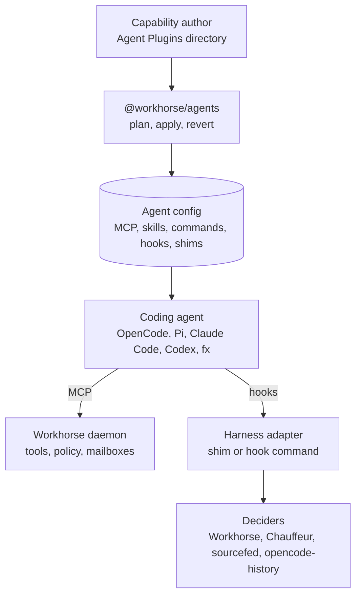
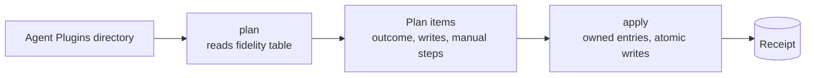
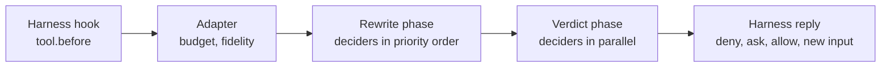
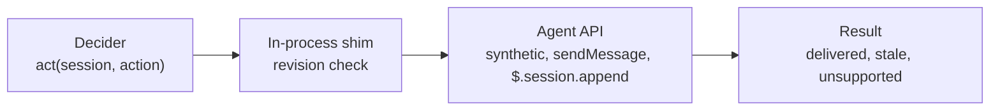
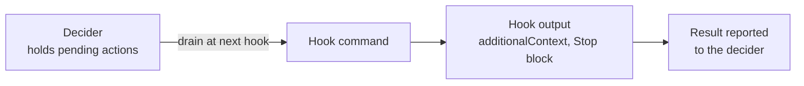
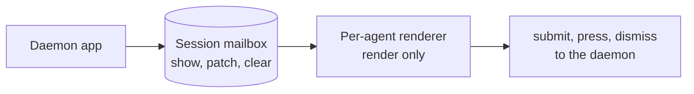

# `@workhorse/agents`: one way to reach every coding agent

**Goal:** a capability author writes a package once. It then works in OpenCode, Pi, Claude Code, Codex and fx: it is installed natively, hooked at run time, and drawn in each agent's UI. Each agent's report states exactly what that agent cannot do.

Status: proposed design. Nothing is built. Evidence is in [FINDINGS.md](FINDINGS.md) (install-time surfaces, prior art, UI), [HARNESS-ADAPTERS.md](HARNESS-ADAPTERS.md) (run-time hooks and actions) and [MATRIX.md](MATRIX.md) (one-page capability matrix). Versions checked: OpenCode 2.1.4, Pi 1.4.0, Claude Code 2.1.310, Codex 0.164.0, fx 0.0.14.

## Architecture



The package has three parts. Each runs at a different time:

| Part | Runs | Does |
| --- | --- | --- |
| **Emitter** | Install time | Turns an Agent Plugins directory into each agent's native files, and reports per agent what is `native`, `fallback` or `unsupported` before writing |
| **Harness adapter** | Inside or beside a running agent | Turns hooks into standard events, sends them to deciders, combines their answers, and carries actions back to the agent |
| **UI renderers** | Inside a running agent | Draw a daemon-defined UI spec in each agent's chat, status bar, panels and dialogs, and report user input back |

Capabilities themselves (tools, resources, prompts, tasks, secrets, policy) are served once by the Workhorse daemon over MCP. This package carries only what MCP cannot.

## Install



`revert` takes a receipt and removes exactly what `apply` wrote.

```ts
const pkg = yield* Package.load("./sourcefed")
const plan = yield* Plan.make(pkg, { scope: "user", targets: [claude(), codex(), opencode(), pi(), fx()] })
// plan.items[0] → { target: "fx", feature: "hooks.preTool", outcome: "unsupported", reason: "fx 0.0.14 has no user hooks" }
const receipt = yield* apply(plan)
yield* revert(receipt)
```

| Feature | What `apply` writes |
| --- | --- |
| MCP endpoint | A native entry in each agent's config: JSON, JSONC or TOML |
| Skills | Files in `.agents/skills`, plus `.claude/skills` for Claude Code |
| Instructions | An opt-in marked block in `AGENTS.md` |
| Commands, subagents | Native files where the agent has them |
| Agent permissions | Rules for the agent's own built-in tools (`Bash`, `Edit`) where it has a permission system |
| Hooks | The harness adapter: a plugin, extension or mod, or hook entries that run the hook command |
| UI | One renderer per agent: a Claude Code mod, an OpenCode CLI plugin, a Pi extension |
| Trust | Reported as a manual step, such as `/hooks` in Codex, `pi --approve` or `fx mcp trust approve` |

## Hooks at run time

### A decision before an action



One adapter per agent registers each hook once and fans out to every decider. Deciders are listed in a user-only file, with their events, budgets, priority, failure policy and owned state.

| Point | Combining rule |
| --- | --- |
| `tool.before` | Rewrites run in priority order. Verdicts follow: `deny > ask > allow`. An explicit deny always wins. A rewrite goes out only when the combined verdict is `allow` |
| `prompt.sent` | Any block wins. Text edits run in priority order. Appends are concatenated and de-duplicated by key |
| `permission.asked` | Any deny wins. If every decider allows, the request is allowed. Otherwise the user decides |
| `compaction.before` | Any veto wins. Instructions are concatenated |
| State actions | Accepted only from the decider that declares ownership of that state, such as `session.update.model` |

A decider that misses its budget contributes its `onTimeout` (`block`, `ask` or `allow`). The adapter answers when every decider has answered, or when the deadline passes.

### An action from a decider

**In-process agents:** OpenCode, Pi, and Claude Code with mods.



**Hook-command agents:** Codex, and Claude Code with mods off.



```ts
const sourcefed = await Decider.serve({ name: "sourcefed", priority: 50 })

await sourcefed.act(session.id, {
  action: "message.append", parts: [{ text: summary }],
  delivery: "wake", late: "next", revision: session.revision,
}) // → { status: "queued", when: "turn-end" } on Codex; { status: "delivered" } on OpenCode

sourcefed.before("tool.before", (e) => policy.check(e) ? e.allow() : e.deny("Outside the lease."),
  { budget: 1_500, onTimeout: "block" })
```

### Standard events and actions

| Kind | Names |
| --- | --- |
| Events | `session.created`, `session.resumed` (reopened), `session.ended`, `prompt.sent` (with `idle_seconds`), `tool.before`, `tool.after`, `permission.asked`, `response.finished` (with `reason: done \| aborted \| error`), `session.idle`, `compaction.before`, `compaction.after`. Every event carries `agent` and `parent` |
| Actions | `session` (`create`, `update`, `compact`, `warm`, `interrupt`, `remove`), `message.append` (`now`, `next`, `wake`), `permission.reply`, and registries for `tool`, `skill`, `agent`, `model`, `mcp` and `command` |
| Edits in `before` | Block, rewrite input, ask the user |

The adapter computes `session.idle` and `idle_seconds` from `response.finished` for every agent.

### What each agent limits

| Agent | Main limits |
| --- | --- |
| OpenCode | No resume event. Warming is configuration only. Asking the user goes through `permission.evaluate`. No hook timeouts |
| Pi | No permission layer, no subagent events, no session removal. Warm can only allow or veto a scheduled refresh. No hook timeouts |
| Claude Code, mods | `session.start` misses `/clear`, `/resume` and `/branch`. No warm |
| Claude Code, hooks | `now` and `next` wait for the next hook. Wake goes through the per-session messaging socket or a `Stop` continuation. No compact, model change or registries |
| Codex | `now` and `next` wait for the next hook; wake works only at turn end. No ask, compact, model change, interrupt or registries through hooks. A rewrite also approves the call. Fails open on any hook error |
| fx | No hooks. Install only |

The full matrix, with the API behind each cell, is [MATRIX.md](MATRIX.md).

## UI



| Surface | Claude Code | OpenCode | Pi | Codex |
| --- | --- | --- | --- | --- |
| `status` | mod | slot `prompt.footer.status` | `setStatus` | unsupported |
| `band` (above the prompt) | `AbovePrompt` | slot `session.composer.top` | `setWidget` | unsupported |
| `panel` | pane | `sidebar.content`, `session.panel` | anchored overlay | unsupported |
| `dialog` | mod, or MCP elicitation | `ui.dialog` | `ctx.ui.*` | MCP elicitation form |
| `toast` | `$.ui.toast` | `ui.toast.show` | `notify` | unsupported |
| `transcript` | `ToolResult` render site | text | `registerToolRenderer` | text |

The spec has json-render's shape: `{root, elements}`, updated with JSON Patch, using a closed catalog: `Box`, `Text`, `Markdown`, `Code`, `Input`, `Select`, `Button`, `Link`, `Progress`. It is defined as an MCP extension contract in `daemon/packages/protocol`. Every surface falls back to plain text. Workhorse's own web, terminal and phone clients render the same spec.

## Decisions

| Concern | Decision |
| --- | --- |
| Scope | A general-purpose emitter for any capability author. It covers Workhorse's needs as one case |
| Name and home | `@workhorse/agents`, in a sibling Bun workspace `agents/` next to `daemon/` with the same gates. `protocol`, `core` and `worker` never import it |
| Input | Agent Plugins 1.x directories. Agent-specific extras sit under a `dev.workhorse/` folder |
| Capability differences | One frozen fidelity table per agent and version range. Every cell has a source. An unknown version fails with the supported range |
| Permissions | Rules for agents' built-in tools are emitted per agent. Access to the outside world stays in daemon policy |
| Skills | On disk. Serving over MCP (SEP-2640) waits until an agent supports it |
| Trust | Never granted or approved by this package. It is always a manual step |
| Hooks | Fail closed. A decider timeout becomes an explicit deny. On fx, steering is unavailable and reported as such |
| Fan-out | One adapter per agent. Deciders register in a user-only file, over Unix sockets in a `0700` directory |
| Delivery without a connection | Deciders hold their own pending actions. The hook command drains them at the next hook that can carry them |
| Mailbox wake | Per-agent wake adapters ship in this package. Workhorse's mailbox is one decider |
| Driving agents | Harness products use AI SDK harness adapters or ACP at their own composition root |
| UI | json-render's spec shape. Renderers only draw and report input; every effect goes through the daemon. Codex gets dialogs only |
| Dependencies | Libraries for TOML (comment-preserving), JSONC editing and YAML frontmatter, each approved before it is added |
| Tests | Golden plans and schema checks; discovery tests against the real CLIs; nightly real-model tests on a capped budget |

## Package layout

```text
agents/
└── packages/
    ├── contract/      JSON Schemas (events, actions, RPC), fidelity data per agent, combining rules. No I/O; Rust can read it
    ├── model/         Agent Plugins read and validation (Effect Schema). No I/O
    ├── targets/       Pure emitters per agent: claude, codex, opencode, pi, fx
    ├── apply/         The only writer of agent config: owned entries, atomic writes, receipts, revert
    ├── harness/       Decider SDK, in-process shims (OpenCode, Pi, Claude mod), hook command
    ├── ui/            Render-only renderers: Claude mod, OpenCode CLI plugin, Pi extension
    └── conformance/   Runs the real CLIs headless in a throwaway HOME
```

The `workhorse` CLI uses `model`, `targets` and `apply` for `workhorse connect <agent>`. The hook command is a compiled executable: Bun starts in 7 ms on the development machine, against 59 ms for Node, and the overhead budget is 20 ms at p99.

## Build order

| Slice | Delivers | Proof |
| --- | --- | --- |
| 1 | MCP registration for all five agents, user scope, with plan, apply and revert | Each real CLI lists the server. `revert` removes exactly that entry. A hand-edited neighbouring entry survives both operations |
| 2 | Skills on disk and the instructions block | Each agent lists the skill; an agent calls a recorder tool using a token found only in the skill body |
| 3 | Harness adapter: `tool.before` through the OpenCode shim and the Codex hook command, with two deciders | A deny prevents the call (the recorder sees nothing); a decider timeout with `onTimeout: "block"` refuses it on both agents |
| 4 | `message.append` `now`, `next` and `wake`; Workhorse mailbox wake | An idle OpenCode or Pi session starts a turn; on Codex the action is drained at turn end; the mailbox acknowledges only after `delivered` |
| 5 | Pi extension and Claude Code mod, with the hook-command fallback | Slices 3 and 4 pass on both agents |
| 6 | UI: one `status` item and one `dialog` | The dialog's `submit` reaches the daemon audit trail; the status text changes after a `patch` |
| 7 | Commands, subagents and agent permissions | Golden plans per agent; each agent lists the emitted command and subagent |

## Open questions

| Question | Recommended default |
| --- | --- |
| Is the runtime half also published under its own name (`@workhorse/harness`) so Chauffeur can depend on it without the emitter? | Subpath exports of `@workhorse/agents` (`/decider`, `/harness/opencode`, …). Split it out only if Chauffeur needs it |
| Do deciders register in a shared file, or with Chauffeur's daemon as the single hub? | The shared registry file; no hub process |
| Who builds the hook command: a compiled Bun executable in this workspace, or Chauffeur's Rust binary? | A compiled Bun executable here. Chauffeur may ship its own if it passes the same conformance suite |
| On Claude Code, install the mod, the hooks, or both? | Both. The hook command stands down for a session when the mod reports it is active |
| A Codex rewrite also approves the call. Allow rewrites there? | Only when every decider returns `allow` |
| Spike Codex's app-server and Claude Code's messaging socket as live delivery paths? | Yes, after slice 4 |
| Standardize model-request events? | No, until a second consumer needs them |
| Which TOML, JSONC and YAML libraries? | Chosen in slice 1, from current registry data, and approved before they are added |
