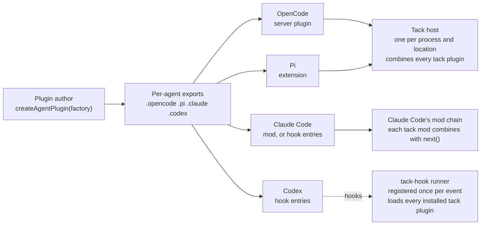
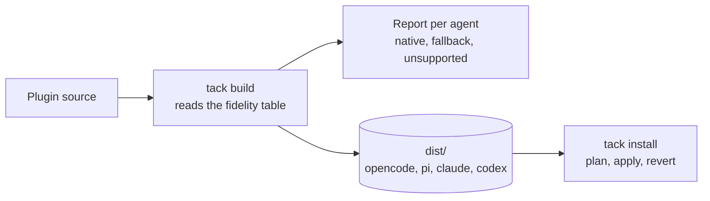

# `@workhorse/tack`: write an agent plugin once, run it in every coding agent

**Goal:** what unplugin does for bundlers, done for coding agents. A plugin author writes one plugin against one small SDK. The SDK turns it into a native plugin for OpenCode, Pi, Claude Code and Codex, and reports, per agent, what that agent cannot do. Tack is the gear that lets a rider fit and steer any horse.

Status: proposed design, rescoped on 2026-10-27, named and given coordination on 2026-10-30. Nothing is built. This folder keeps its working name, `spike/unagent/`. Versions checked: OpenCode 2.1.4, Pi 1.4.0, Claude Code 2.1.310, Codex 0.164.0, fx 0.0.14.

Evidence:

- [MATRIX.md](MATRIX.md): what each agent supports, cell by cell.
- [HARNESS-ADAPTERS.md](HARNESS-ADAPTERS.md): run-time hooks, actions, failure and timing.
- [FINDINGS.md](FINDINGS.md): install surfaces, prior art, UI.
- [A5C-SPIKE.md](A5C-SPIKE.md): the closest existing attempt, tested.
- [REALM-SPIKE.md](REALM-SPIKE.md): whether each agent's plugins can find each other in one process (Pi 1.4.0, OpenCode 2.2.2, Claude Code 2.1.314).

## What changed on 2026-10-27

| Before | Now |
| --- | --- |
| A Workhorse package. The daemon's apps were the main consumer | **Independent of the Workhorse daemon.** The daemon is one possible plugin author, nothing more |
| One adapter per agent fans out to registered deciders and combines their answers | **One native plugin per author, as unplugin does.** Tack plugins in the same agent still find each other and combine by one set of rules (decided 2026-10-30) |
| A daemon-defined UI spec, drawn by render-only renderers | The plugin calls UI functions in the SDK directly |
| Verdicts first, rewrites later | **Rewrites are supported from the start** |
| Five agents | Four built first. Cursor, Copilot CLI, Gemini CLI and others are tabled and get empty placeholder exports |

## The model



unplugin's shape, carried over:

| unplugin | This SDK |
| --- | --- |
| `createUnplugin((options, meta) => ({ name, transform, … }))` | `createAgentPlugin((options, meta) => ({ name, toolBefore, … }))` |
| `meta.framework` is `vite`, `rollup`, … | `meta.agent` is `opencode`, `pi`, `claude`, `codex` |
| `unplugin.vite(options)` returns a Vite plugin | `plugin.opencode(options)` returns an OpenCode plugin |
| `vite: { configureServer }`: native hooks for one bundler | `opencode: { … }` adds native hooks for one agent; `opencode: (generated) => …` replaces the output |
| — | `plugin.opencode(options, override)`: the same override at the call site |
| A table of which hook works in which bundler | The fidelity table, read at build time |

## A plugin

```ts
import { createAgentPlugin } from "@workhorse/tack"

export const guard = createAgentPlugin((options: { protected: string[] }, meta) => ({
  name: "guard",

  toolBefore(call, ctx) {
    if (call.tool === "bash" && /\brm -rf\b/.test(call.input.command)) return ctx.deny("rm -rf is blocked.")
    if (call.tool === "bash" && call.input.command.startsWith("git push")) {
      return ctx.rewrite({ command: `${call.input.command} --dry-run` })
    }
  },

  promptSent(prompt, ctx) {
    return ctx.append(`Protected paths: ${options.protected.join(", ")}`)
  },

  responseFinished(response, ctx) {
    if (response.reason === "error") ctx.session.append({ text: "Last turn failed; check the log." }, { delivery: "next" })
  },

  tools: {
    guard_status: { description: "List protected paths", input: {}, run: () => options.protected },
  },

  // An object adds native hooks next to the generated ones.
  opencode: {
    "session.compacted": async (event) => { /* OpenCode-only behaviour */ },
  },

  // A function replaces the generated plugin: it receives what the SDK built and returns the final one.
  codex: (generated) => ({ ...generated, hooks: { ...generated.hooks, Stop: undefined } }),
}))
```

Each agent then loads its own output function. Like `unplugin.vite(options)`, it takes the options; a second argument takes the same kind of override, so whoever installs the plugin can change the native output without forking it:

```ts
// opencode plugin module
export default guard.opencode({ protected: ["infra/"] })

// the same, with a complete override at the call site
export default guard.opencode({ protected: ["infra/"] }, (generated) => ({
  ...generated,
  "tool.execute.before": async (input, output) => {
    if (input.tool === "webfetch") throw new Error("No network in this repo.")
    return generated["tool.execute.before"]?.(input, output)
  },
}))
```

| Agent | What the user installs | Where it comes from |
| --- | --- | --- |
| OpenCode | A server plugin module | `guard.opencode(options, override?)` |
| Pi | An extension | `guard.pi(options, override?)` |
| Claude Code | A mod by default; a plugin directory whose `hooks.json` calls the hook runner where mods are off | `guard.claude(options, override?)`, packaged by the build command |
| Codex | A plugin directory whose hooks call the hook runner | `guard.codex(options, override?)`, packaged by the build command |

Override order: the generated plugin, then the author's per-agent key, then the call-site override. An object merges; a function replaces and receives the result so far.

## Hooks

| Hook | Arguments | The plugin can return |
| --- | --- | --- |
| `sessionCreated`, `sessionResumed`, `sessionEnded` | session | nothing |
| `promptSent` | prompt text, `idleSeconds` | block, rewrite text, append context |
| `toolBefore` | tool name, input | deny, ask, allow, rewrite input |
| `toolAfter` | tool name, input, result | append context, rewrite result where the agent allows it |
| `permissionAsked` | the request | allow, deny, leave to the user |
| `responseFinished` | `reason: done \| aborted \| error` | nothing |
| `sessionIdle` | session | nothing |
| `compactionBefore`, `compactionAfter` | session | veto, add instructions |

Every hook gets `ctx` with `ctx.session` (append `now`, `next` or `wake`; compact; interrupt; change model) and `ctx.ui` (`status`, `toast`, `dialog`, `band`, `panel`). The SDK computes `sessionIdle` and `idleSeconds` for every agent from `responseFinished`.

`tools` are registered natively where the agent can do that in-process (OpenCode, Pi, Claude Code mods). Otherwise the build adds a stdio MCP server that serves the same definitions.

## Running in each agent

| Agent | How the plugin runs | Fails closed on `toolBefore` by | Actions between hooks |
| --- | --- | --- | --- |
| OpenCode | In-process server plugin | Throwing in `execute.before` | Direct API calls |
| Pi | In-process extension | Returning `block` from `tool_call` | Direct API calls |
| Claude Code, mod | In-process mod | `.catch` returning a deny | Direct `$.session` and `$.prompt` calls |
| Claude Code, hooks | Hook runner per hook | `onFailure: "block"` on the hook entry | Queued; delivered at the next hook that can carry them |
| Codex | Hook runner per hook | The runner printing a deny for every internal error | Queued; delivered at the next hook. A missing or crashing runner still fails open |

On every agent, the SDK gives each `toolBefore` a budget. A handler that throws or misses it produces a deny by default. A plugin can set `onError: "allow"` for hooks that only observe.

Queued actions for hook-command agents are kept in a per-plugin, per-session file under the plugin's state folder. The runner drains them at the next hook that can carry them. A hook-command plugin runs only while a hook is running, so it cannot start work on its own; an idle Codex session wakes only at turn end.

### The hook runner

One runner, `tack-hook`, is installed once per machine. `tack install` registers it once per event (`tack-hook --agent codex`), never once per plugin, and lists each installed plugin in a user-only file, `~/.config/tack/plugins.json`. The runner loads every listed bundle in one process, combines them as below and prints the agent's reply.

- A compiled Bun executable is 89 MB (measured with Bun 1.4.4), so one per plugin is too much.
- Bun starts in 7 ms and Node in 59 ms on the development machine. The overhead budget is 20 ms at p99 for starting and loading every bundle, before any plugin runs. Whether that holds with several bundles is **(inferred; slice 2 measures it with five plugins)**.
- The plugin list comes only from user configuration, never from a project, because the runner executes every listed bundle.

## Several plugins at once

Tack plugins in the same agent find each other and combine by one set of rules, the same on every agent (decided 2026-10-30).

### Finding each other

| Agent | How |
| --- | --- |
| OpenCode, Pi | Each output function still returns a normal native plugin. On load it looks for a host at `globalThis[Symbol.for("@workhorse/tack/host")]`. The first tack plugin to load creates the host and registers the native hooks; every later one only registers its handlers with that host. Both agents load all plugins into one realm (tested in [REALM-SPIKE.md](REALM-SPIKE.md)). On OpenCode one server holds several projects' plugins, so the host is keyed by `ctx.location`, and a plugin's handlers are dropped in its `setup` cleanup |
| Claude Code mod | Each mod has its own realm, and only plain data crosses between mods ([REALM-SPIKE.md](REALM-SPIKE.md)), so there is no host. Each tack mod's hook applies its rewrite to the input it receives, passes it on with `next`, and combines its verdict with what `next` returns. The order is Claude Code's chain order, not tack's `priority` |
| Codex, Claude Code hooks | The runner, registered once per event, loads every installed plugin, so there is only one hook process per event |

The host speaks a versioned protocol. A plugin built against a different major version refuses to load and names both versions; it never silently runs outside the host.

### Combining rules

Plugins run in `priority` order (lower first, ties broken by name). Each has its own budget, and the host answers when every plugin has answered or the largest budget has passed.

| Hook | Rule |
| --- | --- |
| `toolBefore` | **Rewrites first:** in priority order, each plugin sees the input as rewritten so far. **Then verdicts** on the final input: `deny > ask > allow > no opinion`. A plugin that throws or misses its budget contributes its `onError` (deny by default). The rewrite goes out only when the combined verdict is `allow`, because on Codex a rewrite is also an approval |
| `promptSent` | Any block wins. Text rewrites run in priority order. Appends are joined in priority order, de-duplicated by key, within a byte cap |
| `toolAfter` | Result rewrites run in priority order. Appends are joined |
| `permissionAsked` | Any deny wins. If every plugin allows, the request is allowed. Otherwise the user decides |
| `compactionBefore` | Any veto wins. Instructions are joined |
| Observing hooks | Every plugin is called. One plugin's failure does not affect the others |
| `ctx.session` actions | Not combined. Carried out per plugin, in the order each plugin sent them |

These are the rules from [HARNESS-ADAPTERS.md](HARNESS-ADAPTERS.md) section 6, modelled on Kubernetes admission (rewrite, then validate) and a5c-ai's merge table.

### Example

A user installs two tack plugins. `safe-push` (priority 10) rewrites `git push` to `git push --dry-run`. `signed-push` (priority 20) adds `--signed`. The agent runs `git push origin main`.

| Without coordination | With it |
| --- | --- |
| **Codex:** both hooks start at once and see the original command; the last to finish wins, so the push is sometimes a dry run and sometimes real. **OpenCode:** load order decides. **Claude Code hooks:** undocumented | On every agent: `safe-push` rewrites first, `signed-push` sees `git push origin main --dry-run` and returns `git push origin main --dry-run --signed`. If either plugin denies, nothing runs |

### Plugins not built with tack

Between the tack host and other native plugins, the agent's own rules still apply. The build report lists them:

| Agent | Several plugins on the same hook |
| --- | --- |
| OpenCode | Run in order. Each sees the previous one's changes, and the last write wins |
| Pi | Run in order. The first `block` wins, but a later result can overwrite its `reason` |
| Claude Code hooks | Run in parallel: `deny > defer > ask > allow`, and every added context is delivered. How competing rewrites merge is undocumented |
| Claude Code mods | One chain. A mod that answers without calling `next` skips the rest |
| Codex | Run concurrently. Any deny wins. Among rewrites, the last to finish wins, and a rewrite also approves the call |

## What each agent limits

| Agent | Main limits |
| --- | --- |
| OpenCode | No resume event. Warming is configuration only. Asking the user goes through `permission.evaluate`. No hook timeouts, so the SDK imposes budgets |
| Pi | No permission layer, no subagent events, no session removal. No hook timeouts |
| Claude Code, mods | `sessionCreated` misses `/clear`, `/resume` and `/branch` |
| Claude Code, hooks | `now` and `next` wait for the next hook. Wake goes through the session's messaging socket or a `Stop` continuation. No compact, model change or tool registration; tools come from the generated MCP server |
| Codex | `now` and `next` wait for the next hook; wake works only at turn end. No ask, compact, model change or interrupt through hooks. A rewrite approves the call. Fails open if the runner is missing |
| fx | No hooks. Only the generated MCP server works |

The full matrix, with the API behind each cell, is [MATRIX.md](MATRIX.md).

## Build and install



- `tack build` bundles the plugin, writes each agent's package (OpenCode module, Pi extension, Claude Code and Codex plugin directories, the MCP server) and reports what each agent will lose. An unknown agent version fails with the supported range.
- `tack install` registers a built plugin in each agent the user has: config entries in JSON, JSONC or TOML, written atomically, with a receipt that `revert` uses to remove exactly what was written.
- Trust stays manual. The tool reports steps such as `/hooks` in Codex or `pi --approve`, and never performs them.

## Decisions

| Concern | Decision |
| --- | --- |
| Scope | A plugin SDK for any author, shaped like unplugin. Independent of the Workhorse daemon |
| Home | Its own Bun workspace in the Workhorse repo, next to `daemon/`. Nothing in `daemon/` imports it, and it imports nothing from `daemon/` |
| Plugin shape | `createAgentPlugin(factory)` with one output function per agent. Per-agent keys in the factory and a second argument to the output function both override the native output: an object merges, a function replaces |
| Tool input | The common tools (shell, read, write, edit) get one normalized shape. Every other tool passes through with the agent's own name and input, and `call.native` always holds the original |
| Claude Code | The mod is the default export. Hook entries are the fallback where an organization turns mods off. Each mod bundles the tack runtime inside its own folder, with no Node built-ins, because Claude Code refuses anything else |
| Name | `@workhorse/tack`, with the `tack` CLI and the `tack-hook` runner |
| Combining plugins | Tack plugins in one agent combine through one host per process, or one runner per event on hook-command agents, by one set of rules. Other native plugins follow the agent's rules |
| Rewrites | Supported from the start. On Codex a rewrite also approves the call, and the report says so |
| Failure | `toolBefore` fails closed by default, with a budget the SDK enforces. `onError: "allow"` opts out per hook |
| Hook-command agents | One shared runner, registered once per event, loads every installed plugin from a user-only list. Queued actions are kept per plugin and session |
| Tools | Native where the agent registers tools in-process; otherwise a generated stdio MCP server |
| UI | `ctx.ui` calls mapped per agent. Codex gets dialogs only, through MCP elicitation. Every surface falls back to text |
| Capability differences | One frozen fidelity table per agent and version range, each cell with a source |
| Trust | Never granted by the tool |
| Dependencies | Libraries for TOML (comment-preserving), JSONC editing and YAML frontmatter, each approved before it is added |
| Tests | One conformance suite every export must pass, against the real CLIs in a throwaway HOME. Nightly real-model runs on a capped budget |
| Prior art | unplugin is the model. a5c-ai's adapters are the nearest attempt; reuse their phase names, don't depend on them |
| Tabled | Cursor, GitHub Copilot CLI, Gemini CLI, Amp, Factory Droid, Goose, Kiro, OpenClaw, Hermes, Antigravity, and driving agents from outside (AI SDK harness, ACP). Each tabled agent gets an empty export that fails with "not supported yet" |

## Package layout

```text
tack/                    sibling of daemon/
├── src/
│   ├── index.ts         createAgentPlugin, types
│   ├── contract/        Events, hook results, fidelity data per agent. No I/O
│   ├── agents/
│   │   ├── opencode.ts
│   │   ├── pi.ts
│   │   ├── claude.ts    mod export and hook-entry export
│   │   ├── codex.ts
│   │   ├── fx.ts        MCP server only
│   │   └── cursor.ts, copilot.ts, gemini.ts, amp.ts, droid.ts, goose.ts,
│   │       kiro.ts, openclaw.ts, hermes.ts, antigravity.ts   (empty, tabled)
│   ├── host/            Finds the other tack plugins in the process and combines them
│   ├── runner/          tack-hook: stdin in, every installed plugin, native reply out, action queue
│   ├── mcp/             Generated stdio MCP server for plugin tools
│   └── cli/             build, install, revert
└── conformance/         One suite, run against every export
```

## Build order

| Slice | Delivers | Proof |
| --- | --- | --- |
| 1 | `createAgentPlugin`, with `toolBefore` (deny, rewrite) and `promptSent` (append) for OpenCode and Pi, and the host combining two plugins | In each real CLI, a deny prevents the call (a recorder tool sees nothing), a rewrite changes what runs, and the appended text reaches the model. With `safe-push` and `signed-push` loaded in either order, the recorder sees `--dry-run --signed` every time |
| 2 | The Claude Code mod export, and the hook runner for Codex, with the same plugins | The slice 1 tests pass on both, including the two-plugin test repeated 50 times on Codex. A throwing or slow handler refuses the call. Runner overhead with five plugins measured under 20 ms at p99 |
| 3 | `tools`: native on OpenCode, Pi and the Claude Code mod; generated MCP server on Codex and fx | Each agent calls the tool and the recorder sees the call |
| 4 | `ctx.session.append` with `now`, `next` and `wake`; the action queue for hook-command agents | An idle OpenCode, Pi or Claude Code session starts a turn; on Codex the queued message arrives at turn end |
| 5 | Claude Code hook entries, for when mods are off | Slices 1 to 4 pass with mods disabled |
| 6 | `tack build` and `tack install`, with revert | Each agent loads the installed plugin; `revert` removes exactly what was written; a hand-edited neighbouring entry survives both |
| 7 | `ctx.ui.status` and `ctx.ui.dialog` | The dialog's answer reaches the plugin; the status text changes |
| Later | Tabled agents and driving agents from outside | — |

## Open questions

| Question | Recommended default |
| --- | --- |
| Who owns the `@workhorse` scope on npm? `@workhorse/tack` returned 404 on 2026-10-30, but the scope's owner is not verified | Check before slice 1 and register the scope if it is free |
| On Claude Code, tack mods run in the chain's order rather than by `priority`. Should `tack install` write manifest `dependencies` between installed tack mods to impose priority order? | Not in v0. Report the chain order; revisit if order matters for a real pair of plugins |
| Should the shared runner be installed separately, or bundled with the first plugin that needs it? | Installed by the install command once per machine, versioned, with plugins declaring the runner range they need |
| Which TOML, JSONC and YAML libraries? | Chosen in slice 6 from current registry data, and approved before they are added |
